# Part I: Putting the Domain Model to Work

**The purpose and value of a domain model:**

1. The model and the heart of the design influence each other. It is precisely this tight binding
   between the model and the implementation that makes the model useful and ensures that the
   analysis we do in the model translates into the final product (a running program). This close
   binding of model and implementation is also useful during maintenance and subsequent development,
   because we can interpret the code based on our understanding of the model. (See Chapter 3)
2. The model is the hub of the team's common language. Because of the association between model and
   implementation, developers can use that language to discuss the program. They can communicate
   with domain experts without translation. And because the language is based on the model, we can
   refine the model itself with the help of natural language. (See Chapter 2)
3. The model is distilled knowledge. The model is the way the team has agreed to organize domain
   knowledge and to distinguish the important elements. Through how we choose terminology, break
   down concepts, and relate concepts to one another, the model records how we view the domain. When
   developers and domain experts organize information into the model, this shared language (the
   model) drives them to collaborate efficiently. The tight binding of model and implementation lets
   experience from early versions of the software feed back into the modeling process. (See
   Chapter 1)

## Chapter 1: Crunching Knowledge

**Ingredients of effective modeling (with an evolving model)**

1. Binding the model and the implementation. The initial prototype, though crude, established an
   early link between the model and the implementation, and we maintained that link through all
   subsequent iterations.
2. Establishing a language based on the model. At first, the engineers had to explain basic PCB
   issues to me, and I had to explain to them what the class diagram meant. But as the project
   progressed, both sides could use the terms of the model directly, organizing them into statements
   that fit the structure of the model, and understanding each other without translation.
3. Developing a knowledge-rich model. The objects had behavior and enforced rules. The model was not
   just a data schema; it was an integral part of solving a complex problem. The model contained
   various kinds of knowledge.
4. Distilling the model. As the model became more complete, important concepts kept being added, but
   equally important, concepts that were no longer used or no longer mattered were removed from the
   model. When an unneeded concept was related to a needed one, the important concept was extracted
   into a new model and the unneeded ones could be discarded.
5. Brainstorming and experimenting. Language and sketches, together with brainstorming, turned our
   discussions into a "model laboratory" where hundreds of variations could be demonstrated, tried,
   and judged. As the team walked through scenarios, the spoken expression itself served as a
   feasibility test of the proposed model, because people hearing it could immediately tell whether
   it was expressed clearly and simply or awkwardly. It was the creativity of brainstorming and
   massive experimentation that led us to a knowledge-rich model and its refinement. Along the way,
   the model-based language was a great help, and the feedback loop running through the whole
   implementation "trained" the model. This knowledge crunching turned the team's knowledge into a
   valuable model.

## Chapter 2: Communication and the Use of Language: Ubiquitous Language

**Ubiquitous Language:** Creating a flexible, knowledge-rich design requires a common, shared team
language and continual experimentation with it, and a software project needs a UBIQUITOUS LANGUAGE
for communication between domain experts and technologists.

**How the Ubiquitous Language emerges:** "Model out loud": bring the model into discussions of the
system. Describe scenarios out loud using the model elements and their interactions, and combine
concepts in the ways the model allows. Find simpler ways to say what you need to say, then apply
those new ideas to the diagrams and code.

Diagrams are a means of communication and explanation, and they can facilitate brainstorming. Small,
concise diagrams serve these goals well, while a comprehensive diagram covering the whole object
model loses the ability to communicate or explain, because it drowns readers in a mass of detail and
lacks purpose. For this reason, we should avoid all-encompassing object model diagrams, and even a
UML repository containing every detail. Instead, use simplified diagrams containing only the
important concepts of the object model — the parts essential to understanding the design.


## Chapter 3: Binding Model and Implementation (Model-Driven Design)

**The purpose of DDD**
1. Domain-driven design requires that the model not only guide early analysis but also become the
   foundation of the design.
2. The design of the various parts of the software system should faithfully reflect the domain
   model, so that the explicit correspondence between the two is visible. We should repeatedly
   examine and revise the model so that the software can implement it more naturally, even when we
   want the model to reflect deeper domain concepts. The model we need must satisfy both
   requirements and also support a robust UBIQUITOUS LANGUAGE.

# Part II: Building Blocks of a Model-Driven Design


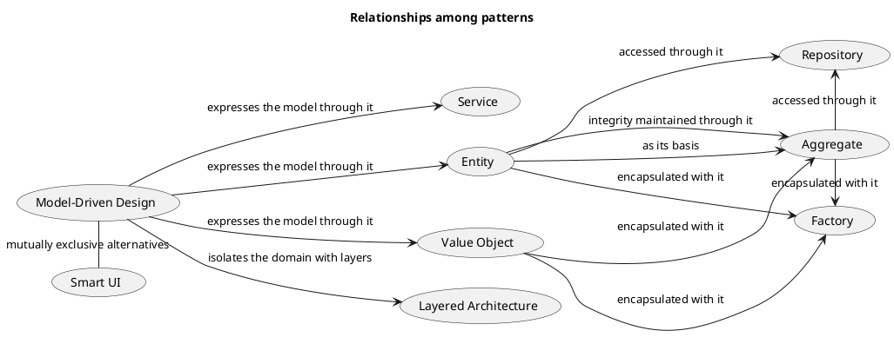


## Chapter 4: Separating the Domain: Layered Architecture

**The basic principle of LAYERED ARCHITECTURE** is that any element of a layer depends only on other
elements in its own layer or on elements of the layers beneath it. Communication upward must pass
through indirect mechanisms.

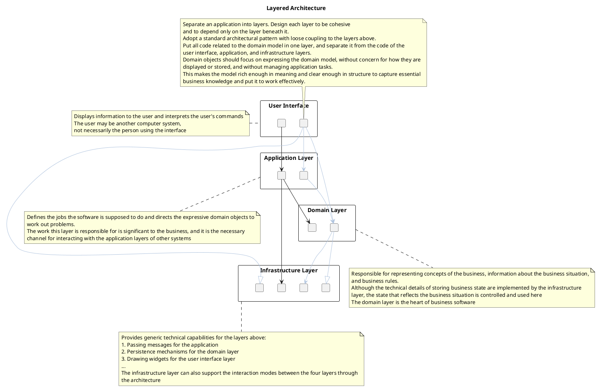


## Chapter 5: A Model Expressed in Software

### Entity (Reference Object)

**Entity (Reference Object):** Many things are defined by their identity, not by any of their
attributes. We would generally think that a person (continuing the nontechnical example) has an
identity that accompanies them through life (and even beyond). The person's physical attributes
change and eventually disappear. Their name may change, and financial relationships may change; no
attribute is constant for a lifetime, but the identity is permanent.

An ENTITY can be anything, as long as two conditions are met: it has continuity throughout its life
cycle, and its distinction is not determined by attributes that are important to the user.

When an object is distinguished by its identity (rather than its attributes), the definition of the
object in the model should be based primarily on that identity. Keep the class definition simple,
focusing on continuity of the life cycle and on identity. Define a way of distinguishing each
object that is independent of its form and history. Be especially careful about requirements that
call for matching objects by attributes. When defining the identity operation, make sure it
produces a result that is unique for each object, which can be done by attaching a symbol that
guarantees uniqueness. This means of identification may come from outside, or it may be an
arbitrary identifier created by the system, but it must be a unique identity in the model. The
model must define "what it means to be the same thing".


### Value Object

**Value Object:** An object used to describe some aspect of the domain and having no conceptual
identity is called a VALUE OBJECT. Once instantiated, a VALUE OBJECT represents design elements we
care about only for what they are, not who they are. That is, a value object only cares about what
it is (what attributes it has), not who it is (its identifier).

When we care only about the attributes of a model element, classify it as a VALUE OBJECT. Make that
model element capable of expressing the meaning of its attributes and give it related
functionality. VALUE OBJECTS should be immutable. Give them no identity, and do not design them to
be as complex as ENTITIES.


**Situations where value object attributes are immutable (shared)**
1. When saving database space or reducing the number of objects is a critical requirement;
2. When communication overhead is low (such as in a central server);
3. When the shared objects are strictly limited to being immutable.


**Situations where value object values are mutable**
1. If VALUES change frequently;
2. If creating or deleting objects is expensive;
3. If replacement (rather than modification) would disturb a cluster (as discussed in the earlier
   example);
4. If VALUES are not shared much, or sharing does not improve cluster performance, or for some other
   technical reason.


### Entity versus Value Object

Is an object meant to represent something with continuity and identity (something that can be
tracked through the different states it goes through, even across different implementations), or is
it meant to describe the attributes of some state? This is the fundamental distinction between
ENTITY and VALUE OBJECT.

- Entity: something with continuity that can change over time
- Value Object: only a description of some state


### Service

**Service:** A SERVICE emphasizes its relationship to other objects. Unlike ENTITY and VALUE OBJECT,
it just defines what it can do for a client. A SERVICE is usually named for an activity rather than
an ENTITY — a verb rather than a noun. Services are not used only in the domain layer; they can be
used in the application layer, the domain layer, and the infrastructure layer.


**A good SERVICE has three characteristics.**
1. The operation relates to a domain concept that is not a natural part of an ENTITY or VALUE
   OBJECT.
2. The interface is defined in terms of the other elements of the domain model.
3. The operation is stateless.


### Associations


**Ways to simplify associations between objects**
1. Impose a traversal direction.
2. Add a qualifier to effectively reduce multiplicity.
3. Eliminate nonessential associations.


## Chapter 6: The Life Cycle of a Domain Object


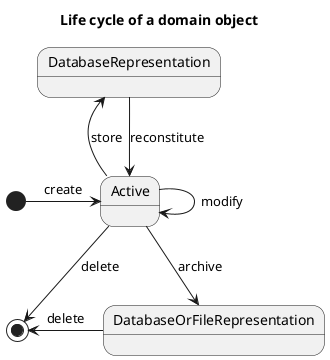

**The main challenges in managing the life cycle of domain objects fall into two categories.**
1. Maintaining integrity throughout the life cycle.
2. Preventing the model from getting bogged down in the complexity of managing the life cycle.

### Aggregate

**Aggregate definition:** First, we need an abstraction to encapsulate the references within the
model. An AGGREGATE is a collection of related objects that we treat as a unit for the purpose of
data changes. Each AGGREGATE has a root and a boundary. The boundary defines what is inside the
AGGREGATE. The root is a specific ENTITY contained in the AGGREGATE. With respect to the AGGREGATE,
external objects may reference the root only, while objects inside the boundary may reference one
another. ENTITIES other than the root have local identities, but those identities only need to be
distinguishable within the AGGREGATE, because external objects can see nothing inside except the
root ENTITY.

**Aggregate rules**
1. An invariant is a consistency rule that must be kept whenever data changes, involving the
   internal relationships among AGGREGATE members. Rules that span AGGREGATES will not be expected
   to be up-to-date at every moment. Through event handling, batch processing, or other update
   mechanisms, those dependencies are resolved within some period of time. But at the completion of
   every transaction, the invariants applied within the AGGREGATE must be satisfied.
2. Now, to realize this conceptual AGGREGATE, a set of rules must be applied to all transactions.
3. The root ENTITY has global identity and is ultimately responsible for checking invariants.
4. The root ENTITY has global identity. ENTITIES inside the boundary have local identity, unique
   only within the AGGREGATE.
5. Objects outside the AGGREGATE may hold references to the root ENTITY only and to no other
   internal object. The root ENTITY may pass references to internal ENTITIES to them, but those
   objects may use the references only transiently and may not hold on to them. The root may hand a
   copy of a VALUE OBJECT to another object and need not care what happens to it, because it is
   only a VALUE, no longer associated with the AGGREGATE.
6. As a corollary of the previous rule, only AGGREGATE roots can be obtained directly through
   database queries. All other objects must be found by traversing associations.
7. Objects inside the AGGREGATE may hold references to the roots of other AGGREGATES.
8. A delete operation must remove everything within the AGGREGATE boundary at once. (With garbage
   collection, this is easy to do. Because objects other than the root have no external references,
   once the root is deleted, all the others are collected.)
9. When a change to any object within the AGGREGATE boundary is committed, all invariants of the
   entire AGGREGATE must be satisfied.


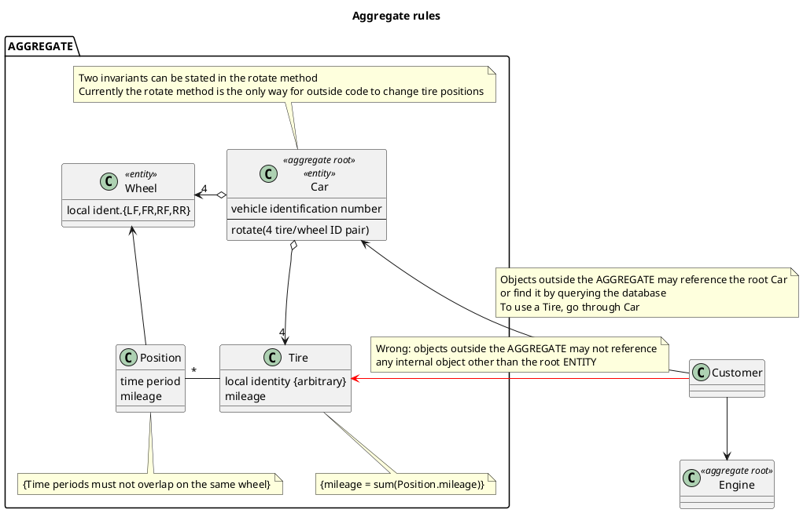


### Factory

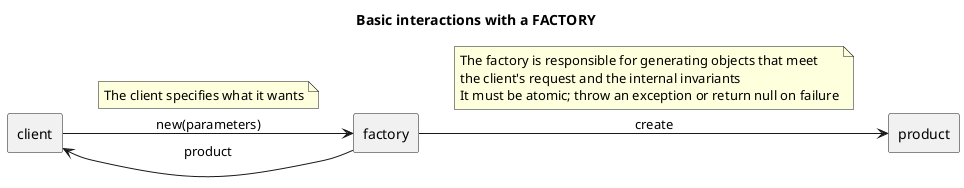


**The purpose of a Factory:** A factory exists to produce the set of objects inside a complex
aggregate. Object creation can itself be a major operation, but the created objects are not well
suited to carry out complicated assembly. Mixing those responsibilities can produce clumsy designs
that are hard to understand. Making the client directly responsible for creating objects entangles
the client's design, breaks the encapsulation of the assembled object or AGGREGATE, and couples the
client too tightly to the implementation of the created objects. The responsibility for creating
instances of complex objects and AGGREGATES should be shifted to a separate object, which may itself
carry no responsibility in the domain model but is still part of the domain design. Provide an
interface that encapsulates all the complex assembly and that does not require the client to
reference the concrete classes of the objects being instantiated. Create an AGGREGATE as a whole and
make sure it satisfies its invariants.

**Every good factory must meet these basic requirements.**
1. Each creation method is atomic and enforces all invariants of the created object or AGGREGATE.
   Objects produced by a FACTORY must be in a consistent state. When generating an ENTITY, this
   means creating the entire AGGREGATE with all invariants satisfied, though optional elements may
   be added after creation. When creating an immutable VALUE OBJECT, this means all attributes must
   be initialized to their correct final state. If a FACTORY receives a request through its
   interface to create an object but cannot create it correctly, it should throw an exception or
   use another mechanism to ensure that no incorrect value is returned.
2. A FACTORY should be abstracted to the type desired, not the concrete class(es) created. The
   advanced FACTORY patterns in [Gamma et al. 1995] introduce this topic.
3. The entire AGGREGATE is usually created by a single FACTORY, which hands out the reference to the
   root and makes sure the created AGGREGATE satisfies its invariants. If an object inside an
   AGGREGATE needs a FACTORY that does not fit on the AGGREGATE root, build a separate FACTORY.
   Still obey the rule: restrict access to within the AGGREGATE, and make sure only transient
   references to the constructed object are available from outside the AGGREGATE.


**When to use a constructor instead of a factory**
1. The class is a type. It is not part of any relevant hierarchy, and no polymorphism is implemented
   through an interface.
2. The client cares about the implementation, perhaps as a way of choosing a STRATEGY.
3. The client has access to all attributes of the object, so no nested object creation is exposed
   to the client through the public constructor.
4. The construction is not complicated.
5. A public constructor must obey the same rules as a FACTORY: it must be an atomic operation and
   satisfy all invariants of the created object.
6. Do not call constructors of other classes inside a constructor. Constructors should be kept
   absolutely simple. Complex assembly, especially of AGGREGATES, calls for a FACTORY. The bar for
   using a FACTORY METHOD is not high.


**Where to put invariant logic:** A FACTORY already knows the internal structure of the objects it
creates, and the purpose of creating a FACTORY is closely tied to the implementation of the created
objects. In some cases it is beneficial to put invariant logic in the FACTORY, which keeps the
responsibilities of the created objects clearer. This is especially true for AGGREGATE rules (which
constrain many objects). But invariant logic is a particularly poor fit for FACTORY METHODs
associated with other domain objects.


**A FACTORY for reconstitution is very similar to one for creation, with two main differences.**
1. The ENTITY FACTORY used for reconstitution does not assign a new tracking ID. Reassigning an ID
   would lose continuity with the previous object. So in a reconstitution FACTORY, the identity
   attribute must be part of the input parameters.
2. A reconstitution FACTORY handles unsatisfied invariants differently. When creating a new object,
   if the invariants are not satisfied, the FACTORY should simply refuse to create it, but
   reconstitution calls for a more flexible response. If the object already exists somewhere in the
   system (such as in a database), that fact cannot be ignored. Yet neither can the rules be left
   broken. Some strategy must repair the inconsistency, which makes reconstitution harder than
   creating a new object.

### REPOSITORY

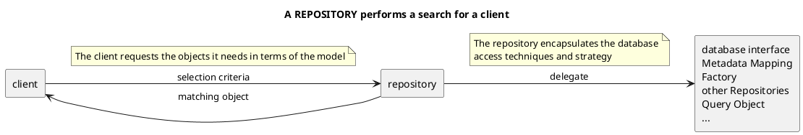

**Problems without a repository (database queries breaking aggregates):**
1. Clients need an effective way to obtain references to existing domain objects. If the
   infrastructure makes this easy, developers may add many traversable associations, which clutters
   the model badly. On the other hand, developers may use queries to pull the data they need from
   the database, or extract specific objects directly, rather than getting them through AGGREGATE
   roots. Domain logic then moves into queries and client code, while ENTITIES and VALUE OBJECTS
   become mere data containers. The complexity of most database access technologies quickly muddles
   client code, which leads developers to simplify the domain layer until the model no longer
   matters.
2. Of all persisted objects, a small number must be globally accessible through a search based on
   object attributes. This kind of access is needed when it is difficult to traverse to certain
   AGGREGATE roots. They are usually ENTITIES, sometimes VALUE OBJECTS with complex internal
   structure, and sometimes enumerated VALUES. Other objects should not be accessed this way,
   since it blurs the important distinctions among them. Casual database queries destroy the
   encapsulation of domain objects and AGGREGATES. Exposure of technical infrastructure and
   database access mechanisms increases client complexity and obstructs model-driven design.

**Benefits of Repository**
1. Create one object for each type of object that needs global access; this object acts as a
   "stand-in" for an in-memory collection of all objects of that type. Provide access through a
   well-known global interface. Provide methods for adding and removing objects, using them to
   encapsulate the actual insertion or removal of data in the data store. Provide methods that
   select objects by specific criteria and return objects or collections of objects whose attribute
   values satisfy the query (the returned objects are fully instantiated), thereby encapsulating
   the actual storage and query technology. Provide REPOSITORIES only for AGGREGATE roots that truly
   need direct access. Keep the client focused on the model at all times, leaving all object
   storage and access to the REPOSITORY.
2. They present clients with a simple model for obtaining persistent objects and managing their
   life cycle;
3. They decouple the application and domain design from persistence technology (multiple database
   strategies or even multiple data sources);
4. They express design decisions about object access;
5. They can easily be replaced with a "dummy implementation" for use in testing (usually an
   in-memory collection).

**Notes on repositories**
1. Abstract the type. A REPOSITORY "contains" all instances of a specific type, but that does not
   mean every class needs a REPOSITORY. The type can be an abstract superclass in a hierarchy (for
   example, TradeOrder can be a BuyOrder or SellOrder). The type can be an interface — its
   implementers are not related by hierarchy — or it can be a concrete class. Remember that we
   face many constraints, because database technology lacks such polymorphic qualities.
2. Take advantage of the decoupling from the client. We can change the implementation of a
   REPOSITORY easily, but if the client calls the underlying mechanism directly, changing the
   implementation is hard. Decoupling can also be used to optimize performance, because different
   query techniques can be used, objects can be cached in memory, and the persistence strategy can
   be switched freely at any time. Providing an easily manipulated in-memory dummy implementation
   also makes it convenient to test client code and domain objects.
3. Leave transaction control to the client. Although a REPOSITORY performs database inserts and
   deletions, it usually does not commit transactions. For example, committing right after saving
   may seem natural, but presumably only the client has the context to initialize and commit the
   unit of work correctly. Transaction management becomes much simpler if the REPOSITORY keeps its
   hands off transaction control.


### REPOSITORY and FACTORY


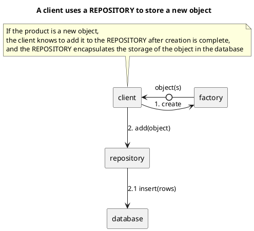

FACTORIES and REPOSITORIES have completely different responsibilities. A FACTORY creates new
objects, while a REPOSITORY finds old ones. A REPOSITORY should make clients feel as though the
objects were resident in memory. An object may have to be reconstituted (indeed, a new instance may
be created), but it is the same conceptual object, still in the middle of its life cycle.

A REPOSITORY may also delegate to a FACTORY to create an object. This approach (rarely done in
practice, though theoretically viable) can be used to create an object from scratch, at which point
there is no need to distinguish the two perspectives.


## Chapter 7: Using the Language: An Extended Example

Suppose we are developing new software for a shipping company. The initial requirements include
three basic functions:
1. Tracking the main handling of customer cargo;
2. Booking cargo in advance;
3. Automatically sending invoices to customers when cargo reaches some point in its handling.

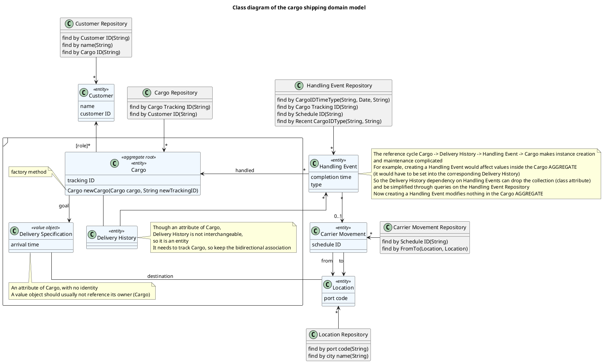
A Cargo involves multiple Customers, each playing a different role.  
The delivery goal of the Cargo is specified.  
The goal is fulfilled by a series of Carrier Movements that satisfy the Specification.  
A Handling Event is a distinct operation performed on the Cargo, such as loading it onto a ship or
clearing it through customs. This class could be refined into a hierarchy of different kinds of
events (such as loading, unloading, or pickup by the receiver).  
A Delivery Specification defines the delivery goal, which at least includes the destination and
the arrival date, but could be more complex. This class follows the Specification pattern.  
The responsibilities of a Delivery Specification could have been carried by the Cargo object itself,
but abstracting out the Delivery Specification has at least three advantages.  
1. Without a Delivery Specification, the Cargo object would be responsible for providing all the
   attributes and associations used to specify the delivery goal. This would clutter the Cargo
   object, making it hard to understand or modify.
2. When the model is interpreted as a whole, this abstraction lets us easily and safely omit
   details. For example, a Delivery Specification may also encapsulate other criteria, but given the
   detail Figure 7-1 is meant to show, they need not be displayed. The diagram tells the reader that
   a delivery specification exists, but its details aren't important here (and indeed, the details
   are easy to change later).
3. The model is more expressive. The Delivery Specification makes it clear that the specific way
   the Cargo is transported is not specified, but it must fulfill the goal defined in the Delivery
   Specification.

The part a Customer plays in the transportation is distinguished by role, such as shipper, receiver,
payer, and so on. Since only one Customer can play a given role for a Cargo, the association between
them is a qualified many-to-one relationship, not many-to-many. The role can be implemented simply
as a string, or as a class when other behavior is needed.  
A Carrier Movement represents a journey from one Location to another performed by a Carrier (such
as a truck or a ship). Once the Cargo is loaded onto the Carrier, it can be moved between
locations through one or more Carrier Movements of the Carrier.  
A Delivery History reflects what actually happened to the Cargo, the exact counterpart of the
Delivery Specification, which describes the goal. A Delivery History object can compute the current
location of the cargo by analyzing the last loading and unloading and the destination of the
corresponding Carrier Movement. A successful delivery will end up with a Delivery History that
satisfies the goal of the Delivery Specification.  


### Connecting to other systems

When this system depends on other systems that do not use a domain model, or whose domain model
does not match ours, an anticorruption layer and enterprise segments can keep this system clean.  
An enterprise segment is a set of dimensions that defines a way of partitioning the business.

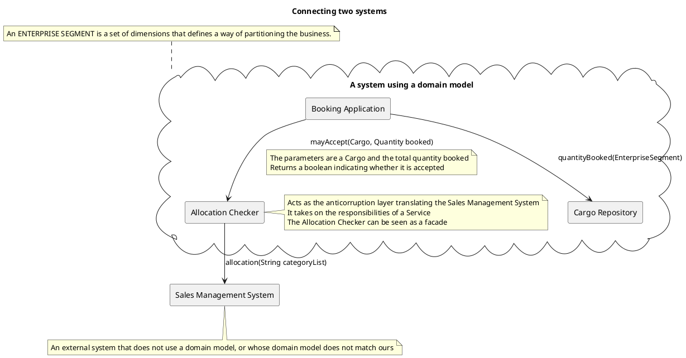

# Part III: Deepening Understanding Through Refactoring

## Chapter 9: Making Implicit Concepts Explicit

Constraints are a very important category of model concepts. They are usually implicit, and making
them explicit can greatly improve design quality. For example, for a field that must not be less
than 0, the condition can be extracted into a method for validation; a more complex constraint can
even be extracted into a special simple class (such as a strategy class).

### SPECIFICATION

**Specification:** Create an explicit VALUE OBJECT in predicate form for a special purpose. A
SPECIFICATION is a predicate (whether something is X, for example, whether a simple constraint is
satisfied) that can be used to determine whether an object meets certain criteria.

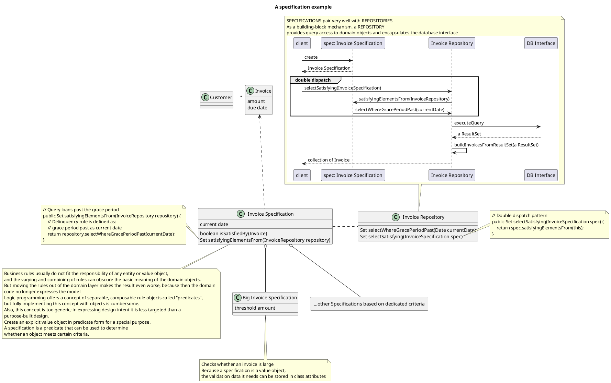

## Chapter 10: Supple Design

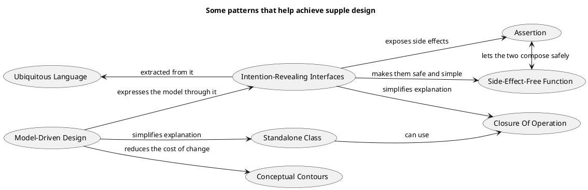

### INTENTION-REVEALING INTERFACES

**Definition of Intention-Revealing Interfaces:** All public elements of a design together form its
interface, and the name of each element offers an opportunity to reveal the intent of the design.
Type names, method names, and argument names combined form an INTENTION-REVEALING INTERFACE.


**How to apply Intention-Revealing Interfaces:**

Name classes and operations to describe their effect and purpose, not the way they achieve it.
This frees client developers from having to understand the internals. The names should conform to
the UBIQUITOUS LANGUAGE so team members can quickly infer their meaning. Write a test for a
behavior before creating it, which forces you to think about it from the client developer's point
of view.

All complicated mechanisms should be encapsulated behind abstract interfaces that state intent
only, not means.

In the public interfaces of the domain, state relationships and rules but not how the rules are
enforced; describe events and actions but not how they are executed; give equations but not the
mathematical methods that solve them. Pose the question, but don't provide the means of getting
the answer.

### 10.2 Pattern: SIDE-EFFECT-FREE FUNCTION

**Definitions of query and command:** A query may simply access data in a variable, or it may
perform a computation using that data. A command (also called a modifier) is an operation that
changes the system (a simple example is setting a variable).

**Definition of side effect:** Any change to system state that affects future operations can be
called a side effect.

**Definition and value of Side-Effect-Free Function:** An operation that returns a result without
producing side effects is called a function. A function can be called multiple times and returns
the same value each time. A function can call other functions without concern for the depth of
nesting. Functions are easier to test than operations with side effects. For these reasons, using
functions reduces risk.

**Ways to reduce the number of commands:**
1. Keep commands and queries strictly in separate operations. Ensure that methods that cause state
   changes do not return domain data and stay as simple as possible. Perform all queries and
   computations in methods that cause no observable side effects [Meyer 1988].
2. There are always alternative models and designs that require no modification of existing
   objects. Instead, they create and return a VALUE OBJECT representing the result of the
   computation. This is a common technique, demonstrated in the examples to follow. A VALUE OBJECT
   can be created and passed in response to a query and then discarded — unlike an ENTITY, whose
   life cycle is strictly managed.
3. VALUE OBJECTS are immutable, which means all their operations are functions except initializers
   called during creation. Like functions, VALUE OBJECTS are safe to use and easy to test. If an
   operation mixes logic or computation with state changes, refactor it into two separate
   operations [Fowler 1999, p. 279]. By definition, isolating side effects into simple command
   methods applies only to ENTITIES. After completing the separation of modification and query,
   consider refactoring again to move the responsibility for complex computation into a VALUE
   OBJECT. By deriving a VALUE OBJECT (rather than changing existing state), or by moving the
   responsibility entirely into a VALUE OBJECT, side effects can often be eliminated completely.

```java
// Example of Side-Effect-Free Function and Closure of Operation
// The paint example
class ValueObject {}
// PigmentColor is a ValueObject, so it is immutable
class PigmentColor extends ValueObject {
    private int red;
    private int blue;
    private int yellow;
    // Closure of Operation: parameter and return value are both PigmentColor itself
    // Closure of Operation is typically used for Value Objects, not for Entities
    public PigmentColor mixedWith(PigmentColor other, double ratio) {
        // Many lines of complicated color-mixing logic
        // ending with the creation of a new PigmentColor object
        // with appropriate new red, blue, and yellow value
        return null;
    }
}

// Paint: has color and volume attributes
class Paint {
    private double volume;
    private PigmentColor pigmentColor;

    // Mix paint
    public void mixIt(Paint other) {
        this.volume = this.volume + other.volume;
        double ratio = other.volume / this.volume;
        // Separate modification (command) from query
        // pigmentColor.mixedWith() returns a new object; the call itself is not a command
        this.pigmentColor = this.pigmentColor.mixedWith(other.pigmentColor, ratio);
    }
}
```

### ASSERTION

**The role of Assertion:** Encapsulating complex computation in SIDE-EFFECT-FREE FUNCTIONS
simplifies the problem, but an entity still has some commands with side effects, and people using
these ENTITIES must understand the consequences of using them. In such cases, ASSERTIONS make the
side effects explicit, making them easier to handle.

### CONCEPTUAL CONTOUR

**The use of Conceptual Contours:** Break design elements (operations, interfaces, classes, and
AGGREGATES) into cohesive units, taking into account your intuition about the important divisions
in the domain. Observe stability and change across successive refactorings, and look for the
underlying CONCEPTUAL CONTOURS that explain those patterns of change. Align the model with the
consistent aspects of the domain — the aspects that make the domain a useful body of knowledge.

### STANDALONE CLASS

**The role of Standalone Class:** Low coupling is a fundamental element of object design. Keep
coupling as low as possible in every way. Factor all unrelated concepts out of the object. The class
then becomes completely independent, allowing us to study and understand it alone. Each such
standalone class greatly reduces the burden of understanding a MODULE.

**How to achieve a Standalone Class:** Try to extract the most complex computation into STANDALONE
CLASSES. One way to do this is to model VALUE OBJECTS out of classes that have many dependencies.

### CLOSURE OF OPERATION

**Definition of Closure of Operation:** Where appropriate, define an operation whose return type is
the same as the type of its argument(s). If the state of the implementer is used in the computation,
the implementer is effectively an argument of the operation, so the argument(s) and return value
should be of the same type as the implementer. Such an operation is closed over the set of instances
of that type. Closure provides a high-level interface without introducing any dependency on other
concepts. (Argument, return value, and operator are one class: a class A has a method whose
parameter and return value are both A; A is usually a Value Object)

### 10.8 Declarative Style of Design

**Declarative design:** Declarative design is a design philosophy focused on describing WHAT is to
be done rather than HOW to do it. It differs from imperative design, which concerns itself with
concrete execution steps and processes. In domain models, declarative design is usually used to
describe the objects, relationships, and behaviors of the business domain without diving into
concrete operational details.

```java
// Intention-Revealing Interface, Side-Effect-Free Function and Assertion working together:
// an example of a declarative design style, combining SPECIFICATIONS with logical operations
interface Specification {
    public boolean isSatisfiedBy(Object candidate);
    // Closure of Operation
    public Specification and(Specification other);
    public Specification or(Specification other);
    public Specification not();

}

abstract class AbstractSpecification  implements Specification {
    public Specification and(Specification other) {
        return new AndSpecification(this, other);
    }
    public Specification or(Specification other) {
        return new OrSpecification(this, other);
    }
    public Specification not() {
        return new NotSpecification(this);
    }
}

class AndSpecification extends AbstractSpecification {
    private Specification one;
    private Specification other;

    public AndSpecification(Specification one, Specification other) {
        this.one = one;
        this.other = other;
    }

    @Override
    public boolean isSatisfiedBy(Object candidate) {
        return one.isSatisfiedBy(candidate) && other.isSatisfiedBy(candidate);
    }
}

class OrSpecification extends AbstractSpecification {
    private Specification one;
    private Specification other;

    public OrSpecification(Specification one, Specification other) {
        this.one = one;
        this.other = other;
    }

    @Override
    public boolean isSatisfiedBy(Object candidate) {
        return one.isSatisfiedBy(candidate) || other.isSatisfiedBy(candidate);
    }
}
class NotSpecification extends AbstractSpecification {
    private Specification wrapped;


    public NotSpecification(Specification wrapped) {
        this.wrapped = wrapped;
    }


    @Override
    public boolean isSatisfiedBy(Object candidate) {
        return !wrapped.isSatisfiedBy(candidate);
    }
}
```

### 10.9 Angles of Attack

**Leverage existing forms as much as possible**

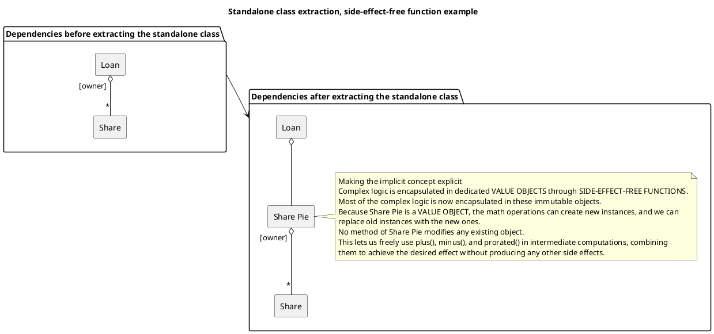


```java
import java.util.Collection;
import java.util.HashMap;
import java.util.HashSet;
import java.util.Iterator;
import java.util.Map;
import java.util.Map.Entry;
import java.util.Set;

class Share {
    // owner
    String owner;
    // amount (percentage)
    double amount;
    public Share(String owner, double amount) {
        this.owner = owner;
        this.amount = amount;
    }
    public double getAmount() {
        return amount;
    }

}


class Loan {

    private Map<String/*owner*/, Share> shares;

    // NOTE 3 Third version: extract a Standalone Class (a Value Object) responsible for
    // computation
    // Using this attribute retires the shares attribute, which was extracted into SharePie
    private SharePie sharePie;


    // NOTE 1 First version: query and modification mixed together
    // TODO distributePrincipalPayment is a dangerous operation: it computes and modifies
    // attributes (a command) in one method
    public Map<String/*owner*/, Share> distributePrincipalPayment(double paymentAmount) {
        Map<String/*owner*/, Share> paymentShares = new HashMap<>();
        Map<String/*owner*/, Share> loanShares = getShares();
        Set<Entry<String, Share>> entrys = loanShares.entrySet();
        double total = getAmount();
        for(Entry<String, Share> entry : entrys) {
            String owner = entry.getKey();
            double initialLoanShareAmount = getShareAmount(owner);
            double paymentSharesAmount = initialLoanShareAmount / (total * paymentAmount);
            paymentShares.put(owner, new Share(owner, paymentSharesAmount));

            // Modifies raw data. TODO: dangerous - computes and modifies attributes in one
            // method; this is a command
            shares.put(owner, new Share(owner, initialLoanShareAmount - paymentSharesAmount));

        }

        return paymentShares;
    }

    // NOTE 2 Second version: query and modification separated
    // Improved distributePrincipalPayment by refactoring the query out of the modification;
    // applyPrincipalPaymentShares() only modifies
    // Client usage:
    // Map<String, Share> distributon = loan.calculatePrincipalPaymentShares(paymentAmount);
    // loan.applyPrincipalPaymentShares(distributon);
    public void applyPrincipalPaymentShares(Map<String/*owner is lender*/, Share> paymentShares) {
        Map<String/*owner*/, Share> loanShares = getShares();
        Set<Entry<String, Share>> entrys = paymentShares.entrySet();
        for(Entry<String, Share> entry : entrys) {
            String lender = entry.getKey();
            Share paymentShare = entry.getValue();
            Share loanShare = loanShares.get(lender);
            // A separate modification method
            loanShares.put(lender, new Share(lender,
                    loanShare.getAmount() - paymentShare.getAmount()));
        }

    }

    // Extracted query method: only queries, never modifies - a Side-Effect-Free Function
    public Map<String/*owner*/, Share> calculatePrincipalPaymentShares(double paymentAmount) {
        Map<String/*owner*/, Share> paymentShares = new HashMap<>();
        Map<String/*owner*/, Share> loanShares = getShares();
        Set<Entry<String, Share>> entrys = loanShares.entrySet();
        double total = getAmount();
        for(Entry<String, Share> entry : entrys) {
            String owner = entry.getKey();
            double initialLoanShareAmount = getShareAmount(owner);
            double paymentSharesAmount = initialLoanShareAmount / (total * paymentAmount);
            paymentShares.put(owner, new Share(owner, paymentSharesAmount));
        }

        return paymentShares;
    }

    // NOTE 3 Third version: query and modification separated, and switched to a Standalone Class
    // Client usage:
    // Map<String, Share> distributon = loan.calculatePrincipalPaymentShares(paymentAmount);
    // SharePie  distributon = loan.calculatePrincipalPaymentShares_Standalone(paymentAmount);
    // loan.applyPrincipalPaymentShares_Standalone(distributon);
    public void applyPrincipalPaymentShares_Standalone(SharePie paymentShares) {
        this.sharePie = this.sharePie.minus(paymentShares);
    }

    // Extracted query method: only queries, never modifies - a Side-Effect-Free Function
    // The Standalone Class version
    public SharePie calculatePrincipalPaymentShares_Standalone(double paymentAmount) {
        return this.sharePie.prorated(paymentAmount);
    }

    public double getShareAmount(String owner) {
        if (shares.containsKey(owner)) {
            return shares.get(owner).getAmount();
        }
        // Returns 0 if there is no such owner
        return 0D;
    }

    public double getAmount() {

        Map<String/*owner*/, Share> loanShares = getShares();
        double total = 0D;
        Iterator<Share> iterator = loanShares.values().iterator();
        while (iterator.hasNext()) {
            total += iterator.next().getAmount();
        }

        return total;
    }

    public Map<String, Share> getShares() {
        return shares;
    }


}

// Standalone Class: a Value Object responsible only for computation
// SharePie makes the implicit concept explicit
class SharePie {

    private Map<String/*owner*/, Share> shares;


    // Prorated allocation
    // Closure of Operation, Side-Effect-Free Function
    public SharePie prorated(double amountToProrate) {
        SharePie proration = new SharePie();
        double basis = getAmount();
        Set<Entry<String, Share>> entrys = shares.entrySet();
        for (Entry<String, Share> entry : entrys) {
            String owner = entry.getKey();
            Share share = entry.getValue();

            proration.add(owner, share.getAmount() / (basis * amountToProrate));
        }
        return proration;
    }

    // The difference of two pies equals the difference of the shares held by these owners
    // Closure of Operation, Side-Effect-Free Function
    public SharePie minus(SharePie otherShares) {
        SharePie result = new SharePie();
        Set<String> owners = new HashSet<>();
        owners.addAll(getOwners());
        owners.addAll(otherShares.getOwners());
        for (String owner : owners) {
            // TODO A hidden rule: amount must not be less than 0; extract it into a Specification
            result.add(owner, getShareAmount(owner) - otherShares.getShareAmount(owner));
        }

        return result;
    }

    public void add(String owner, double amount) {
        this.shares.put(owner, new Share(owner, amount));
    }

    private Collection<? extends String> getOwners() {
        return this.shares.keySet();
    }

    public double getShareAmount(String owner) {
        if (shares.containsKey(owner)) {
            return shares.get(owner).getAmount();
        }
        // Returns 0 if there is no such owner
        return 0D;
    }


    public double getAmount() {

        Map<String/*owner*/, Share> loanShares = getShares();
        double total = 0D;
        Iterator<Share> iterator = loanShares.values().iterator();
        while (iterator.hasNext()) {
            total += iterator.next().getAmount();
        }

        return total;
    }

    public Map<String, Share> getShares() {
        return shares;
    }

}
```

# Part IV: Strategic Design

## Chapter 14: Maintaining Model Integrity

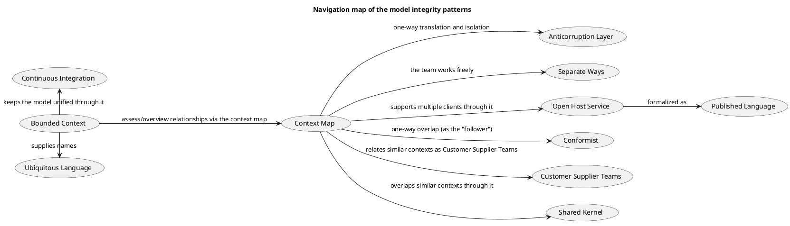

**Patterns for maintaining model integrity**
1. Bounded Context: a bounded application of a specific model. Explicitly define the context within
   which a model applies. Set the boundaries of the model according to the organization of the
   team, the usage of the parts of the software system, and the physical manifestations (code and
   database schemas, etc.). Strictly keep the model consistent within these boundaries, undisturbed
   and unconfused by issues outside them.
2. Continuous Integration: merge all work within one context frequently enough to keep it
   consistent, so that when the model fragments, problems can be discovered and corrected quickly.
   Like other methods in domain-driven design, CONTINUOUS INTEGRATION has two levels of operation:
   (1) integration of model concepts; (2) integration of the implementation.
3. Context Map: a representation of the bounded contexts involved in a project and the
   relationships between them and the models (the relationships between the models of two bounded
   contexts).
4. Shared Kernel: designate a subset of the domain model that two teams agree to share. Of course
   this includes, along with the subset of the model, the subset of code associated with that part
   of the model, or a subset of the database design. This explicitly shared stuff has special
   status; a team should not change it without consulting the other team.
5. Customer Supplier Teams: establish a clear customer/supplier relationship between two teams. In
   planning sessions, the downstream team plays the role of customer to the upstream team.
   Negotiate and budget tasks based on the downstream team's needs so that everyone knows the
   commitment and schedule of both parties. The two teams jointly develop automated acceptance
   tests that validate the expected interface. Add those tests to the upstream team's test suite
   so they run as part of its continuous integration. These tests let the upstream team make
   changes without worrying about side effects on the downstream team.
6. Conformist: strictly following the upstream team's model eliminates the complexity of translation
   between BOUNDED CONTEXTS. Although this constrains the style of the downstream designers and may
   not yield an ideal application model, choosing CONFORMITY greatly simplifies integration. It also
   lets you share a UBIQUITOUS LANGUAGE with the supplier team. The supplier is in command, so it is
   best to make communication easy. Out of altruism, they will share information with you.
7. Anticorruption Layer: create an isolating layer to provide clients with functionality in terms
   of their own domain model. This layer talks to the other system through its existing interface,
   requiring little or no modification of that system. Internally, the layer performs the necessary
   two-way translation between the two models.
8. Separate Ways: do not integrate; declare a BOUNDED CONTEXT with no connection to any other
   context, allowing developers to find simple, purpose-built solutions within this small scope.
9. Open Host Service: define a protocol that exposes your subsystem as a set of SERVICES for other
   systems to access. Open the protocol so that everyone who needs to integrate with your subsystem
   can use it. Enhance and extend the protocol when new integration needs arise, except for the
   special needs of individual teams. Meet such special needs with a one-off translator that
   augments the protocol, keeping the shared protocol simple and cohesive.
10. Published Language: use a well-documented shared language that can express the required domain
    information (an industry-standard format such as CML, the Chemistry Markup Language) as the
    common medium of communication, translating other information into and out of that language as
    needed.


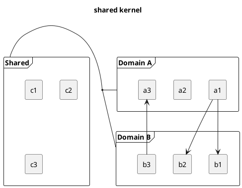

### Anticorruption Layer

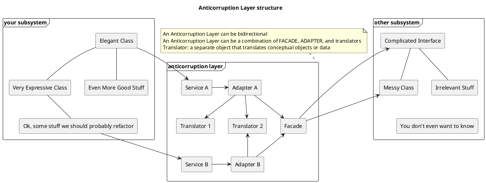

**The basic elements of an Anticorruption Layer**
1. A FACADE is an alternative interface for a subsystem that simplifies client access and makes the
   subsystem easier to use. Since we know exactly which features of the other system we want to
   use, we can create a FACADE to facilitate and simplify access to those features while hiding the
   rest. A FACADE does not change the model of the underlying system. It should be written strictly
   in terms of the other system's model. Otherwise serious consequences follow: at best,
   translation responsibilities spread across multiple objects and burden the FACADE; at worst,
   another model is created that belongs neither to the other system nor to your own BOUNDED
   CONTEXT. The FACADE should belong to the other system's BOUNDED CONTEXT, presenting a friendlier
   appearance just to serve your special needs.
2. An ADAPTER is a wrapper that allows a client to use a different protocol, one the implementer of
   the behavior does not understand. When the client sends a message to the adapter, the ADAPTER
   converts it into a semantically equivalent message and sends it to the "adaptee". The ADAPTER
   then converts the response and passes it back. My use of the term adapter here is a bit loose,
   because [Gamma et al. 1995] emphasizes making the wrapped object conform to a standard interface
   the client expects, whereas we choose the interface being adapted, and the adaptee may not even
   be an object. We emphasize the translation between two models, but I believe this is consistent
   with the intent of ADAPTER.
3. Each SERVICE we define needs an ADAPTER that supports its interface, and the adapter must also
   know how to issue the corresponding requests to the other system and its FACADE.
4. The remaining element is the translator. The job of the ADAPTER is to know how to generate
   requests. The actual translation of conceptual objects or data is a completely different,
   complicated task that can be assigned to a separate object, making both the translating object
   and the ADAPTER easier to understand. A translator can be a lightweight object that is
   instantiated when needed. Since it belongs only to the ADAPTER it serves, it need not be
   stateful or distributed.


## Chapter 15: Distillation

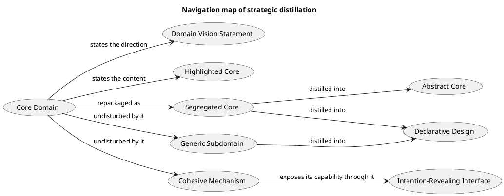

**Concepts of strategic distillation**
1. Core Domain: the distinctive part of the model, central to the users' goals, which makes the
   application different and valuable.
2. Generic Subdomain: identify cohesive subdomains that are not the motivation for the project.
   Extract the generic models of these subdomains and place them in separate MODULES. Also consider
   off-the-shelf solutions or "published models" (PUBLISHED MODEL) for these GENERIC SUBDOMAINS.
3. Domain Vision Statement: write a short description (about one page) of the CORE DOMAIN and the
   value it will create — the "value proposition". Leave out aspects that do not distinguish your
   domain model from others. Show how the domain model serves and balances the interests of the
   parties. Keep it brief. Write it early and revise it as new understanding emerges. A DOMAIN
   VISION STATEMENT can serve as a guide that helps the development team stay on a unified course
   while distilling the model and code. Nontechnical team members, management, and even customers
   can share the vision statement (except where it contains proprietary information).
4. Highlighted Core: flag what belongs to the CORE DOMAIN (with markers such as different colors or
   stereotypes). (Write a very brief document describing the CORE DOMAIN and the primary
   interactions among CORE elements.)
5. Cohesive Mechanism: partition a conceptually COHESIVE MECHANISM into a separate lightweight
   framework. Pay particular attention to formulas or fully documented algorithms. Expose the
   functionality of the framework with an INTENTION-REVEALING INTERFACE. Now the other elements of
   the domain can focus on expressing the problem (what), leaving the intricate details of the
   solution (how) to the framework. A COHESIVE MECHANISM does not represent the domain; its
   purpose is to solve some complicated computational problem posed by the descriptive model.
6. Segregated Core: separate the core concepts from supporting elements (including ill-defined
   ones) and increase the cohesion of CORE while reducing its coupling to other code. Extract all
   generic or supporting elements into other objects and place those objects in other packages —
   even if this separates some tightly coupled elements.
7. Abstract Core: identify the most fundamental concepts of the model and factor them into distinct
   classes, abstract classes, or interfaces. Design this abstract model so that it can express most
   of the interactions between the significant components. Place this complete abstract model in
   its own MODULE, while the specialized, detailed implementation classes remain in MODULES defined
   by the subdomains.

## Chapter 16: Large-Scale Structure

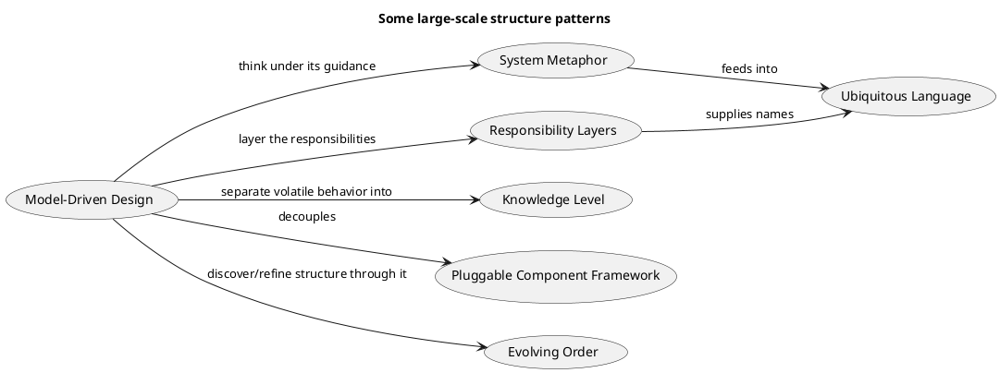


**Large-scale structure patterns**
1. Evolving Order: let this conceptual large-scale structure evolve with the application, possibly
   even changing to a completely different style of structure. Do not place excessive constraints
   on detailed design and model decisions, which must be determined after detailed knowledge is in
   hand.
2. System Metaphor: when a concrete analogy of the system matches the team's imagination of it and
   can guide their thinking in a useful direction, use the analogy as a large-scale structure.
   Organize the design around this metaphor and absorb it into the UBIQUITOUS LANGUAGE. A SYSTEM
   METAPHOR should both facilitate communication about the system and guide its development. It
   can increase consistency across different parts of the system, even across different BOUNDED
   CONTEXTs. But no metaphor is perfectly precise, so keep checking whether it is overextended or
   inappropriate, and be ready to abandon it when it gets in the way.
3. Responsibility Layers: to keep a large model coherent, it is necessary to impose some structured
   control over the allocation of responsibilities.
4. Knowledge Level: create a group of distinct objects to describe and constrain the structure and
   behavior of the basic model. Divide these objects into two "levels": one very concrete, the
   other providing rules and knowledge that can be customized by users or superusers.
5. Pluggable Component Framework: distill an ABSTRACT CORE from the interfaces and interactions,
   and create a framework that allows diverse implementations of those interfaces to be freely
   substituted. Likewise, allow any application to use these components as long as it operates
   strictly through the interfaces of the ABSTRACT CORE.

### Responsibility Layers

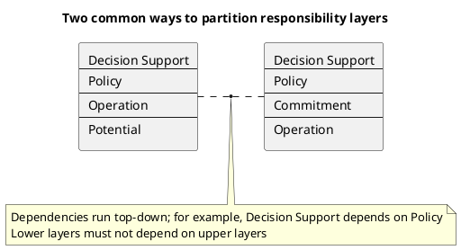

**The responsibility layers**
1. Potential layer. What can we do? The potential layer is not about what we intend to do but
   about what we are capable of. The resources of the enterprise (including people) and how those
   resources are organized are the heart of the potential layer.
2. Operation layer. What are we doing? What have we done with these capabilities? Like the
   potential layer, this layer should also reflect reality, not what we envision. In this layer we
   want to see our work and activities: what we are selling, not what we could sell. As a rule,
   operation layer objects may reference potential layer objects, and may even be composed of
   them, but potential layer objects should not reference operation layer objects.
3. Decision support layer. What action should be taken or what strategy should be set? This layer
   is for analysis and decision making. It analyzes information from the lower layers (such as the
   potential or operation layer). Decision support software can use historical information to
   actively seek opportunities applicable to current and future operations.
4. Policy layer. What are the rules and goals? Rules and goals are largely passive, but they
   constrain the behavior of the other layers. Designing these interactions is a delicate matter.
   Sometimes a policy is passed as a parameter to a method of a lower layer. Sometimes the
   STRATEGY pattern is used. The policy layer works well with the decision support layer, which
   provides ways to search for goals set by the policy layer, goals that are in turn constrained
   by the rules the policy layer sets.
5. Commitment layer. What have we committed to? This layer has the nature of the policy layer, since
   it states goals that guide future operations; but it also has the nature of the operation layer,
   since commitments emerge and change as part of subsequent business activity. The potential and
   commitment layers are not mutually exclusive. In some domains (such as a shipping company
   offering many customized transport services), both layers matter and can be used together.


## Chapter 17: Bringing the Strategy Together

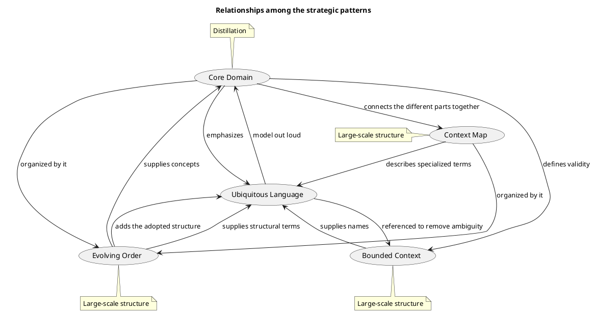

# Glossary

AGGREGATE — A cluster of associated objects that we treat as a unit for the purpose of data
changes. External references are restricted to one member of the AGGREGATE, designated as the root.
A set of consistency rules applies within the AGGREGATE's boundary.
1. analysis pattern — A concept collection that represents common constructs in business modeling.
   It may pertain to only one domain or span several [Fowler 1997, p. 8].
2. ASSERTION — A statement of the correct state of a program at a given point, independent of how
   that state is reached. Usually, an ASSERTION specifies the result of an operation or an
   invariant of a design element.
3. BOUNDED CONTEXT — A bounded application of a specific model. A BOUNDED CONTEXT lets every
   member of the team know exactly what must be consistent and what can be developed independently.
4. client — A program element that calls on the element under design, using its capabilities.
5. cohesion — Logical agreement and dependencies.
6. command, or modifier — An operation that changes the system (for example, setting a variable).
   It is an operation intentionally designed to produce side effects.
7. CONCEPTUAL CONTOUR — An underlying unity in the domain that, if reflected in the model, helps
   the design adapt to change more naturally.
8. context — The setting in which a word or statement appears, determining its meaning. See
   BOUNDED CONTEXT.
9. CONTEXT MAP — A representation of the bounded contexts involved in a project and the
   relationships between them and the models (the relationships between the models of two bounded
   contexts).
10. CORE DOMAIN — The distinctive part of the model, central to the users' goals, that makes an
    application different and valuable.
11. declarative design — A form of programming in which software is actually controlled by precise
    property descriptions. It is a kind of executable specification.
12. deep model — A clear representation of the concerns of the domain experts and the knowledge most
    relevant to them. A deep model looks beyond the surface aspects of the domain and a naive
    understanding of it.
13. design pattern — A description of interacting objects and classes that we customize to solve a
    general design problem in a particular context [Gamma et al. 1995, p. 3].
14. distillation — The process of separating a mixture of components to extract the most important
    content, making it more valuable and useful. In software design, distillation is the
    abstraction of key aspects of a model, or the partitioning of a large system, to draw out the
    CORE DOMAIN.
15. domain — A sphere of knowledge, influence, or activity.
16. domain expert — One of the members of a software project whose expertise is the subject matter
    of the software rather than software development. Not every user of the software is a domain
    expert; a domain expert has deep knowledge of the subject.
17. domain layer — That portion of the design and implementation, in a layered architecture,
    responsible for the domain logic. The domain layer is where the domain model is represented in
    the software.
18. ENTITY — An object defined not by its attributes but by a chain of continuity and identity.
19. FACTORY — A mechanism for encapsulating complex creation logic and abstracting the type of a
    created object for the client.
20. function — An operation that computes and returns a result without side effects.
21. immutable — The property of never changing state after creation.
22. implicit concept — A concept that is essential to understanding the meaning of the model and
    design, yet is never mentioned.
23. INTENTION-REVEALING INTERFACE — The names of classes, methods, and other elements convey both
    the purpose for which the original developers created them and the value they will bring to
    client developers.
24. invariant — An assertion about some design element that must always be true, except during
    transient situations (such as the middle of a method's execution or the middle of an
    uncommitted database transaction).
25. iteration — The process of repeatedly making small improvements in a program; also a step in
    that process.
26. large-scale structure — A set of high-level concepts and/or rules that establishes a design
    pattern for an entire system. It lets people discuss and understand the system in the large.
27. LAYERED ARCHITECTURE — A technique for separating the concerns of a software system, keeping
    the domain layer separate from the other layers.
28. life cycle — A sequence of states an object passes through from creation to deletion, usually
    with constraints to ensure integrity when changing from one state to the next. It may include
    the migration of an ENTITY between different systems and BOUNDED CONTEXTS.
29. model — An abstract system describing selected aspects of a domain, usable for solving
    problems related to that domain.
30. MODEL-DRIVEN DESIGN — A subset of software elements corresponds strictly to elements of a
    model. Also a process of developing the model and implementation together so they stay
    consistent.
31. modeling paradigm — A particular way of extracting concepts from a domain, used in combination
    with a tool to create software analogs of those concepts. (For example, object-oriented
    programming and logic programming.)
32. REPOSITORY — A mechanism for encapsulating storage, retrieval, and search behavior that
    resembles a collection of objects.
33. responsibility — An obligation to perform a task or know information [Wirfs-Brock et al. 2003,
    p. 3].
34. SERVICE — An operation offered as an interface that stands alone in the model, with no
    encapsulated state.
35. side effect — Any observable change in state produced by an operation, whether intentional or
    incidental (even an intentional update is a side effect).
36. SIDE-EFFECT-FREE FUNCTION — See FUNCTION.
37. STANDALONE CLASS — A class that can be understood and tested without reference to any other
    objects (except system primitives and base libraries).
38. stateless — A property of a design element: clients need not be concerned with its history
    when using any stateless operation. A stateless element may use, even modify, global information
    (that is, it may have side effects), but it holds no private state that affects its behavior.
39. strategic design — Modeling and design decisions that apply to the system as a whole. Such
    decisions affect the entire project and must be made by the team.
40. supple design — Design that lets client developers grasp and apply the potential in a deep
    model to produce clear, flexible, and robust implementations that yield expected results.
    Equally important, the deep model lets developers easily implement and adjust the design,
    readily incorporating their new knowledge into it.
41. UBIQUITOUS LANGUAGE — A language built around a domain model, used by all team members to
    connect all the team's activities to the software.
42. unification — Internal consistency of a model, so that every term is unambiguous and no rules
    conflict.
43. VALUE OBJECT — An object that describes a characteristic or attribute but carries no
    conceptual identity.
44. WHOLE VALUE — An object that models a single, complete concept.
