# Design Patterns

## Resources
1. Official code: https://wickedlysmart.com/head-first-design-patterns/
2. GitHub code repository: https://github.com/bethrobson/Head-First-Design-Patterns


## OO (object-oriented) basics

### OO basics

- Abstraction
- Encapsulation
- Polymorphism
- Inheritance

### OO principles / design principles

- Encapsulate what varies: identify the aspects of your application that vary and separate them from
  what stays the same

- Program to an interface, not an implementation
    > Programming to an interface really means programming to a supertype.  
    > The word interface is overloaded here. Interface is a concept as well as a Java construct.
    > Programming to an interface doesn't have to mean using a Java interface.  
    > The point is to exploit polymorphism by programming to a supertype, so that the actual runtime
    > object isn't locked into the code  

- Favor composition over inheritance
    > If we rely on inheritance, our behavior can only be determined statically at compile time.  
    > In other words, we only get the behavior the superclass gives us, or we override it.  
    > With composition, we can mix and match behavior any way we like at runtime

- Strive for loosely coupled designs between objects that interact

- Open-Closed Principle: classes should be open for extension (inheritance, composition, delegation,
  etc.) but closed for modification (no need to change existing code)
    > Our goal is to allow classes to be easily extended to incorporate new behavior without
    > modifying existing code

- Dependency Inversion Principle: depend on abstractions, not on concrete classes; for instantiation
  you can use the [Factory Method](#factory-method)
    > This principle sounds a lot like 'program to an interface, not an implementation'.  
    > But this principle puts more emphasis on abstraction; it says high-level components should not
    > depend on low-level components  
    > rather, both should depend on abstractions. For example, the pizza store PizzaStore is a
    > high-level component and the Pizza implementations are low-level components  
    > See [Dependency inversion in Factory Method](#dependency-inversion-in-factory-method) for
    > details  
    > Guidelines for the Dependency Inversion Principle  
    > 1. No variable should hold a reference to a concrete class: using new holds a concrete class;
    >    get around it with a factory method
    > 2. No class should derive from a concrete class: deriving from a concrete class makes you
    >    depend on it. Derive from an abstract class/interface instead
    > 3. No method should override an implemented method of any of its base classes: if you override
    >    an implemented method, the base class wasn't really an abstraction suitable for
    >    inheritance; implemented methods in the base class should be shared by all subclasses

- Principle of Least Knowledge: talk only to your immediate friends
    > When designing a system, for any object, be careful about the number of classes it interacts
    > with and how it interacts with them  
    > This principle prevents us from creating designs with a large number of classes coupled
    > together, so that changes in one part of the system don't cascade to other parts  
    > The Principle of Least Knowledge says we should only invoke methods that belong to  
    > 1. the object itself  
    > 2. objects passed in as a parameter to the method  
    > 3. any object the method creates or instantiates  
    > 4. any components of the object (member variables)  
    >  
    > e.g. a.getB().getC() violates this principle

- The Hollywood Principle: don't call us, we'll call you
    > The Hollywood Principle gives us a way to prevent "dependency rot". Dependency rot happens
    > when high-level components depend on low-level components, which depend on high-level
    > components, which depend on sideways components... When rot sets in, nobody can easily
    > understand how the system was designed  
    > With the Hollywood Principle, we allow low-level components to hook themselves into a system,
    > but the high-level components decide when they are needed and how. In other words, high-level
    > components treat low-level components as "don't call us, we'll call you"  
    > Low-level components often end up calling methods defined above them in the inheritance
    > hierarchy, but we want to avoid creating explicit circular dependencies between low-level and
    > high-level components  
    > The Dependency Inversion Principle (avoid concrete classes, use abstractions as much as
    > possible) and the Hollywood Principle (a technique for building frameworks or components so
    > that low-level components can hook into the computation without creating circular dependencies
    > between high-level and low-level components) both aim at decoupling, but the Dependency
    > Inversion Principle makes a much stronger and more general statement about how to avoid
    > dependencies in design  
    > Example of the Hollywood Principle: [The Hollywood Principle and Template
    > Method](#the-hollywood-principle-and-template-method)  
    > The following design patterns use the Hollywood Principle  
    > 1. Template Method pattern
    > 2. Factory Method
    > 3. Observer pattern

- Single Responsibility Principle: a class should have only one reason to change
    > Every responsibility of a class is an area of potential change. More than one responsibility
    > means more than one area of change.  
    > This principle guides us to keep each class to a single responsibility  
    > `Cohesion`: when a module or class is designed around a set of related functions, we say it
    > has high cohesion; when it is designed around a set of unrelated functions, we say it has low
    > cohesion  

## Introduction to design patterns

### Creational patterns

1. [Factory Method pattern](#factory-method): defines an interface for creating an object, but lets
   subclasses decide which class to instantiate. Factory Method lets a class defer instantiation to
   subclasses
2. [Abstract Factory pattern](#abstract-factory-pattern): provides an interface for creating
   families of related or dependent objects without specifying their concrete classes
2. [Builder pattern](#builder-pattern): separates the construction of a complex object from its
   representation, so that the same construction process can create different representations
3. [Prototype pattern](#prototype-pattern): specifies the kinds of objects to create using a
   prototypical instance, and creates new objects by copying this prototype. Lets you copy existing
   objects without making your code dependent on their classes.
4. [Singleton pattern](#singleton-pattern): ensures a class has only one instance, and provides a
   global point of access to it

### Structural patterns

1. [Adapter pattern](#adapter-pattern): converts the interface (object) of a class into another
   interface (object) the client expects. Adapter lets classes work together that couldn't otherwise
   because of incompatible interfaces. This decouples the client from the implemented interface
2. [Bridge pattern](#bridge-pattern): decouples an abstraction from its implementation so that the
   two can vary independently
3. [Composite pattern](#composite-pattern): lets you compose objects into tree structures to
   represent part-whole hierarchies. Composite lets clients treat individual objects (leaf nodes)
   and compositions of objects (non-leaf nodes) uniformly
4. [Decorator pattern](#decorator-pattern): attaches additional responsibilities to an object
   dynamically. Decorators provide a flexible alternative to subclassing for extending functionality
5. [Facade pattern](#facade-pattern): provides a unified interface to a set of interfaces in a
   subsystem. Facade defines a higher-level interface that makes the subsystem easier to use.
6. [Flyweight pattern](#flyweight-pattern): uses sharing to support large numbers of fine-grained
   objects efficiently
7. [Proxy pattern](#proxy-pattern): provides a surrogate or placeholder for another object to
   control access to it

### Behavioral patterns

1. [Chain of Responsibility pattern](#chain-of-responsibility-pattern): gives more than one object a
   chance to handle a request, avoiding coupling between the sender and receiver of the request.
   Chains the receiving objects and passes the request along the chain until an object handles it.
2. [Command pattern](#command-pattern): encapsulates a request as an object, letting you
   parameterize other objects with different requests, queues or log requests, and supports undoable
   operations
3. [Iterator pattern](#iterator-pattern): provides a way to access the elements of an aggregate
   object without exposing its underlying representation
4. [Mediator pattern](#mediator-pattern): uses a mediator object to encapsulate a set of object
   interactions; the mediator keeps objects from referring to each other explicitly, which loosens
   their coupling and lets their interactions vary independently (the pattern restricts direct
   communication between objects and forces them to collaborate only via a mediator object.)
5. [Memento pattern](#memento-pattern): without violating encapsulation, captures an object's
   internal state and stores it outside the object, so the object can later be restored to that
   state.
6. [Observer pattern](#observer-pattern): defines a one-to-many dependency between objects so that
   when one object changes state, all its dependents are notified and updated automatically
7. [State pattern](#state-pattern): allows an object (Context) to alter its behavior when its
   internal state changes. The object (Context) will appear to change its class
8. [Strategy pattern](#strategy-pattern): defines a family of algorithms, encapsulates each one, and
   makes them interchangeable. Strategy lets the algorithm vary independently from the clients that
   use it
9. [Template Method pattern](#template-method-pattern): defines the skeleton of an algorithm in a
   method, deferring some steps to subclasses. Template Method lets subclasses redefine certain
   steps of an algorithm without changing the algorithm's structure. It is a method that defines an
   algorithm as a set of steps, one or more of which are abstract and implemented by subclasses
10. [Visitor pattern](#visitor-pattern): encapsulates operations that act on the elements of some
    data structure, letting you define new operations on these elements without changing the data
    structure
11. [Interpreter pattern](#interpreter-pattern): given a language, defines a representation for its
    grammar along with an interpreter that uses the representation to interpret sentences in the
    language

## Strategy Pattern
Strategy pattern: defines a family of algorithms, encapsulates each one, and makes them
interchangeable. Strategy lets the algorithm vary independently from the clients that use it

### Strategy pattern class diagram

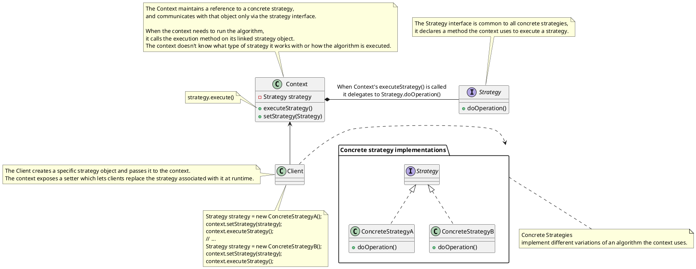

### Strategy pattern example: duck pond simulation game
In the example below, ducks (clients) use algorithms (fly behavior, quack behavior), with different
implementations that can be swapped

Joe works at a company that makes a highly successful duck pond simulation game, SimUDuck. The game
shows a variety of duck species swimming and quacking.
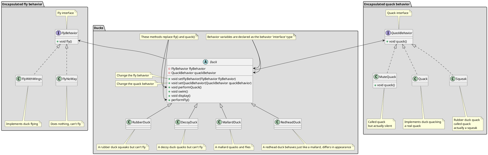

```java

// Quack behavior
public interface QuackBehavior {
    public void quack();
}

// Implements duck quacking: a real quack
public class Quack implements QuackBehavior {
    public void quack() {
        System.out.println("Quack");
    }
}

// Rubber duck quack: called quack, actually a squeak
public class MuteQuack implements QuackBehavior {
    public void quack() {
        System.out.println("<< Silence >>");
    }
}

// Called quack, but actually silent
public class Squack implements QuackBehavior {
    public void quack() {
        System.out.println("Squack");
    }
}

// Fly behavior
public interface FlyBehavior {
    public void fly();
}

// Implements duck flying
public class FlyWithWings implements FlyBehavior {
    public void fly() {
        System.out.println("fly");
    }
}

// Does nothing, can't fly
public class FlyNoWay implements FlyBehavior {
    public void fly() {
        System.out.println("not fly");
    }
}


// Abstract duck class
public abstract class Duck {
    protected QuackBehavior quackBehavior;
    protected FlyBehavior flyBehavior;
    
    public void setFlyBehavior(FlyBehavior flyBehavior) {
        this.flyBehavior = flyBehavior;
    }
    public void setQuackBehavior(QuackBehavior quackBehavior) {
        this.quackBehavior = quackBehavior;
    }

    // To perform the quack, a Duck just asks the object referenced by quackBehavior to quack.
    // In this part of the code we don't care what kind of Duck object it is,
    // all we care about is that it knows how to quack()
    public void performQuack() {
        quackBehavior.quack();
    }

    public void performFly() {
        flyBehavior.fly();
    }

    // Identify the aspects that vary and separate them from what stays the same
    public abstract void swim() {
        System.out.println("All ducks float, even decoys!");
    }
    public abstract void display();

}

// A mallard quacks and flies
public class MallardDuck extends Duck {
    // Instantiate the Duck's quackBehavior and flyBehavior
    public MallardDuck() {
        // MallardDuck uses the Quack class to handle its quack, so when performQuack() is called,
        // the responsibility for the quack is delegated to the Quack object and we get a real quack
        this.quackBehavior = new Quack();
        this.flyBehavior = new FlyWithWings();
    }

    public void display() {
        System.out.println("I'm a real red mallard");
    }
}


// Test class
public class MiniDuckSimulator {
    public static void main(String[] args) {
        Duck mallard = new MallardDuck();
        mallard.performQuack(); // prints Quack
        mallard.performFly(); // prints fly

        // Change to not flying
        mallard.setFlyBehavior(new FlyNoWay());
        mallard.performFly(); // prints not fly
    }
}

```

## Observer Pattern

### Observer pattern definition

Defines a one-to-many dependency between objects so that when one object changes state, all of its
dependents are notified and updated automatically

#### Subject/Observer

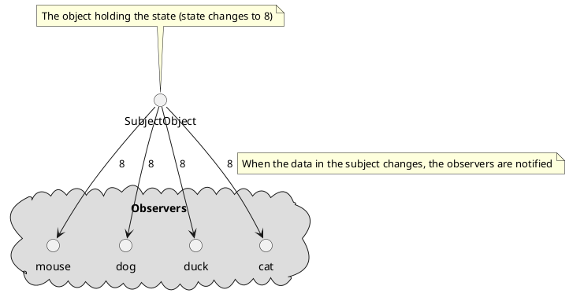

The subject and observers define a one-to-many relationship. When the subject changes, many
observers are notified. The observers depend on the subject: when the subject's state changes, the
observers are notified.

There are several ways to implement the Observer pattern, but most revolve around a class design
that includes Subject and Observer interfaces

#### Observer pattern class diagram

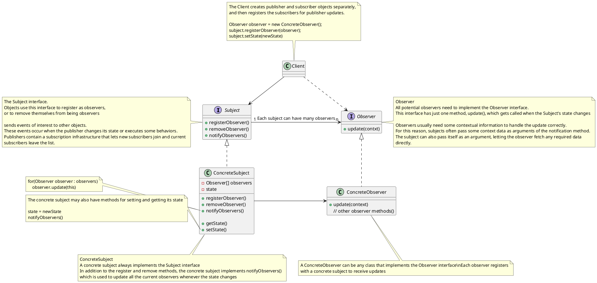

### Observer pattern key points

1. The Observer pattern defines a one-to-many relationship between objects
2. Subjects update observers using a common interface
3. Observers of any concrete type can participate in the pattern as long as they implement the
   Observer interface
4. Observers are loosely coupled: the subject knows nothing about them other than that they
   implement the Observer interface.
5. When using the pattern, you can push or pull data from the subject (pull is considered more
   "correct")
6. Swing makes heavy use of the Observer pattern, as do many GUI frameworks
7. You'll also find the pattern in many other places, including RxJava, JavaBeans and RMI, as well
   as frameworks in other languages, like Cocoa, Swift and JavaScript events
8. The Observer pattern is related to the Publish/Subscribe pattern, which is for more complex
   situations with multiple subjects and/or multiple message types.
9. The Observer pattern is a commonly used pattern, and we'll see it again when we learn about
   Model-View-Controller (MVC)

### Observer pattern discussion

1. The subject notifies all observers of any state change, but a given state change may only matter
   to some observers
2. Why doesn't the subject give specific observers only the state changes they need, instead of
   handing out all state
3. Why don't observers pull the subject's state themselves
4. Observers should not depend on a specific notification order

### Observer example: weather station
A weather station needs to track the current weather, and a WeatherData object tracks the current
weather conditions. The WeatherData object looks like this
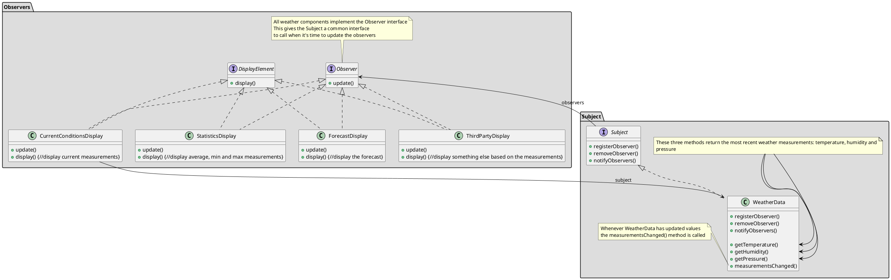

```java

public interface Subject {
    // Both of these methods take an Observer as an argument, i.e. the Observer to register or
    // remove
    public void registerObserver(Observer o);
    public void removeObserver(Observer o);
    // This method is called to notify all observers when the Subject's state has changed
    public void notifyObservers();
}

public interface Observer {
    // These are the state values the observers get from the Subject when the weather measurements
    // change
    public void update(float temp, float humidity, float pressure);
}

// The DisplayElement interface has just one method, display(), called when a display element needs
// to be displayed
public interface DisplayElement {
    public void display();     
}


import java.util.*;
// WeatherData implements the Subject interface
public class WeatherData implements Subject {
    // We add a List to hold the Observers
    private List<Observer> observers;
    private float temperature;
    private float humidity;
    private float pressure;

    public WeatherData() {
        observers = new ArrayList<Observer>();
    }

    public void registerObserver(Observer o) {
        observers.add(o);
    }

    public void removeObserver(Observer o) {
        observers.remove(o);
    }

    public void notifyObservers() {
        for (Observer observer : observers) {
            observer.update(temperature, humidity, pressure);
        }
    }
   public void measurementsChanged() {
        notifyObservers();
    }

   // Called when the weather station detects a change in the weather data (simulated)
    public void setMeasurements(float temperature, float humidity, float pressure) {
        this.temperature = temperature;
        this.humidity = humidity;
        this.pressure = pressure;
        measurementsChanged();
    }

    public float getTemperature() {
        return temperature;
    }

    public float getHumidity() {
        return humidity;
    }

    public float getPressure() {
        return pressure;
    }

}

// This implements Observer so it can get changes from the WeatherData object
// It also implements DisplayElement because our API requires all display elements to implement this
// interface
public class CurrentConditionsDisplay implements Observer, DisplayElement { 
    private float temperature;
    private float humidity;
    private WeatherData weatherData;
      
    public CurrentConditionsDisplay(WeatherData weatherData) { 
        this.weatherData = weatherData;
        weatherData.registerObserver(this);
    } 
      
    public void update(float temperature, float humidity, float pressure) { 
        this.temperature = temperature;
        this.humidity = humidity;
        display();
    } 
      
    public void display() { 
        System.out.println("Current conditions: " + temperature 
            + "F degrees and " + humidity + "% humidity");
    } 
}

// Test program
public class WeatherStation {
      
    public static void main(String[] args) {
        WeatherData weatherData = new WeatherData();
    
        CurrentConditionsDisplay currentDisplay = 
            new CurrentConditionsDisplay(weatherData);
        // StatisticsDisplay statisticsDisplay = new StatisticsDisplay(weatherData); 
        // ForecastDisplay forecastDisplay = new ForecastDisplay(weatherData);

        weatherData.setMeasurements(80, 65, 30.4f);
        weatherData.setMeasurements(82, 70, 29.2f);
        weatherData.setMeasurements(78, 90, 29.2f);
        
        weatherData.removeObserver(forecastDisplay);
        weatherData.setMeasurements(62, 90, 28.1f);
    }
}

```

### Java's built-in Observer pattern

#### ~~Java Observer Observable classes~~

Deprecated in Java 9, not discussed

#### JavaBean PropertyChangeEvent

```java
import java.beans.PropertyChangeEvent;
import java.beans.PropertyChangeListener;
import java.beans.PropertyChangeSupport;
import java.io.Serializable;

public class PropertyChangeEventMain {

    public static void main(String[] args) {
        JavaBean bean = new JavaBean();

        bean.setId(1L);
        bean.setName("java bean 1");
        bean.setName("java bean 2");

        // Don't send an event if the id didn't change
        bean.setId(1L);
    }


    // This example is both the subject and an observer
    static class JavaBean implements PropertyChangeListener, Serializable {

        private Long id;
        private String name;

        // This is a subject
        private PropertyChangeSupport pcs = new PropertyChangeSupport(this);

        public JavaBean() {
            // Register to listen for all changes (all-changes observer)
            pcs.addPropertyChangeListener(this);
            // Register to listen only for id changes (id-change observer)
            pcs.addPropertyChangeListener("id", this);
            // Register to listen only for name changes (name-change observer)
            pcs.addPropertyChangeListener("name", this);
        }

        /**
         * Observer update(), i.e. Observer.update()
         *
         * @param evt event/message
         */
        @Override
        public void propertyChange(PropertyChangeEvent evt) {
            System.out.println("property name is : " + evt.getPropertyName());
            System.out.println("old value is : " + evt.getOldValue());
            System.out.println("new value is : " + evt.getNewValue());
            System.out.println("======================");
        }
        public Long getId() {
            return this.id;
        }

        public void setId(Long id) {
            Long oldId = this.id;
            this.id = id;

            // Fire the id-changed event, similar to the subject's notifyObservers(), i.e.
            // Subject.notifyObservers()
            pcs.firePropertyChange("id", oldId, id);
        }

        public String getName() {
            return this.name;
        }

        public void setName(String name) {
            String oldName = this.name;
            this.name = name;

            // Fire the name-changed event, similar to the subject's notifyObservers(), i.e.
            // Subject.notifyObservers()
            pcs.firePropertyChange("name", oldName, name);
        }
    }
}

```

## Decorator Pattern

`Decorator pattern` attaches additional responsibilities to an object dynamically. Decorators
provide a flexible alternative to subclassing for extending functionality

### Decorator pattern class diagram

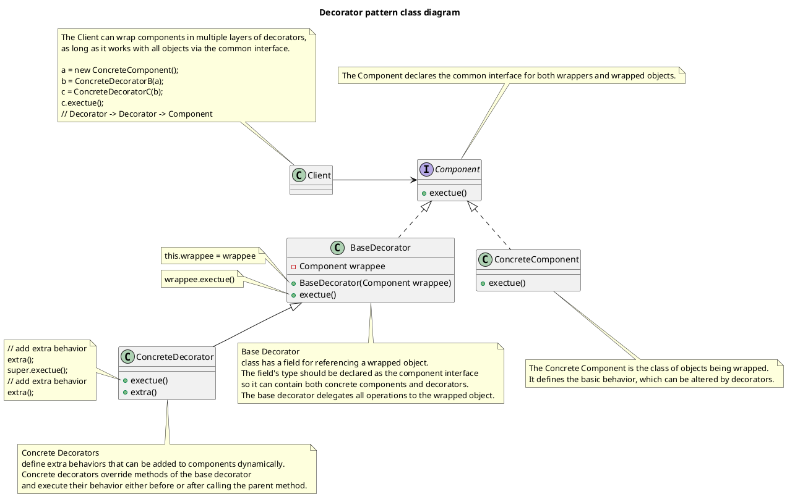

### Decorator pattern key points

1. Inheritance is one form of extension, but not necessarily the best way to achieve flexibility in
   our designs
2. In our designs we should allow behavior to be extended without modifying existing code
3. Composition and delegation can often be used to add new behaviors at runtime
4. The Decorator pattern provides an alternative to subclassing for extending behavior
5. The Decorator pattern involves a set of decorator classes that are used to wrap concrete
   components
6. Decorator classes mirror the type of the components they decorate (in fact, they are the same
   type as the components they decorate, either through inheritance or interface implementation)
7. Decorators change the behavior of their components by adding new functionality before and/or
   after (or even in place of) method calls to the component
8. You can wrap a component with any number of decorators
9. Decorators are typically transparent to the client of the component, unless the client relies on
   the component's concrete type
10. Decorators can result in many small objects in our design, and overuse can be complex
11. An adapter wraps an object to change its interface, a decorator wraps an object to add new
    behaviors and responsibilities, and a facade "wraps" a set of objects to simplify; the code of
    the three is largely the same but the intent differs

### Decorator pattern discussion

- Decorators have the same supertype as the objects they decorate
- You can use one or more decorators to wrap an object
- Given that the decorator has the same supertype as the object it decorates, we can pass around a
  decorated object in place of the original (wrapped) object
- ***The decorator adds its own behavior before and/or after delegating to the object it decorates
  to do the rest of the job***
- Objects can be decorated at any time, so we can decorate objects dynamically at runtime with as
  many decorators as we like
- Decorated objects should use composition rather than inheritance, so we can mix and match
  decorators any way we like at runtime, rather than deciding statically at compile time
- The Decorator pattern tends to produce lots of small classes (see the java.io classes)
- The Decorator pattern has typing problems: if code depends on specific types, introducing
  decorators breaks it
    > e.g. in Starbuzz Coffee, if HouseBlend does something like a discount, then as soon as I wrap
    > HouseBlend with decorators, the code stops working  
    > You only know the outermost decorator, e.g. in Starbuzz Coffee for a DarkRoast with Mocha, Soy
    > and Whip, code could end up referencing Soy instead of Whip, which means the order doesn't
    > include Whip  
    > You can't look at other decorators in the chain, e.g. in Starbuzz Coffee for a DarkRoast with
    > Mocha, Soy and Whip, you only know the outermost one
- The Decorator pattern increases the complexity of the code needed to instantiate a component: once
  you use decorators, you not only instantiate the component but also wrap it in decorators
- Component: see the Beverage note and the coffee/concrete component package in the [Starbuzz Coffee
  class diagram](#starbuzz-coffee-class-diagram)

### Difference from the Proxy pattern

TODO to be added

### Decorator pattern example: Starbuzz Coffee

Starbuzz Coffee has made a name for itself as the fastest-growing coffee shop around. If you've seen
one on your local corner, look across the street; you'll see another one.  
Because they've grown so quickly, they're scrambling to update their ordering systems to match their
beverage offerings

When they first went into business they designed their classes like this; in addition to your
coffee, you can also ask for several condiments like mocha, whip...  
This design is a class explosion
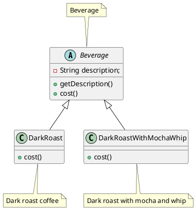

#### Starbuzz Coffee class diagram

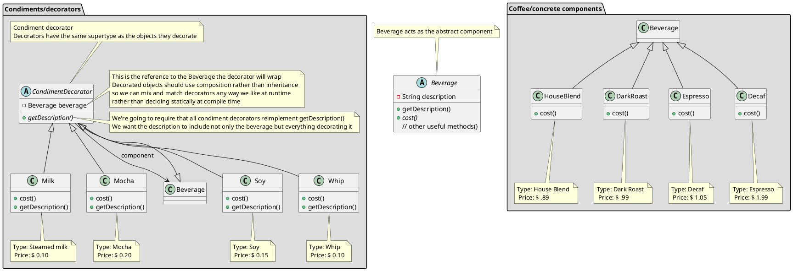
#### Dark Roast with Mocha and Whip: code

```java

// Beverage
public abstract class Beverage {
    String description = "Unknown Beverage";
  
    public String getDescription() {
        return description;
    }   
 
    public abstract double cost();
}

// House blend coffee
public class HouseBlend extends Beverage {
    public HouseBlend() {
        description = "House Blend Coffee";
    }

    public double cost() {
        return .89;
    }
}

// Dark roast coffee
public class DarkRoast extends Beverage {
    public DarkRoast() {
        description = "Dark Roast Coffee";
    }

    public double cost() {
        return .99;
    }
}

// Decaf coffee
public class Espresso extends Beverage {

    public Espresso() {
        description = "Decaf Coffee";
    }

    public double cost() {
        return 1.99;
    }
}

// Espresso
public class Decaf extends Beverage {
    public Decaf() {
        description = "Espresso";
    }

    public double cost() {
        return 1.05;
    }
}

// Condiment decorator
public abstract class CondimentDecorator extends Beverage {
    Beverage beverage;

    // We're going to require that all condiment decorators reimplement getDescription()
    // We want the description to include not only the beverage but everything decorating it
    public abstract String getDescription();
}

// Steamed milk
public class Milk extends CondimentDecorator {
    public Milk(Beverage beverage) {
        this.beverage = beverage;
    }

    public String getDescription() {
        return beverage.getDescription() + ", Steamed Milk";
    }

    public double cost() {
        return .10 + beverage.cost();
    }
}

// Mocha
public class Mocha extends CondimentDecorator {
    public Mocha(Beverage beverage) {
        this.beverage = beverage;
    }

    public String getDescription() {
        return beverage.getDescription() + ", Mocha";
    }

    public double cost() {
        return .20 + beverage.cost();
    }
}

// Soy
public class Soy extends CondimentDecorator {
    public Soy(Beverage beverage) {
        this.beverage = beverage;
    }

    public String getDescription() {
        return beverage.getDescription() + ", Soy";
    }

    public double cost() {
        return .15 + beverage.cost();
    }
}

// Whip
public class Whip extends CondimentDecorator {
    public Whip(Beverage beverage) {
        this.beverage = beverage;
    }

    public String getDescription() {
        return beverage.getDescription() + ", Whip";
    }

    public double cost() {
        return .10 + beverage.cost();
    }
}

// Order test code
public class StarbuzzCoffee {

    public static void main(String args[]) {

        // Order an espresso, no condiments, and print its description and cost
        Beverage beverage = new Espresso();
        System.out.println(beverage.getDescription()
                + " $" + beverage.cost());

        // Make a DarkRoast object
        Beverage beverage2 = new DarkRoast();
        // Wrap it with a Mocha
        beverage2 = new Mocha(beverage2);
        // Wrap it in a second Mocha
        beverage2 = new Mocha(beverage2);
        // Wrap it in a Whip
        beverage2 = new Whip(beverage2);
        System.out.println(beverage2.getDescription()
                + " $" + beverage2.cost());

        // Give us a HouseBlend with Soy and Whip
        Beverage beverage3 = new HouseBlend();
        beverage3 = new Soy(beverage3);
        beverage3 = new Mocha(beverage3);
        beverage3 = new Whip(beverage3);
        System.out.println(beverage3.getDescription()
                + " $" + beverage3.cost());

        // Finally give us a Dark Roast with Mocha and Whip
        Beverage beverage4 = new DarkRoast();
        beverage4 = new Mocha(beverage4);
        beverage4 = new Whip(beverage4);
        System.out.println(beverage4.getDescription()
                + " $" + beverage4.cost());


    }
}

```

#### Dark Roast with Mocha and Whip: call flow

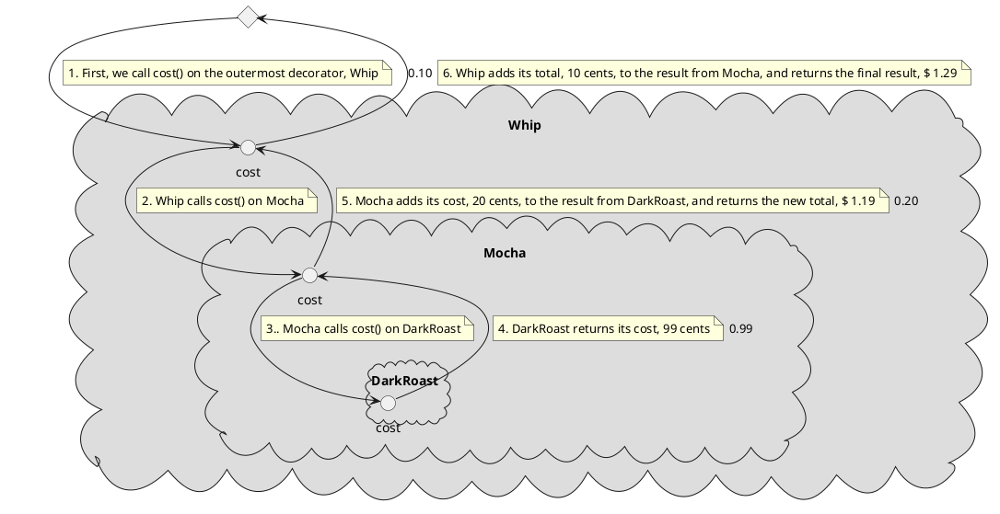

### Decorator pattern in Java: java.io

Taking InputStream as an example
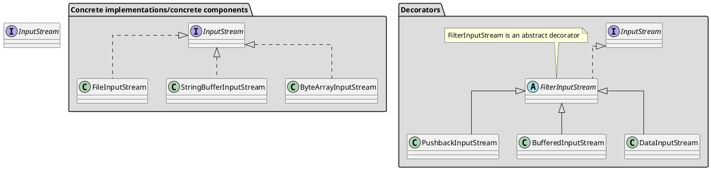

```java
import java.io.*;              

// Convert all uppercase characters in the input stream to lowercase
// e.g. reading "I know the Decorator Pattern therefore I RULE" -> "i know the decorator pattern
// therefore i rule"
public class LowerCaseInputStream extends FilterInputStream {
  
    public LowerCaseInputStream(InputStream in) {
        super(in);             
    }
    
    public int read() throws IOException { 
        int c = in.read();
        return (c == -1 ? c : Character.toLowerCase((char)c));
    } 
        
    public int read(byte[] b, int offset, int len) throws IOException {
        int result = in.read(b, offset, len);
        for (int i = offset; i < offset+result; i++) {
            b[i] = (byte)Character.toLowerCase((char)b[i]);
        }
        return result;
    }
}

import java.io.*;

// Test class
public class InputTest {
    public static void main(String[] args) throws IOException {
        int c;
        InputStream in = null;
        try {
            in =
                new LowerCaseInputStream(
                    new BufferedInputStream(
                        new FileInputStream("test.txt")));

            while((c = in.read()) >= 0) {
                System.out.print((char)c);
            }
        } catch (IOException e) {
            e.printStackTrace();
        } finally {
            if (in != null) { in.close(); }
        }
        System.out.println();
        try (InputStream in2 =
                new LowerCaseInputStream(
                    new BufferedInputStream(
                        new FileInputStream("test.txt"))))
        {
            while((c = in2.read()) >= 0) {
                System.out.print((char)c);
            }
        } catch (IOException e) {
            e.printStackTrace();
        }
    }
}

```

## Factory Pattern

### Background

When you use the new operator you are certainly instantiating a concrete class, so that's definitely
an implementation, not an interface.  
Technically there's nothing wrong with new; the problem is "change" and how change affects our use
of new.  
If your code is written to an interface, then through polymorphism it will work with any class that
implements that interface.  
But when your code makes use of lots of concrete classes, adding a new concrete class means changing
the code  
How can we take all the code that instantiates concrete classes out of the application and separate
or encapsulate it, so it doesn't affect the rest of the application  
> The Factory pattern is mainly used to encapsulate instantiation, so that clients depend only on
> interfaces rather than concrete classes when instantiating objects; it also avoids duplication in
> the code

### Factory pattern discussion
1. Even with only one ConcreteCreator, the Factory Method pattern still decouples the product
   implementation and doesn't affect the Creator (since the Creator isn't tightly coupled to any
   ConcreteCreator)
2. Each ConcreteCreator in the Factory Method pattern is similar to a Simple Factory
3. The Creator class in Factory Method can be a concrete Creator, providing a default implementation

### Factory Method key points
1. All factories encapsulate object creation
2. Simple Factory isn't a true design pattern, but it's still a simple way to decouple clients from
   concrete classes
3. Factory Method relies on inheritance: object creation is delegated to subclasses, which implement
   the factory method to create objects
4. Abstract Factory relies on object composition: object creation is implemented in methods exposed
   in the factory interface
5. All factory patterns promote loose coupling by reducing the dependency of your application on
   concrete classes
6. The intent of Factory Method is to allow a class to defer instantiation to its subclasses
7. The intent of Abstract Factory is to create families of related objects without depending on
   their concrete classes
8. The Dependency Inversion Principle guides us to avoid dependencies on concrete types and to
   strive for abstractions
9. Factories are a powerful technique for coding to abstractions, not concrete classes

### Simple Factory

Simple Factory isn't really a pattern; it's more of a programming idiom

#### Simple Factory example: a simple pizza factory

Suppose you have a pizza store that makes several kinds of pizza.
One day you want to add some trendy pizza flavors: Clam pizza and Veggie pizza,
and Greek pizza hasn't been selling well, so you decide to take it off the menu
So the initial code looks like this
```java

public class PizzaStore {
    public Pizza orderPizze(String type) {
        Pizze pizza;
    
        if (type.equals("cheese")) {
            pizza = new CheesePizza();
        } 
        /* Greek pizza hasn't been selling well, so you decide to take it off the menu
        else if (type.equals("greek")) {
            pizza = new GreekPizza();
        }
        **/ 
        else if (type.equals("pepperoni")) {
            pizza = PepperoniPizza();
        } 
        //  One day you want to add some trendy pizza flavors: Clam pizza and Veggie pizza
        else if (type.equals("clam")) {
            pizza = ClamPizza();
        } else if (type.equals("veggie")) {
            pizza = VeggiePizza();
        }
    
        // prepare the pizza
        pizza.perpare();
        // bake the pizza
        pizza.bake();
        // cut the pizza
        pizza.cut();
        // box the pizza
        pizza.box();
        
        return pizza;
    }
}
```

Clearly the code that decides which concrete class gets instantiated is what's really messing up the
orderPizze() method  
If you add/remove concrete implementation classes, every place that instantiates them has to
change  
So the object creation needs to move out of the orderPizze() method

##### Simple pizza factory class diagram

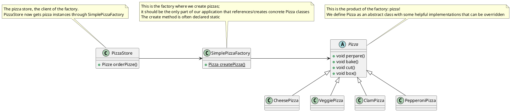

##### Simple pizza factory code
```java
public class PizzaStore {      
    SimplePizzaFactory factory;
  
    public PizzaStore(SimplePizzaFactory factory) { 
        this.factory = factory;
    }
  
    public Pizza orderPizza(String type) { 
        Pizza pizza;           
    
        pizza = factory.createPizza(type);
    
        pizza.prepare();
        pizza.bake();
        pizza.cut();
        pizza.box();           

        return pizza;
    }

}

public class SimplePizzaFactory {

    public Pizza createPizza(String type) {
        Pizza pizza = null;

        if (type.equals("cheese")) {
            pizza = new CheesePizza();
        } else if (type.equals("pepperoni")) {
            pizza = new PepperoniPizza();
        } else if (type.equals("clam")) {
            pizza = new ClamPizza();
        } else if (type.equals("veggie")) {
            pizza = new VeggiePizza();
        }
        return pizza;
    }
}

abstract public class Pizza {
    String name;
    
    // dough
    String dough;
    // sauce
    String sauce;
    // toppings
    List<String> toppings = new ArrayList<String>();
  
    public String getName() {  
        return name;
    } 

    // prepare the pizza 
    public void prepare() {    
        System.out.println("Preparing " + name);
    }

    // bake the pizza
    public void bake() {       
        System.out.println("Baking " + name);
    }

    // cut the pizza
    public void cut() {        
        System.out.println("Cutting " + name);
    }

    // box the pizza
    public void box() {
        System.out.println("Boxing " + name);
    }

    public String toString() {
        // code to display pizza name and ingredients
        StringBuffer display = new StringBuffer();
        display.append("---- " + name + " ----\n");
        display.append(dough + "\n");
        display.append(sauce + "\n");
        for (String topping : toppings) {
            display.append(topping + "\n");
        }
        return display.toString();
    }

}

public class CheesePizza extends Pizza {
    public CheesePizza() {
        name = "Cheese Pizza";
        dough = "Regular Crust";
        sauce = "Marinara Pizza Sauce";
        toppings.add("Fresh Mozzarella");
        toppings.add("Parmesan");
    }
}


public class ClamPizza extends Pizza {
    public ClamPizza() {
        name = "Clam Pizza";
        dough = "Thin crust";
        sauce = "White garlic sauce";
        toppings.add("Clams");
        toppings.add("Grated parmesan cheese");
    }
}

public class PepperoniPizza extends Pizza {
    public PepperoniPizza() {
        name = "Pepperoni Pizza";
        dough = "Crust";
        sauce = "Marinara sauce";
        toppings.add("Sliced Pepperoni");
        toppings.add("Sliced Onion");
        toppings.add("Grated parmesan cheese");
    }
}

public class VeggiePizza extends Pizza {
    public VeggiePizza() {
        name = "Veggie Pizza";
        dough = "Crust";
        sauce = "Marinara sauce";
        toppings.add("Shredded mozzarella");
        toppings.add("Grated parmesan");
        toppings.add("Diced onion");
        toppings.add("Sliced mushrooms");
        toppings.add("Sliced red pepper");
        toppings.add("Sliced black olives");
    }
}
```


### Factory Method

Defines an interface for creating an object, but lets subclasses decide which class to instantiate.
Factory Method lets a class defer instantiation to subclasses

#### Factory Method pattern class diagram

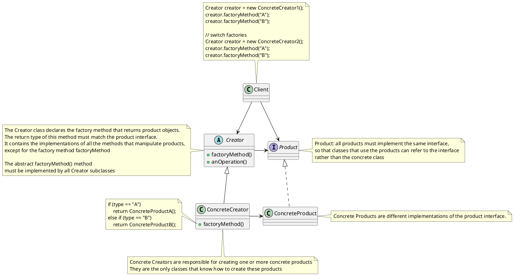

#### Factory Method pattern example: pizza factory

The pizza store is doing well and wants to open franchises, but people in each region have different
tastes,  
so each franchise needs to offer pizzas in its regional style (e.g. New York, Chicago, California)

##### Factory Method pattern example: pizza factory class diagram

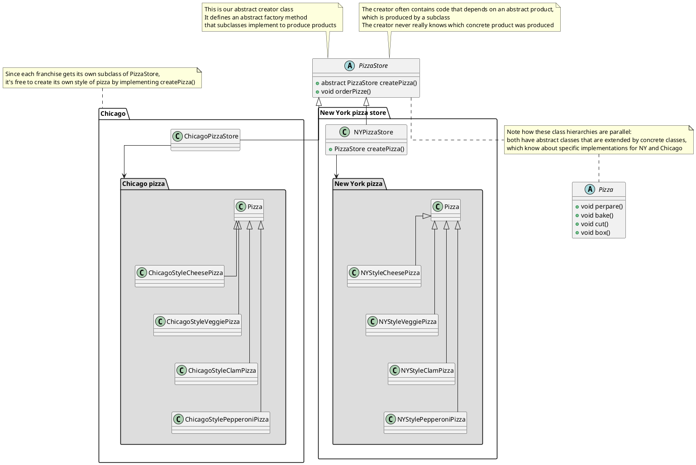

##### Factory Method pattern example: pizza factory code

```java
public abstract class PizzaStore {
  
    abstract Pizza createPizza(String item); 
    
    public Pizza orderPizza(String type) { 
        Pizza pizza = createPizza(type);
        System.out.println("--- Making a " + pizza.getName() + " ---");
        pizza.prepare();
        pizza.bake();
        pizza.cut();
        pizza.box();
        return pizza;
    }
}

public abstract class Pizza {
    String name;
    
    // dough
    String dough;
    // sauce
    String sauce;
    // toppings
    List<String> toppings = new ArrayList<String>();
  
    public String getName() {  
        return name;
    } 

    // prepare the pizza 
    public void prepare() {    
        System.out.println("Preparing " + name);
    }

    // bake the pizza
    public void bake() {       
        System.out.println("Baking " + name);
    }

    // cut the pizza
    public void cut() {        
        System.out.println("Cutting " + name);
    }

    // box the pizza
    public void box() {
        System.out.println("Boxing " + name);
    }

    public String toString() {
        // code to display pizza name and ingredients
        StringBuffer display = new StringBuffer();
        display.append("---- " + name + " ----\n");
        display.append(dough + "\n");
        display.append(sauce + "\n");
        for (String topping : toppings) {
            display.append(topping + "\n");
        }
        return display.toString();
    }

}

public class NYPizzaStore extends PizzaStore {

    Pizza createPizza(String item) {
        if (item.equals("cheese")) {
            return new NYStyleCheesePizza();
        } else if (item.equals("veggie")) {
            return new NYStyleVeggiePizza();
        } else if (item.equals("clam")) {
            return new NYStyleClamPizza();
        } else if (item.equals("pepperoni")) {
            return new NYStylePepperoniPizza();
        } else return null;
    }
}

public class NYStyleCheesePizza extends Pizza {

    public NYStyleCheesePizza() {
        name = "NY Style Sauce and Cheese Pizza";
        dough = "Thin Crust Dough";
        sauce = "Marinara Sauce";

        toppings.add("Grated Reggiano Cheese");
    }
}

public class ChicagoPizzaStore extends PizzaStore {

    Pizza createPizza(String item) {
        if (item.equals("cheese")) {
            return new ChicagoStyleCheesePizza();
        } else if (item.equals("veggie")) {
            return new ChicagoStyleVeggiePizza();
        } else if (item.equals("clam")) {
            return new ChicagoStyleClamPizza();
        } else if (item.equals("pepperoni")) {
            return new ChicagoStylePepperoniPizza();
        } else return null;
    }
}


public class ChicagoStyleCheesePizza extends Pizza {

    public ChicagoStyleCheesePizza() {
        name = "Chicago Style Deep Dish Cheese Pizza";
        dough = "Extra Thick Crust Dough";
        sauce = "Plum Tomato Sauce";

        toppings.add("Shredded Mozzarella Cheese");
    }

    // Chicago pizza overrides how the pizza is cut
    void cut() {
        System.out.println("Cutting the pizza into square slices");
    }
}

public class PizzaTestDrive {

    public static void main(String[] args) {
        PizzaStore nyStore = new NYPizzaStore();
        PizzaStore chicagoStore = new ChicagoPizzaStore();

        Pizza pizza = nyStore.orderPizza("cheese");
        System.out.println("Ethan ordered a " + pizza.getName() + "\n");

        pizza = chicagoStore.orderPizza("cheese");
        System.out.println("Joel ordered a " + pizza.getName() + "\n");
    }
}
```

### Dependency inversion in Factory Method

For a class that uses the simple factory approach:

```java
public class DependentPizzaStore {
  
    public Pizza createPizza(String style, String type) {
        Pizza pizza = null;    
        if (style.equals("NY")) {       
            if (type.equals("cheese")) {
                pizza = new NYStyleCheesePizza();
            } else if (type.equals("veggie")) {
                pizza = new NYStyleVeggiePizza();
            } else if (type.equals("clam")) { 
                pizza = new NYStyleClamPizza(); 
            } else if (type.equals("pepperoni")) { 
                pizza = new NYStylePepperoniPizza();
            }
        } else if (style.equals("Chicago")) {
            if (type.equals("cheese")) {    
                pizza = new ChicagoStyleCheesePizza();
            } else if (type.equals("veggie")) {
                pizza = new ChicagoStyleVeggiePizza();
            } else if (type.equals("clam")) { 
                pizza = new ChicagoStyleClamPizza();
            } else if (type.equals("pepperoni")) { 
                pizza = new ChicagoStylePepperoniPizza();
            }
        } else {               
            System.out.println("Error: invalid type of pizza");
            return null;
        }
        pizza.prepare();
        pizza.bake();
        pizza.cut();
        pizza.box();
        return pizza;
    }
}

```
the object dependencies look like this

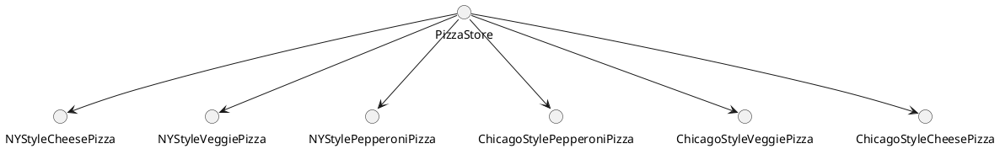

After applying the Factory Method pattern, the dependency graph looks like this
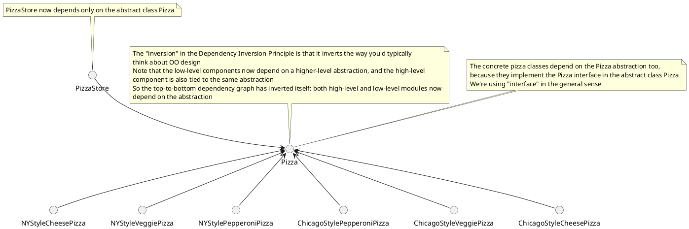

### Abstract Factory Pattern

`Abstract Factory pattern`: provides an interface for creating families of related or dependent
objects without specifying their concrete classes

#### Abstract Factory pattern class diagram

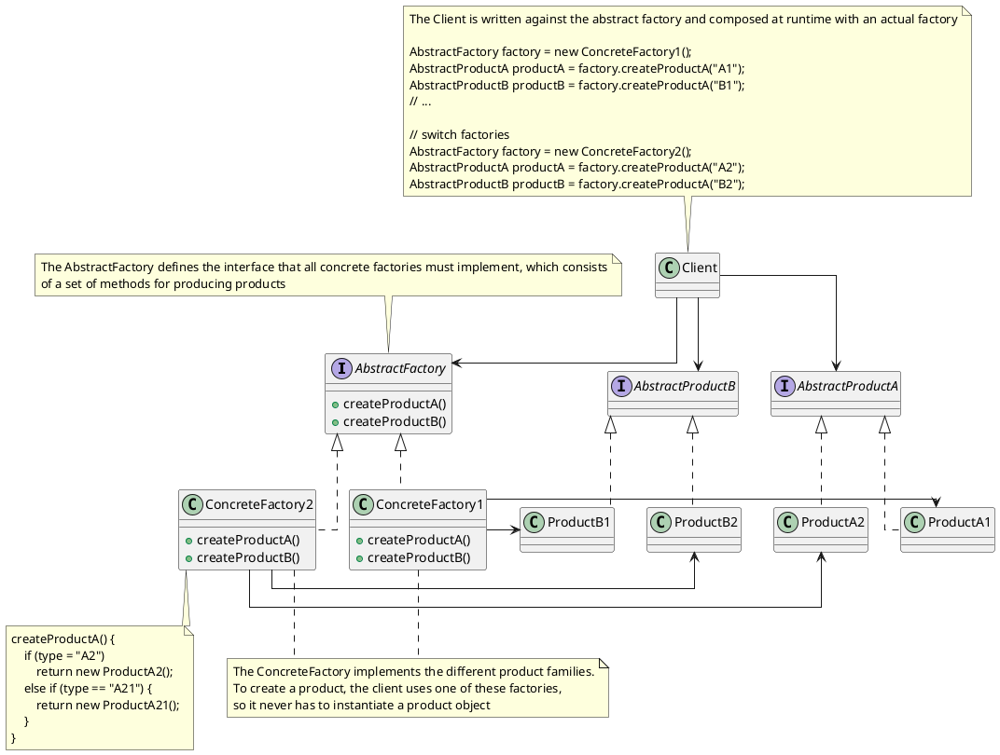

#### Abstract Factory pattern example: an ingredient factory for the pizza store

The key to the pizza store's success is fresh, quality ingredients. To make franchises follow your
process and standardize ingredients, you plan to build an ingredient factory (abstract factory)

To build the ingredient factory you have to figure out how to handle families of ingredients

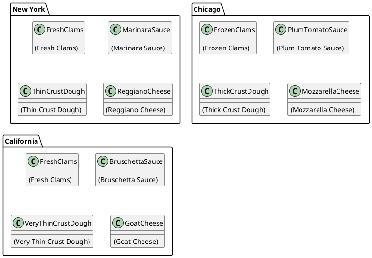

So for the ingredient factory, the code to create all the ingredients is as follows

```java
// Pizza ingredient factory
public interface PizzaIngredientFactory {

    // dough
    public Dough createDough();
    // sauce
    public Sauce createSauce();
    // cheese
    public Cheese createCheese();
    // veggies
    public Veggies[] createVeggies();
    // pepperoni
    public Pepperoni createPepperoni();
    // clams
    public Clams createClam();

}
```

The full code is as follows

```java

// Pizza ingredient factory
public interface PizzaIngredientFactory {

    // dough
    public Dough createDough();
    // sauce
    public Sauce createSauce();
    // cheese
    public Cheese createCheese();
    // veggies
    public Veggies[] createVeggies();
    // pepperoni
    public Pepperoni createPepperoni();
    // clams
    public Clams createClam();

}

// New York ingredient factory
public class NYPizzaIngredientFactory implements PizzaIngredientFactory {
 
    public Dough createDough() {
        return new ThinCrustDough();    
    }
 
    public Sauce createSauce() {    
        return new MarinaraSauce();     
    }
 
    public Cheese createCheese() {  
        return new ReggianoCheese();    
    }
 
    public Veggies[] createVeggies() {
        Veggies veggies[] = { new Garlic(), new Onion(), new Mushroom(), new RedPepper() };
        return veggies;
    }
 
    public Pepperoni createPepperoni() {
        return new SlicedPepperoni();   
    }

    public Clams createClam() {
        return new FreshClams();        
    }
}

// Chicago ingredient factory
public class ChicagoPizzaIngredientFactory implements PizzaIngredientFactory {

    public Dough createDough() {
        return new ThickCrustDough();
    }

    public Sauce createSauce() {
        return new PlumTomatoSauce();
    }

    public Cheese createCheese() {
        return new MozzarellaCheese();
    }

    public Veggies[] createVeggies() {
        Veggies veggies[] = { new BlackOlives(),
                              new Spinach(),
                              new Eggplant() };
        return veggies;
    }

    public Pepperoni createPepperoni() {
        return new SlicedPepperoni();
    }
    public Clams createClam() {
        return new FrozenClams();
    }
}

// Dough
public interface Dough {
    public String toString();
}

// Sauce
public interface Sauce {
    public String toString();
}

// Cheese
public interface Cheese {
    public String toString();
}

// Veggies
public interface Veggies {
    public String toString();
}

// Pepperoni
public interface Pepperoni {
    public String toString();
}

// Clams
public interface Clams {
    public String toString();
}

// Rework the pizza: mainly make prepare() abstract; this method gathers the ingredients the pizza
// needs, which of course come from the ingredient factory
public abstract class Pizza {
    String name;

    // The ingredients the pizza needs are as follows
    Dough dough;
    Sauce sauce;
    Veggies veggies[];
    Cheese cheese;
    Pepperoni pepperoni;
    Clams clam;

    abstract void prepare();   

    void bake() {
        System.out.println("Bake for 25 minutes at 350");
    }

    void cut() {
        System.out.println("Cutting the pizza into diagonal slices");
    }

    void box() {
        System.out.println("Place pizza in official PizzaStore box");
    } 
    void setName(String name) {
        this.name = name;
    }

    String getName() {
        return name;
    }
    public String toString() {
        StringBuffer result = new StringBuffer();
        result.append("---- " + name + " ----\n");
        if (dough != null) {
            result.append(dough);
            result.append("\n");
        }
        if (sauce != null) {
            result.append(sauce);
            result.append("\n");
        }
        if (cheese != null) {
            result.append(cheese);
            result.append("\n");
        }
        if (veggies != null) {
            for (int i = 0; i < veggies.length; i++) {
                result.append(veggies[i]);
                if (i < veggies.length-1) {
                    result.append(", ");
                }
            }
            result.append("\n");
        }
        if (clam != null) {
            result.append(clam);
            result.append("\n");
        }
        if (pepperoni != null) {
            result.append(pepperoni);
            result.append("\n");
        }
        return result.toString();
    }
}

// The cheese pizza is as follows
public class CheesePizza extends Pizza {
    PizzaIngredientFactory ingredientFactory;

    // To make a pizza now, we need a factory to provide the ingredients
    public CheesePizza(PizzaIngredientFactory ingredientFactory) {
        this.ingredientFactory = ingredientFactory;
    }

    void prepare() {
        System.out.println("Preparing " + name);
        dough = ingredientFactory.createDough();
        sauce = ingredientFactory.createSauce();
        cheese = ingredientFactory.createCheese();
    }
}

public class ClamPizza extends Pizza {
    PizzaIngredientFactory ingredientFactory;

    public ClamPizza(PizzaIngredientFactory ingredientFactory) {
        this.ingredientFactory = ingredientFactory;
    }

    void prepare() {
        System.out.println("Preparing " + name);
        dough = ingredientFactory.createDough();
        sauce = ingredientFactory.createSauce();
        cheese = ingredientFactory.createCheese();
        // A clam pizza also has clams
        clam = ingredientFactory.createClam();
    }
}

// New York pizza store
public class NYPizzaStore extends PizzaStore {

    protected Pizza createPizza(String item) {
        Pizza pizza = null;
        PizzaIngredientFactory ingredientFactory =
            new NYPizzaIngredientFactory();

        if (item.equals("cheese")) {

            pizza = new CheesePizza(ingredientFactory);
            pizza.setName("New York Style Cheese Pizza");

        } else if (item.equals("veggie")) {

            pizza = new VeggiePizza(ingredientFactory);
            pizza.setName("New York Style Veggie Pizza");

        } else if (item.equals("clam")) {

            pizza = new ClamPizza(ingredientFactory);
            pizza.setName("New York Style Clam Pizza");

        } else if (item.equals("pepperoni")) {

            pizza = new PepperoniPizza(ingredientFactory);
            pizza.setName("New York Style Pepperoni Pizza");

        }
        return pizza;
    }
}


```

The class diagram is as follows
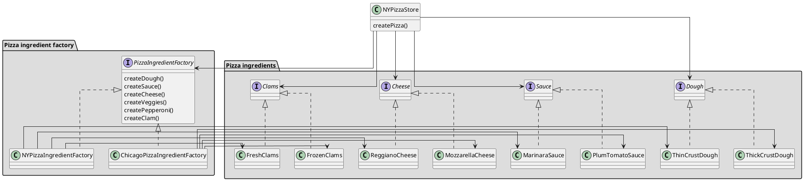

## Singleton Pattern

`Singleton pattern`: ensures a class has only one instance, and provides a global point of access to
it

### Singleton pattern discussion

1. With multiple class loaders, the same class may be loaded more than once, producing multiple
   singletons
2. Reflection and serialization/deserialization can also produce multiple singletons
3. The Singleton pattern violates the loose coupling principle / Single Responsibility Principle
4. Compared with a global variable, a singleton can be lazily loaded
5. Global variables encourage developers to pollute the namespace with lots of global references to
   small objects

### Singleton pattern key points

1. The Singleton pattern ensures you have at most one instance of a class in your application
2. The Singleton pattern also provides a global access point to that instance
3. Java's implementation of the Singleton pattern uses a private constructor, a static method and a
   static variable
4. Examine your performance and resource constraints and carefully choose an appropriate Singleton
   implementation for multithreaded applications (and we should consider all applications
   multithreaded!)
5. Beware the double-checked locking implementation; it isn't thread safe in versions before Java 5
6. Be careful if you are using multiple class loaders; this could defeat the Singleton
   implementation and result in multiple instances
7. You can use Java's enums to simplify your Singleton implementation

### Singleton pattern class diagram

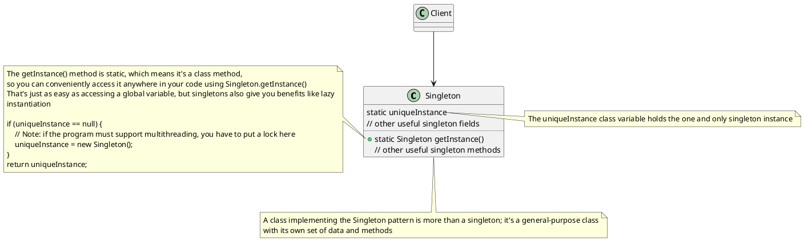

### Singleton pattern implementations

```java
public class Singleton {
    private static Singleton uniqueInstance;
    // other useful singleton fields

    private Singleton() {}

    /**
     * <pre>
     * This approach has a multithreading problem and may create multiple Singletons
     * But if calling getInstance() doesn't add much overhead to your application and multiple
     * instances are acceptable, you can use it
     * </pre>
     */
    public static Singleton getInstance() {
        if (uniqueInstance == null) {
            uniqueInstance == new Singleton();
        }
        return uniqueInstance;
    }

    // other useful singleton methods
}

public class Singleton {
    private static Singleton uniqueInstance = new Singleton();
    // other useful singleton fields

    private Singleton() {}
    
    /**
     * Create the instance eagerly instead of lazily
     */
    public static Singleton getInstance() {
        return uniqueInstance;
    }

    // other useful singleton methods
}


public class Singleton {
    // The volatile keyword ensures that multiple threads handle the uniqueInstance variable
    // correctly when it is being initialized to the singleton instance
    private volatile static Singleton uniqueInstance;
    // other useful singleton fields

    private Singleton() {}

    /**
     * <pre>
     * Double-checked locking to initialize the instance; problematic in certain scenarios
     * There may be a problem when uniqueInstance has been assigned an address but init has not run
     * yet
     * </pre>
     */
    public static Singleton getInstance() {
        // Check for an instance; if there isn't one, enter a synchronized block
        if (uniqueInstance == null) {
            // Note: we only synchronize the first time through
            synchronized (Singleton.class) {
                if (uniqueInstance == null) {
                    // Once in the block, check again; if it's still null, create an instance
                    uniqueInstance == new Singleton();
                }
            }
        }
        return uniqueInstance;
    }

    // other useful singleton methods
}
```

## Command Pattern

`Command pattern`: encapsulates a request as an object, letting you parameterize other objects with
different requests, queues or log requests, and supports undoable operations

### Command pattern key points

1. The Command pattern decouples an object making a request from the one that knows how to perform
   it
2. A command object is at the center of this decoupling and encapsulates a receiver with an action
   (or set of actions)
3. An invoker makes a request of a command object by calling its execute() method, which invokes the
   actions on the receiver
4. Invokers can be parameterized with commands, even dynamically at runtime
5. Commands may support undo by implementing an undo() method that restores the object to its
   previous state before execute() was last called
6. MacroCommands are a simple extension of Command that allow multiple commands to be invoked.
   Likewise, MacroCommands can easily support undo()
7. In practice, it's not uncommon for "smart" command objects to implement the request themselves
   rather than delegating to a receiver
8. Commands may also be used to implement logging and transactional systems

### Command pattern class diagram

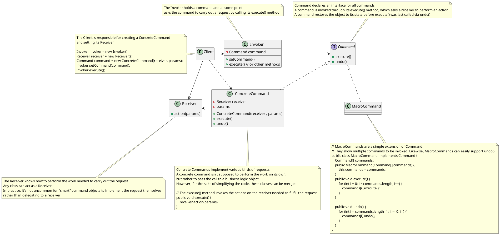
### Command pattern sequence diagram

```plantuml
@startuml
autonumber

participant Client as client
participant Invoker as invoker
participant Command as command
participant Receiver as receiver

client -> command : The client creates a command object
client -> invoker : The client calls setCommand() to store the command object in the invoker
client -> invoker : The client asks the invoker to execute the command
invoker -> command : The invoker calls the command object's execute() method
command -> receiver : execute() invokes the actions on the receiver needed to fulfill the request

@enduml
```

### Command pattern example: remote control

We need to design the code for a remote control where each slot can be assigned to control a device
or a set of devices  
Note that it must be able to control all current devices as well as any devices vendors may supply
in the future  

Below are the interfaces of the objects we need to control from the remote; some of these devices
have very different interfaces

```plantuml
@startuml
' light
class Light {
    on()
    off()
}
note top of Light : Light
' ceiling fan
class CeilingFan {
    high()
    medium()
    low()
    off()
    getSpeed()
}
note top of CeilingFan : Ceiling fan
' TV
class TV {
    on()
    off()
    setInputChannel()
}
note top of TV : TV

@enduml
```

```plantuml
@startuml

package "Remote control" as remote_control {
    
    together {
        () ON1
        () OFF1

        note right of ON1 : Light on
        note left of OFF1 : Light off
    }
    
    together {
        () ON2
        () OFF2

        note right of ON2 : Ceiling fan on high\n(low and medium speeds not shown for brevity)
        note left of OFF2 : Ceiling fan off
    }
    
    together {
        () ON3
        () OFF3

        note right of ON3 : TV on
        note left of OFF3 : TV off
    }
  
    together {
        () ON4
        () OFF4

        note right of ON4 : Light, TV on, ceiling fan on high
        note left of OFF4 : Light, ceiling fan, TV off
    }
    
    together {
        () undo
        note right of undo
        Restores the object to its state before execute() was last called,
        but the TV uses a lambda and can't be undone
        end note
    }

' layout control, no meaning

' together1 -down[hidden]-> together2
' together2 -down[hidden]-> together3
' together3 -down[hidden]-> together4
' together4 -down[hidden]-> together_undo
}

note top of remote_control
The 4 slots each have their own on and off buttons
Each slot pair needs to be programmed. We can put a different device in each slot
and then control it with the buttons
There's also an undo slot that restores the object to its state before execute() was last called
end note

@enduml
```

The remote control class diagram is as follows

```plantuml
@startuml

skinparam linetype ortho

class RemoteLoader {

}

class RemoteControl {
    Command[] onCommands;
    Command[] offCommands;

    setCommand()
    onButtonWasPushed()
    offButtonWasPushed()
}

interface Command {
    execute()
}
' light
class Light {
    on()
    off()
}
note top of Light : Light
class LightOnCommand implements Command {
    execute()
}
class LightOffCommand implements Command {
    execute()
}

' ceiling fan
class CeilingFan {
    high()
    medium()
    low()
    off()
    getSpeed()
}
note top of CeilingFan : Ceiling fan
class CeilingFanHighCommand implements Command {
    execute()
}
class CeilingFanOffCommand implements Command {
    execute()
}

' TV
class TV {
    on()
    off()
    setInputChannel()
}
note top of TV : TV, uses two lambda expressions to create commands

class MacroCommand implements Command {
    execute()
}

RemoteLoader -> Light
RemoteLoader -> CeilingFan
RemoteLoader -> TV
RemoteLoader -> LightOnCommand
RemoteLoader -> LightOffCommand
RemoteLoader -> CeilingFanHighCommand
RemoteLoader -> CeilingFanOffCommand

RemoteControl -> Command


@enduml
```

The code is as follows
```java
// This is the invoker
public class RemoteControl {
    Command[] onCommands;
    Command[] offCommands;     
    Command undoCommand;
 
    public RemoteControl() {   
        onCommands = new Command[4];
        offCommands = new Command[4];   
 
        Command noCommand = new NoCommand();
        for(int i=0;i<4;i++) { 
            onCommands[i] = noCommand;
            offCommands[i] = noCommand;
        }
        undoCommand = noCommand;        
    }
  
    public void setCommand(int slot, Command onCommand, Command offCommand) {
        onCommands[slot] = onCommand;   
        offCommands[slot] = offCommand; 
    }
    public void onButtonWasPushed(int slot) {
        onCommands[slot].execute();
        undoCommand = onCommands[slot];
    }

    public void offButtonWasPushed(int slot) {
        offCommands[slot].execute();
        undoCommand = offCommands[slot];
    }

    public void undoButtonWasPushed() {
        undoCommand.undo();
    }

    public String toString() {
        StringBuffer stringBuff = new StringBuffer();
        stringBuff.append("\n------ Remote Control -------\n");
        for (int i = 0; i < onCommands.length; i++) {
            stringBuff.append("[slot " + i + "] " + onCommands[i].getClass().getName()
                + "    " + offCommands[i].getClass().getName() + "\n");
        }
        stringBuff.append("[undo] " + undoCommand.getClass().getName() + "\n");
        return stringBuff.toString();
    }
}

// Command interface
public interface Command {
    public void execute();
    public default void undo() {}

    // Each command is stored to disk when it's executed
    public default void store() {}
    // After a system failure, these objects are reloaded
    public default Command load() {return null;}
}

// Default no-op implementation, avoids null pointer exceptions
public class NoCommand implements Command {
    public void execute() { }
    public void undo() { }
}

// MacroCommands are a simple extension of Command
// They allow multiple commands to be invoked. Likewise, MacroCommands can easily support undo()
public class MacroCommand implements Command {
    Command[] commands;

    public MacroCommand(Command[] commands) {
        this.commands = commands;
    }

    public void execute() {
        for (int i = 0; i < commands.length; i++) {
            commands[i].execute();
        }
    }

    /**
     * NOTE:  these commands have to be done backwards to ensure proper undo functionality
     */
    public void undo() {
        for (int i = commands.length -1; i >= 0; i--) {
            commands[i].undo();
        }
    }
}

// Light
public class Light {
    String location = "";

    public Light(String location) {
        this.location = location;
    }

    public void on() {
        System.out.println(location + " light is on");
    }

    public void off() {
        System.out.println(location + " light is off");
    }
}


// Plain light switch (the most basic Command pattern)
public class LightOffCommand implements Command {
    Light light;

    public LightOffCommand(Light light) {
        this.light = light;
    }

    public void execute() {
        light.off();
    }

    public void undo() {
        light.on();
    }
}

// Plain light switch (the most basic Command pattern)
public class LightOnCommand implements Command {
    Light light;

    public LightOnCommand(Light light) {
        this.light = light;
    }

    public void execute() {
        light.on();
    }

    public void undo() {
        light.off();
    }
}

// Ceiling fan
public class CeilingFan {
    public static final int HIGH = 3;
    public static final int MEDIUM = 2;
    public static final int LOW = 1;
    public static final int OFF = 0;
    String location;
    int speed;

    public CeilingFan(String location) {
        this.location = location;
    }

    public void high() {
        // turns the ceiling fan on to high
        speed = HIGH;
        System.out.println(location + " ceiling fan is on high");
    }

    public void medium() {
        // turns the ceiling fan on to medium
        speed = MEDIUM;
        System.out.println(location + " ceiling fan is on medium");
    }

    public void low() {
        // turns the ceiling fan on to low
        speed = LOW;
        System.out.println(location + " ceiling fan is on low");
    }

    public void off() {
        // turns the ceiling fan off
        speed = OFF;
        System.out.println(location + " ceiling fan is off");
    }

    public int getSpeed() {
        return speed;
    }
}

// Undo using state: the ceiling fan supports several speeds; this button sets it to high
public class CeilingFanHighCommand implements Command {
    CeilingFan ceilingFan;
    // Add a local variable to track the fan's previous speed
    int prevSpeed;

    public CeilingFanHighCommand(CeilingFan ceilingFan) {
        this.ceilingFan = ceilingFan;
    }
    public void execute() {
        // In execute(), before changing the fan speed, record its previous state so undo can use it
        prevSpeed = ceilingFan.getSpeed();
        ceilingFan.high();
    }

    // Set the fan back to its previous speed to undo
    public void undo() {
        switch (prevSpeed) {
            case CeilingFan.HIGH:   ceilingFan.high(); break;
            case CeilingFan.MEDIUM: ceilingFan.medium(); break;
            case CeilingFan.LOW:    ceilingFan.low(); break;
            default:                ceilingFan.off(); break;
        }
    }
}

// Turn off the ceiling fan
public class CeilingFanOffCommand implements Command {
    CeilingFan ceilingFan;     
    int prevSpeed;
    
    public CeilingFanOffCommand(CeilingFan ceilingFan) {
        this.ceilingFan = ceilingFan;   
    }   
    public void execute() {    
        prevSpeed = ceilingFan.getSpeed();
        ceilingFan.off();      
    } 
    public void undo() {       
        switch (prevSpeed) {
            case CeilingFan.HIGH:   ceilingFan.high(); break;
            case CeilingFan.MEDIUM: ceilingFan.medium(); break;
            case CeilingFan.LOW:    ceilingFan.low(); break;
            default:                ceilingFan.off(); break;
        }
    }
}

public class TV {
    String location;
    int channel;

    public TV(String location) {
        this.location = location;
    }

    public void on() {
        System.out.println(location + " TV is on");
    }

    public void off() {
        System.out.println(location + " TV is off");
    }

    public void setInputChannel() {
        this.channel = 3;
        System.out.println(location + " TV channel is set for DVD");
    }
}

public class RemoteLoader {

    public static void main(String[] args) {

        RemoteControl remoteControl = new RemoteControl();

        // Plain light switch (the most basic Command pattern)
        Light light = new Light("Living Room");
        LightOnCommand lightOn = new LightOnCommand(light);
        LightOffCommand lightOff = new LightOffCommand(light);
        remoteControl.setCommand(0, lightOn, lightOff);
        
        // Ceiling fan switch (undo using state)
        CeilingFan ceilingFan = new CeilingFan("Living Room");
        CeilingFanHighCommand ceilingFanHigh = new CeilingFanHighCommand(ceilingFan);
        CeilingFanOffCommand ceilingFanOff = new CeilingFanOffCommand(ceilingFan);
        remoteControl.setCommand(1, ceilingFanHigh, ceilingFanOff);
 
        // TV switch, using lambda expressions, doesn't support undo()
        TV tv = new TV("Living Room");
        remoteControl.setCommand(2, () -> tv.on(), tv.off());
        
        // Macro command: turn on the light, the fan on high and the TV together, and turn off the
        // light, fan and TV together
        Command[] partyOn = { lightOn, ceilingFanHigh};
        Command[] partyOff = { lightOff, ceilingFanOff};
        MacroCommand partyOnMacro = new MacroCommand(partyOn);
        MacroCommand partyOffMacro = new MacroCommand(partyOff);
        remoteControl.setCommand(3, partyOnMacro, partyOffMacro);

        System.out.println(remoteControl);
        System.out.println("--- Pushing Macro On---");
        remoteControl.onButtonWasPushed(0);
        System.out.println("--- Pushing Macro Off---");
        remoteControl.offButtonWasPushed(0);
    }
}

```

### Command pattern use cases

#### Queuing requests (e.g. thread pools)

Commands package up a piece of computation (a receiver and a set of actions) and pass it around as a
first-class object.  
The computation itself may be invoked long after some client application created the command
object.  
In fact, it may even be invoked by a different thread. We can apply this to many applications,  
such as schedulers, thread pools and job queues


Imagine a job queue: you add commands to the queue on one end, and on the other end sits a group of
threads.  
The threads run the following script: remove a command from the queue, call its execute() method,  
wait for the call to finish, then discard the command object and retrieve a new one......  
The job queue classes are totally decoupled from the objects doing the computation. One minute a
thread may be computing a financial computation,  
the next it may be retrieving something from the network.  
The job queue objects don't care; they just retrieve commands and call exectue() 
Likewise, as long as you put objects that implement the Command pattern into the queue, execute()
will be called when a thread is available


#### Logging requests

Some applications require that we log all actions and be able to recover after a crash by reinvoking
those actions. By adding two methods, store() and load(), the Command pattern can support this. In
JAVA we can implement these methods with object serialization

How does it work? As we execute commands, we store a history of them on disk; when a crash occurs,
we reload the command objects and invoke their execute() methods in batch and in order

```plantuml
@startuml

() Invoker as invoker
() Command1 as command1
() Command2 as command2
() Command3 as command3

[Persistent storage] as store

invoker ..> command1 : 1. execute()
invoker ..> command2 : 2. execute()
invoker ..> command3 : 3. execute()

command1 --> store : store
command2 --> store : store
command3 --> store : store

@enduml
```

Restore from persistent storage after a crash

```plantuml
@startuml

() Invoker as invoker
() Command1 as command1
() Command2 as command2
() Command3 as command3

[Persistent storage] as store

invoker ..> command1 : 1. execute()
invoker ..> command2 : 2. execute()
invoker ..> command3 : 3. execute()

command1 <-- store : load
command2 <-- store : load
command3 <-- store : load

@enduml
```

## Adapter Pattern

`Adapter pattern`: converts the interface (object) of a class into another interface (object) the
client expects. Adapter lets classes work together that couldn't otherwise because of incompatible
interfaces. This decouples the client from the implemented interface

### Adapter pattern key points

1. An adapter doesn't have to wrap just one class; an adapter may hold two or more adaptees needed
   to implement the target interface
2. When you need to use an existing class and its interface is not the one you need, use an adapter
3. An adapter changes an interface into one the client expects
4. Implementing an adapter may require little work or a great deal of work, depending on the size
   and complexity of the target interface
5. There are two forms of the Adapter pattern: object adapters and class adapters. Class adapters
   require multiple inheritance
6. An adapter wraps an object to change its interface, a decorator wraps an object to add new
   behaviors and responsibilities, and a facade "wraps" a set of objects to simplify; the code of
   the three is largely the same but the intent differs

### Adapter pattern class diagram

#### Object adapter class diagram

```plantuml
@startuml

class Client {
}

note top of Client : The client sees only the Target interface

interface Target {
    + request(params)
}

class Adapter implements Target {
    - Adaptee adaptee

    + Adapter(Adaptee adaptee)
    + request(params)
}

note left of Adapter::request
data = convertToData(params);
return adaptee.speciffcRequest(data);
end note

note "The Adapter implements the Target interface" as Target_Adapter_note
Target_Adapter_note .up. Target
Target_Adapter_note .down. Adapter


Class Adaptee {
    + speciffcRequest(data)
}

Client -> Target
Adapter -> Adaptee : The Adapter is composed with the Adaptee\nAll requests are delegated to the \
Adaptee

@enduml
```

#### Class adapter

```plantuml
@startuml

class Client {
}


class Target {
    + request(params)
}

Class Adaptee {
    + speciffcRequest(data)
}

class Adapter extends Target, Adaptee {
    + request(params)
    + speciffcRequest(data)
}
note left of Adapter::request
data = convertToData(params);
return speciffcRequest(data);
end note


note bottom of Adapter
The adapter now subclasses both the Adaptee and the Target class (multiple inheritance)
instead of using composition to adapt the Adaptee (Java has no multiple inheritance)
end note

Client -> Target

@enduml
```

### Adapter pattern overall flow

```plantuml
@startuml

() Client as client
() Adapter as adapter
() Adaptee as adaptee

client -> adapter : request()
adapter -> adaptee : translatedRequest()

note top of client : The client is implemented against the target interface
note bottom of adapter
The adapter implements the target interface and holds an instance of the adaptee
end note
note top of adapter : Target interface
note top of adaptee : Adaptee interface

@enduml
```

```plantuml
@startuml
autonumber

participant Client as client
participant Adapter as adapter
participant Adaptee as adaptee

client -> adapter : The client makes a request to the adapter by calling a method on it using the \
target interface
adapter -> adaptee : The adapter translates the request into one or more calls on the adaptee \
using the adaptee interface
adapter --> client : The client receives the results of the call and never knows there is an \
adapter doing the translation

note over of client
Note that the client and adaptee are decoupled:
neither knows about the other
end note

@enduml
```


### Adapter pattern example

We need to disguise a turkey as a duck

```java

// Duck interface
public interface Duck {        
    // quack
    public void quack();
    // fly
    public void fly();
}

// Mallard duck
public class MallardDuck implements Duck {
    public void quack() {
        System.out.println("Quack");
    }

    public void fly() {
        System.out.println("I'm flying");
    }
}

// Turkey
public interface Turkey {      
    public void gobble();
    public void fly();
} 

// Wild turkey
public class WildTurkey implements Turkey {
    public void gobble() {
        System.out.println("Gobble gobble");
    }

    // Turkeys can only fly short distances
    public void fly() {
        System.out.println("I'm flying a short distance");
    }
}

// Turkey adapter: disguises a turkey as a duck
// First, implement the interface of the type you're adapting to; this is the interface your client
// expects to see
public class TurkeyAdapter implements Duck {
    // Next, we need a reference to the object we're adapting; here we get it through the
    // constructor
    Turkey turkey;

    public TurkeyAdapter(Turkey turkey) {
        this.turkey = turkey;
    }

    // Now we implement all the methods in the interface; quack() translates easily between the
    // classes, just call gobble()
    public void quack() {
        turkey.gobble();
    }

    // Even though both interfaces have a fly() method, turkeys fly in short spurts and can't fly
    // long distances like ducks
    // To map between Duck's fly() and Turkey's fly(), we call Turkey's fly() five times to make up
    // for it
    public void fly() {
        for(int i=0; i < 5; i++) {
            turkey.fly();
        }
    }
}

// Test
public class DuckTestDrive {
    public static void main(String[] args) {
        Duck duck = new MallardDuck();

        Turkey turkey = new WildTurkey();
        Duck turkeyAdapter = new TurkeyAdapter(turkey);

        System.out.println("The Turkey says...");
        turkey.gobble();
        turkey.fly();

        System.out.println("\nThe Duck says...");
        testDuck(duck);

        System.out.println("\nThe TurkeyAdapter says...");
        testDuck(turkeyAdapter);

    }

    static void testDuck(Duck duck) {
        duck.quack();
        duck.fly();
    }
}

```

## Facade Pattern

`Facade pattern`: provides a unified interface to a set of interfaces in a subsystem. Facade defines
a higher-level interface that makes the subsystem easier to use.

### Facade pattern class diagram

```plantuml
@startuml

class Client {}
note top of Client
The Client uses the facade instead of calling the subsystem objects directly.
end note

class Facade {
    - linksToSubsystemObjects
    - optionalAdditionalFacade

    + subsystemOptional()
}
note top of Facade
The Facade provides convenient access to a particular part of the subsystem's functionality.
It knows where to direct the client's request and how to operate all the moving parts.
end note

class AdditionalFacade {
    + anotherOptional()
}
note top of AdditionalFacade
An Additional Facade class can be created
to prevent polluting a single facade with unrelated features
that might make it yet another complex structure.
Additional facades can be used by both clients and other facades.
end note

package "Subsystem classes" as subsystem {
    class Service1 {}
    class Service2 {}
    class Service3 {}

    Service1 -> Service3
}
note bottom of subsystem
The Complex Subsystem consists of dozens of various objects.
To make them all do something meaningful, you have to dive deep into the subsystem's implementation
details,
such as initializing objects in the correct order and supplying them with data in the proper format.

Subsystem classes aren't aware of the facade's existence; they operate within the system and work
with each other directly
end note

Client -right-> Facade
Facade -right-> AdditionalFacade
Facade -down-> Service1
Facade -down-> Service2
@enduml
```
### Facade pattern key points

1. When you need to simplify and unify a large interface or a complex set of interfaces, use a
   facade
2. A facade decouples a client from a complex subsystem
3. Implementing a facade requires that we compose the facade with its subsystem and use delegation
   to perform the work of the facade
4. You can implement more than one facade for a subsystem
5. An adapter wraps an object to change its interface, a decorator wraps an object to add new
   behaviors and responsibilities, and a facade "wraps" a set of objects to simplify; the code of
   the three is largely the same but the intent differs

### Facade pattern example: home theater

To watch a movie at home, you need the following steps

1. Turn on the popcorn popper
2. Start the popper popping
3. Dim the lights
4. Put the screen down
5. Turn the projector on
6. Set the projector input to the streaming player
7. Put the projector in widescreen mode
8. Turn the sound amplifier on
9. Set the amplifier to the streaming player input
10. Set the amplifier to surround sound
11. Set the amplifier volume to medium (5)
12. Turn the streaming player on
13. Start playing the movie

That's 6 classes and 13 actions, and there's more:  
when the movie is over, how do you turn everything off? You have to do all of this over again, in
reverse  
Wouldn't listening to the radio be just as complex?

```plantuml
@startuml
skinparam linetype ortho

class RemoteControl  {
    watchMovie()
    endMovie()
}

RemoteControl -down-> HomeTheaterFacade : The remote is a client of the subsystem facade

note right of RemoteControl
Your client code now calls methods on the home theater facade, not on the subsystem
So now we just call one method, watchMovie()
and it talks to the lights, streaming player, projector, amplifier, screen, popcorn popper, etc.
end note

class HomeTheaterFacade {
    watchMovie()
    endMovie()
    listenToRadio()
    endRadio()
}

package "Device subsystem" as system {
    class Tuner {
        amplifier
        
        on()
        off()
        setAm()
        setFrequency()
        toString()
    }
    
    class Amplifier {
        Tuner tuner
        player

        on()
        off()
        ' set the streaming player
        setStreamingPlayer()
        ' set stereo sound
        setStereoSound()
        ' set surround sound
        setSurroundSoud()
        setTuner()
        setVolume()
        toString()
    }

    class StreamingPlayer {
        amplifier

        on()
        off()
        pause()
        play()
        setSurroundAudio()
        setTwoChannelAudio()
        stop()
        toString()
    }

    class Screen {
        on()
        off()
        toString()
    }

    class PopcornPopper {
        on()
        off()
        pop()
        toString()
    }

    class TheaterLights {
        on()
        off()
        dim()
        toString()
    }

    class Projector {
        player

        on()
        off()
        tvMode()
        WideScreenMode()
        toString()
    }

    Tuner -> Amplifier
    Amplifier -> Tuner
    Amplifier -> StreamingPlayer
    StreamingPlayer -> Amplifier
    Projector -> StreamingPlayer
}

note bottom of system
The facade still leaves the subsystem accessible, so you can use it directly
If you need the advanced functionality of the subsystem classes, they're still available
end note

HomeTheaterFacade -down-> Tuner
HomeTheaterFacade -down-> StreamingPlayer
HomeTheaterFacade -down-> Screen
HomeTheaterFacade -down-> PopcornPopper
HomeTheaterFacade -down-> TheaterLights
HomeTheaterFacade -down-> Projector

@enduml
```

```java
public class HomeTheaterFacade {
    Amplifier amp;             
    Tuner tuner;               
    StreamingPlayer player;    
    CdPlayer cd;               
    Projector projector;       
    TheaterLights lights;      
    Screen screen;             
    PopcornPopper popper;      
  
    public HomeTheaterFacade(Amplifier amp, 
                 Tuner tuner,  
                 StreamingPlayer player,
                 Projector projector,            
                 Screen screen,
                 TheaterLights lights,           
                 PopcornPopper popper) {         
 
        this.amp = amp;
        this.tuner = tuner;    
        this.player = player;  
        this.projector = projector;     
        this.screen = screen;  
        this.lights = lights;  
        this.popper = popper;  
    }
    public void watchMovie(String movie) {
        System.out.println("Get ready to watch a movie...");
        popper.on();
        popper.pop();
        lights.dim(10);
        screen.down();
        projector.on();
        projector.wideScreenMode();
        amp.on();
        amp.setStreamingPlayer(player);
        amp.setSurroundSound();
        amp.setVolume(5);
        player.on();
        player.play(movie);
    }

    public void endMovie() {
        System.out.println("Shutting movie theater down...");
        popper.off();
        lights.on();
        screen.up();
        projector.off();
        amp.off();
        player.stop();
        player.off();
    }

    public void listenToRadio(double frequency) {
        System.out.println("Tuning in the airwaves...");
        tuner.on();
        tuner.setFrequency(frequency);
        amp.on();
        amp.setVolume(5);
        amp.setTuner(tuner);
    }

    public void endRadio() {
        System.out.println("Shutting down the tuner...");
        tuner.off();
        amp.off();
    }
}

// Time to watch a movie (the easy way)
public class HomeTheaterTestDrive {
    public static void main(String[] args) {
        Amplifier amp = new Amplifier("Amplifier");
        Tuner tuner = new Tuner("AM/FM Tuner", amp);
        StreamingPlayer player = new StreamingPlayer("Streaming Player", amp);
        CdPlayer cd = new CdPlayer("CD Player", amp);
        Projector projector = new Projector("Projector", player);
        TheaterLights lights = new TheaterLights("Theater Ceiling Lights");
        Screen screen = new Screen("Theater Screen");
        PopcornPopper popper = new PopcornPopper("Popcorn Popper");

        HomeTheaterFacade homeTheater =
                new HomeTheaterFacade(amp, tuner, player,
                        projector, screen, lights, popper);

        homeTheater.watchMovie("Raiders of the Lost Ark");
        homeTheater.endMovie();
    }
}

```

## Template Method Pattern

`Template Method pattern`: defines the skeleton of an algorithm in a method, deferring some steps to
subclasses. Template Method lets subclasses redefine certain steps of an algorithm without changing
the algorithm's structure.

It is a method that defines an algorithm as a set of steps. One or more of these steps is defined to
be abstract and implemented by a subclass

### Template Method pattern key points

1. A template method defines the steps of an algorithm, deferring to subclasses for the
   implementation of those steps
2. The Template Method pattern gives us an important technique for code reuse
3. The template method's abstract class may define concrete methods, abstract methods and hooks
4. Abstract methods are implemented by subclasses
5. A hook is a method that does nothing or default behavior in the abstract class, but may be
   overridden in the subclass
6. To prevent subclasses from changing the algorithm in the template method, declare the template
   method as `final`
7. The [Hollywood Principle](#the-hollywood-principle-and-template-method) tells us to put decision
   making in high-level modules (callers) that can decide how and when to call low-level modules
8. You'll see lots of uses of the Template Method pattern in real-world code, but (as with any
   pattern) don't expect it all to be designed "by the book"
9. The Strategy and Template Method patterns both encapsulate algorithms, the first by composition
   and the other by inheritance
10. Factory Method is a specialization of Template Method

### Template Method pattern class diagram

```plantuml
@startuml

abstract AbstractClass {
    + templateMethod()
    # {abstract} abstract primitiveOperation1()
    # {abstract} abstract primitiveOperation2()
    # hook()
}
note top of AbstractClass
The Abstract Class declares methods that act as steps of an algorithm,
as well as the actual template method which calls these methods in a specific order.
The steps may either be declared abstract or have some default implementation.
end note

note left of AbstractClass::templateMethod
The AbstractClass contains the template method
The template method uses the primitive operations to implement an algorithm
It is decoupled from the actual implementation of these operations

public void primitiveOperation1() {
    // primitive operation 1, subclasses must implement
    primitiveOperation1();
    // primitive operation 2, subclasses must implement
    primitiveOperation2();
    // hook: has a default implementation, subclasses may choose to ignore it
    hook();
}
end note
note as primitiveOperation_note
and abstract versions of the operations used in the template method
primitiveOperation1
primitiveOperation2
end note
primitiveOperation_note .left. AbstractClass::primitiveOperation1
primitiveOperation_note .left. AbstractClass::primitiveOperation2

note left of AbstractClass::hook
A hook is a method declared in the abstract class, but only given an empty or default
implementation.
This gives subclasses the ability to "hook into" the algorithm at various points,
and subclasses are also free to ignore the hook
end note

class ConcreteClass extends AbstractClass {
    # primitiveOperation1()
    # primitiveOperation2()
}
note bottom of ConcreteClass
Concrete Classes can override all of the steps,
but not the template method itself.
end note

note left of ConcreteClass
There may be many ConcreteClasses (concrete classes that ignore the hook)
each implementing the full set of operations required by the template method
end note

note right of ConcreteClass
The ConcreteClass implements the abstract operations,
which are called when templateMethod() needs them
end note


class ConcreteWithHookClass extends AbstractClass {
    # primitiveOperation1()
    # primitiveOperation2()
    # hook()
}

note bottom of ConcreteWithHookClass
Concrete class implementing the hook (ConcreteWithHookClass)
end note

@enduml
```

### Template Method pattern example: Starbucks tea and coffee

At Starbucks, making tea and coffee follow these recipes

Starbuzz coffee recipe
1. Boil some water
2. Brew coffee in boiling water
3. Pour coffee in cup
4. Add sugar and milk

Starbuzz tea recipe
1. Boil some water
2. Steep tea in boiling water
3. Pour tea in cup
4. Add lemon

Let's play "coding barista" and write some code for creating coffee and tea

```java
// Coffee
public class Coffee {
 
    void prepareRecipe() {
        // 1. Boil some water
        boilWater();
        // 2. Brew coffee in boiling water
        brewCoffeeGrinds();
        // 3. Pour coffee in cup
        pourInCup();
        // 4. Add sugar and milk
        addSugarAndMilk();
    }   
 
    public void boilWater() {
        System.out.println("Boiling water");
    }   
 
    public void brewCoffeeGrinds() {
        System.out.println("Dripping Coffee through filter");
    }   
 
    public void pourInCup() {
        System.out.println("Pouring into cup");
    }   
 
    public void addSugarAndMilk() {
        System.out.println("Adding Sugar and Milk");
    }   
}

// Tea
public class Tea {

    void prepareRecipe() {
        // 1. Boil some water
        boilWater();
        // 2. Steep tea in boiling water
        steepTeaBag();
        // 3. Pour tea in cup
        pourInCup();
        // 4. Add lemon
        addLemon();
    }

    public void boilWater() {
        System.out.println("Boiling water");
    }

    public void steepTeaBag() {
        System.out.println("Steeping the tea");
    }

    public void addLemon() {
        System.out.println("Adding Lemon");
    }

    public void pourInCup() {
        System.out.println("Pouring into cup");
    }
}
```

Comparing the code, steps 1 and 3 are the same while 2 and 4 differ, so we abstract them into a
template method; the class diagram is as follows

Note that
1. For step 2, brewing coffee in boiling water and steeping tea, we call both "brew"
2. For step 4, adding lemon and adding sugar and milk, we call both "add condiments" (addCondiments)
3. For adding condiments we add a hook, customerWantsCondiments, to decide whether condiments are
   needed


```plantuml
@startuml

abstract CaffeineBeverage {
    + prepareRecipe()
    - boilWater()
    # {abstract} abstract brew()
    - pourInCup()
    # {abstract} abstract addCondiments()
    # customerWantsCondiments()
}

note top of CaffeineBeverage : Abstract caffeine beverage class
note left of CaffeineBeverage::prepareRecipe
The fixed flow of the caffeine beverage brewing template method is
1. Boil some water boilWater()
2. Brew the beverage brew()
3. Pour the beverage in the cup pourInCup()
4. If the customer wants condiments customerWantsCondiments (a hook, true by default), add
condiments addCondiments()
end note

class Coffee extends CaffeineBeverage {
    # brew()
    # addCondiments()
}

class TeaWithHook extends CaffeineBeverage {
    # brew()
    # addCondiments()
    # customerWantsCondiments()
}

note left of TeaWithHook::customerWantsCondiments
Tea overrides the hook customerWantsCondiments
to ask the customer whether they want condiments
If it isn't overridden, as with coffee, condiments are added by default
end note

note as CaffeineBeverage_note
Coffee- and tea-specific methods are left in the subclasses
brew the beverage brew()
add condiments addCondiments()
end note
CaffeineBeverage_note .up. TeaWithHook
CaffeineBeverage_note .up. Coffee

' layout control, no meaning
TeaWithHook .right[hidden]. Coffee

@enduml
```

The code is as follows

```java
public abstract class CaffeineBeverage {
 
    final void prepareRecipe() {
        // 1. Boil some water
        boilWater();
        // 2. Brew the beverage
        brew();
        // 3. Pour the beverage in the cup
        pourInCup();
        // 4.  If the customer wants condiments customerWantsCondiments (a hook, true by default),
        // add condiments addCondiments()
        if (customerWantsCondiments()) {
            addCondiments();
        }   
    }   
 
    abstract void brew();
 
    abstract void addCondiments();
 
    void boilWater() {
        System.out.println("Boiling water");
    }   
 
    void pourInCup() {
        System.out.println("Pouring into cup");
    }   
 
    boolean customerWantsCondiments() {
        return true;
    }   
}

public class Coffee extends CaffeineBeverage {
    public void brew() {
        System.out.println("Dripping Coffee through filter");
    }
    public void addCondiments() {
        System.out.println("Adding Sugar and Milk");
    }
}

import java.io.*;

public class TeaWithHook extends CaffeineBeverage {

    public void brew() {
        System.out.println("Steeping the tea");
    }

    public void addCondiments() {
        System.out.println("Adding Lemon");
    }

    public boolean customerWantsCondiments() {

        String answer = getUserInput();

        if (answer.toLowerCase().startsWith("y")) {
            return true;
        } else {
            return false;
        }
    }

    private String getUserInput() {
        // get the user's response
        String answer = null;

        System.out.print("Would you like lemon with your tea (y/n)? ");

        BufferedReader in = new BufferedReader(new InputStreamReader(System.in));
        try {
            answer = in.readLine();
        } catch (IOException ioe) {
            System.err.println("IO error trying to read your answer");
        }
        if (answer == null) {
            return "no";
        }
        return answer;
    }
}

```

### The Hollywood Principle and Template Method

The Template Method pattern follows the Hollywood Principle; take the tea and coffee recipes as an
example

```plantuml
@startuml


abstract CaffeineBeverage {
    + prepareRecipe()
    - boilWater()
    # {abstract} abstract brew()
    - pourInCup()
    # {abstract} abstract addCondiments()
    # customerWantsCondiments()
}
note left of CaffeineBeverage
CaffeineBeverage is our high-level component. It has control over the algorithm for the recipe
and calls on the subclasses only when they're needed for the implementation of a method
end note

note right of CaffeineBeverage
Clients of beverages depend on the CaffeineBeverage abstraction
rather than on a concrete Tea or Coffee
This reduces dependencies in the overall system
end note

class Coffee extends CaffeineBeverage {
    # brew()
    # addCondiments()
}

class TeaWithHook extends CaffeineBeverage {
    # brew()
    # addCondiments()
    # customerWantsCondiments()
}

note as CaffeineBeverage_note
The subclasses are used simply to provide implementation details
Tea and Coffee never call the abstract class directly without being 'called' first
end note
CaffeineBeverage_note .up. Coffee
CaffeineBeverage_note .up. TeaWithHook


@enduml
```

### Template Method pattern example: Java sorting

Java's Arrays sorting doesn't implement an algorithm with steps that subclasses fill in as the
textbook says, but as we know, patterns in the real world are never exactly like the textbook

This sort implementation looks more like the Strategy pattern, but the algorithm Arrays implements
for sort is incomplete, so it's more like Template Method

```java
class Arrays {
    public static void sort(Object[] a) {
        Object[] aux = (Object[])a.clone();
        mergeSort(aux, a, 0, a.length, 0);
    }

    public void static mergeSort(Object[] src, Object[] dest[] int low, int high, int off) {
        for (int i = low; i < high; i++) {
            // We need to implement compareTo() to "fill in" the template method
            for (int j = i; j < low
                    && ((Comparable)desc[j-1]).compareTo(((Comparable)desc[j])) > 0; j--) {
                // A concrete method, already defined in the Arrays class
                swap(dest, j, j-1);
            }
        }
    }
}

public class Duck implements Comparable<Duck> {
    String name;
    int weight;

    public Duck(String name, int weight) {
        this.name = name;
        this.weight = weight;
    }

    public String toString() {
        return name + " weighs " + weight;
    }

    public int compareTo(Duck otherDuck) {


        if (this.weight < otherDuck.weight) {
            return -1;
        } else if (this.weight == otherDuck.weight) {
            return 0;
        } else { // this.weight > otherDuck.weight
            return 1;
        }
    }
} 

public class DuckSortTestDrive {

    public static void main(String[] args) {
        Duck[] ducks = {
                        new Duck("Daffy", 8),
                        new Duck("Dewey", 2),
                        new Duck("Howard", 7),
                        new Duck("Louie", 2),
                        new Duck("Donald", 10),
                        new Duck("Huey", 2)
         };

        System.out.println("Before sorting:");
        display(ducks);

        Arrays.sort(ducks);

        System.out.println("\nAfter sorting:");
        display(ducks);
    }

    public static void display(Duck[] ducks) {
        for (Duck d : ducks) {
            System.out.println(d);
        }
    }
}

```


## Iterator Pattern

`Iterator pattern`: provides a way to access the elements of an aggregate object without exposing
its underlying representation  
`External iterator`: the client controls the iteration by calling next() to get the next element  
`Internal iterator`: the iterator itself controls the iteration; in this case, because the iterator
walks through the elements, you have to tell it what to do with the elements as it goes, i.e. you
need a way to pass an operation to the iterator


This pattern gives you a way to step through the elements of an aggregate without having to know how
things are represented under the covers.

The Iterator pattern takes the responsibility of traversing elements and gives it to the iterator
object, not the aggregate object


### Iterator pattern class diagram

```plantuml
@startuml

interface Aggregate<T> {
    + Iterator createIterator()
}

note top of Aggregate
Having a common interface for your aggregates is handy for your client;
it decouples your client from the implementation of your collection of objects
end note

class ConcreteAggregate<T> implements Aggregate {
    + Iterator createIterator()
}

note bottom of ConcreteAggregate
The ConcreteAggregate has a collection of objects
and implements the method that returns an Iterator for its collection
Each ConcreteAggregate is responsible for instantiating a ConcreteIterator that can iterate over its
collection of objects
end note

ConcreteAggregate -right--> ConcreteIterator


class Clinet {

}

Clinet -left----> Aggregate
Clinet -right----> Iterator

interface Iterator<T> {
    + boolean hasNext()
    + T next()
    + boolean remove()
}

note top of Iterator
The Iterator interface provides the interface that all iterators must implement
and a set of methods for traversing the elements of a collection
Here we're using java.util.Iterator
If you don't want to use Java's Iterator interface, you can create your own
end note

class ConcreteIterator<T> implements Iterator {
    + boolean hasNext()
    + T next()
    + boolean remove()
}

note bottom of ConcreteIterator
The ConcreteIterator is responsible for managing the current position of the iteration
end note

note "The Iterator pattern's class diagram is similar to the Factory pattern's" as all_note

@enduml
```

### Iterator pattern key points

1. An iterator allows access to an aggregate's elements without exposing its internal structure
2. An iterator takes the job of iterating over an aggregate and encapsulates it in another object
3. When using an iterator, we relieve the aggregate of the responsibility of supporting operations
   for traversing its data
4. An iterator provides a common interface for traversing the items of an aggregate, allowing you to
   use polymorphism when writing code that makes use of the items
5. The Iterable interface lets us get an iterator and use Java's enhanced for loop
6. We should strive to assign only one responsibility to each class

### Iterator pattern example: restaurant menus

Objectville Diner and Objectville Pancake House have merged, so now we can enjoy great pancake
breakfasts from the Pancake House and good lunches from the Diner in one place.  
Although both agreed on using MenuItem, the Pancake House implements its menu with
ArrayList<MenuItem> while the Diner uses MenuItem[]  
So printing the Pancake House and Diner menus requires two different loops

Can we encapsulate the iteration?
1. To iterate through the breakfast items, we use the size() and get() methods of ArrayList
    > for (intt i = 0; i < breakfastItems.size(); i++) {  
    >     MenuItem menuItem = breakfastItems.get(i);  
    > }  

2. To iterate through the lunch items, we use the array's length field and the array subscript
   notation
    > for (intt i = 0; i < lunchItems.size(); i++) {  
    >     MenuItem menuItem = lunchItems[]i];  
    > }  

3. Now we create an object, which we'll call an Iterator, that encapsulates the way we iterate
   through a collection of objects; let's try it on the ArrayList
    > Iterator iterator = breakfastMenu.createIterator();  
    > while(iterator.hasNext()) {  
    >    MenuItem menuItem = iterator.next();  
    > }  

4. Let's try it on the array too
    > Iterator iterator = lunchMenu.createIterator();  
    > while(iterator.hasNext()) {  
    >    MenuItem menuItem = iterator.next();  
    > }  

The code is as follows:

```java

// Menu item
public class MenuItem {
    String name;
    String description;
    boolean vegetarian;
    double price;
 
    public MenuItem(String name,    
                    String description,             
                    boolean vegetarian,             
                    double price)                   
    {
        this.name = name;      
        this.description = description; 
        this.vegetarian = vegetarian;   
        this.price = price;    
    }
  
    public String getName() {
        return name;
    }
  
    public String getDescription() {
        return description;    
    }
    public double getPrice() {
        return price;
    }

    public boolean isVegetarian() {
        return vegetarian;
    }
}

// Menu
public interface Menu {
    public Iterator<MenuItem> createIterator();
}


import java.util.ArrayList;    
import java.util.Iterator;     
    
// Pancake House menu implementation
public class PancakeHouseMenu implements Menu {
    ArrayList<MenuItem> menuItems;  
 
    public PancakeHouseMenu() {
        menuItems = new ArrayList<MenuItem>();
        addItem("K&B's Pancake Breakfast", "Pancakes with scrambled eggs, and toast", true, 2.99);
        addItem("Regular Pancake Breakfast", "Pancakes with fried eggs, sausage", false,2.99);
        addItem("Blueberry Pancakes",
                "Pancakes made with fresh blueberries, and blueberry syrup", true, 3.49);\
        addItem("Waffles", "Waffles, with your choice of blueberries or strawberries", true, 3.59);
    }

    public void addItem(String name, String description, boolean vegetarian, double price) {
        MenuItem menuItem = new MenuItem(name, description, vegetarian, price);
        menuItems.add(menuItem);
    }

    public ArrayList<MenuItem> getMenuItems() {
        return menuItems;
    }

    public Iterator<MenuItem> createIterator() {
        return menuItems.iterator();
    }

}

import java.util.Iterator;

// Diner menu
public class DinerMenu implements Menu {
    static final int MAX_ITEMS = 6;
    int numberOfItems = 0;
    MenuItem[] menuItems;

    public DinerMenu() {
        menuItems = new MenuItem[MAX_ITEMS];

        addItem("Vegetarian BLT",
                "(Fakin') Bacon with lettuce & tomato on whole wheat", true, 2.99);
        addItem("BLT", "Bacon with lettuce & tomato on whole wheat", false, 2.99);
        addItem("Soup of the day", "Soup of the day, with a side of potato salad", false, 3.29);
        addItem("Hotdog",
                "A hot dog, with saurkraut, relish, onions, topped with cheese", false, 3.05);
        addItem("Steamed Veggies and Brown Rice", "Steamed vegetables over brown rice", true, 3.99);
        addItem("Pasta",
                "Spaghetti with Marinara Sauce, and a slice of sourdough bread", true, 3.89);
    }

    public void addItem(String name, String description, boolean vegetarian, double price) {
        MenuItem menuItem = new MenuItem(name, description, vegetarian, price);
        if (numberOfItems >= MAX_ITEMS) {
            System.err.println("Sorry, menu is full!  Can't add item to menu");
        } else {
            menuItems[numberOfItems] = menuItem;
            numberOfItems = numberOfItems + 1;
        }
    }

    public MenuItem[] getMenuItems() {
        return menuItems;
    }

    public Iterator<MenuItem> createIterator() {
        // Return the Diner menu iterator
        return new DinerMenuIterator(menuItems);
        //return new AlternatingDinerMenuIterator(menuItems);
    }

    // other menu methods here
}

import java.util.Iterator;

// Diner menu iterator
public class DinerMenuIterator implements Iterator<MenuItem> {
    MenuItem[] list;
    int position = 0;

    public DinerMenuIterator(MenuItem[] list) {
        this.list = list;
    }

    public MenuItem next() {
        MenuItem menuItem = list[position];
        position = position + 1;
        return menuItem;
    }

    public boolean hasNext() {
        if (position >= list.length || list[position] == null) {
            return false;
        } else {
            return true;
        }
    }

    public void remove() {
        if (position <= 0) {
            throw new IllegalStateException
                ("You can't remove an item until you've done at least one next()");
        }
        if (list[position-1] != null) {
            for (int i = position-1; i < (list.length-1); i++) {
                list[i] = list[i+1];
            }
            list[list.length-1] = null;
        }
    }

}

import java.util.List;
 
public class Waitress { 
    Menu pancakeHouseMenu;
    Menu dinerMenu;
 
    public Waitress(Menu pancakeHouseMenu, Menu dinerMenu) { 
        this.pancakeHouseMenu = pancakeHouseMenu;
        this.dinerMenu = dinerMenu;
    } 
      
    // implicit iteration
    // Print the menu items of the merged restaurant
    public void printMenu() { 
        // Without an iterator they have to be printed separately
        List<MenuItem> breakfastItems = ((PancakeHouseMenu) pancakeHouseMenu).getMenuItems();
        for (int i = 0; i < breakfastItems.size(); i++) { 
            printMenuItem(breakfastItems.get(i));
        } 
          
        MenuItem[] lunchItems = ((DinerMenu) dinerMenu).getMenuItems();
        for (int i = 0; lunchItems.length; i++) { 
            printMenuItem(lunchItems[i]);
        } 

        // With an iterator they can be printed uniformly
        Iterator<MenuItem> pancakeIterator = pancakeHouseMenu.createIterator();
        Iterator<MenuItem> dinerIterator = dinerMenu.createIterator();

        System.out.println("MENU\n----\nBREAKFAST");
        printMenu(pancakeIterator);
        System.out.println("\nLUNCH");
        printMenu(dinerIterator);
    }

      
    public void printMenuItem(MenuItem menuItem) { 
        System.out.print(menuItem.getName() + ", ");
        System.out.print(menuItem.getPrice() + " -- ");
        System.out.println(menuItem.getDescription());
    }

    private void printMenu(Iterator<MenuItem> iterator) {
        while (iterator.hasNext()) {
            MenuItem menuItem = iterator.next();
            System.out.print(menuItem.getName() + ", ");
            System.out.print(menuItem.getPrice() + " -- ");
            System.out.println(menuItem.getDescription());
        }
    }


}
```

```plantuml
@startuml

interface Menu {
    createIterator()
}

class PancakeHouseMenu implements Menu {
    List<MenuItem> menuItems

    createIterator()
}

note bottom of PancakeHouseMenu
Pancake House menu
end note

class DinerMenu implements Menu {
    MenuItem[] menuItems

    createIterator()
}

note bottom of DinerMenu
Diner menu
end note

class Waitress {
    printMenu()
}

note top of Waitress : The Waitress only cares about Menu and Iterator


interface Iterator {
    hasNext()
    next()
    remove()
}

class PancakeHouseMenuIterator implements Iterator {
    hasNext()
    next()
    remove()
}

note bottom of PancakeHouseMenuIterator
The Pancake House menu iterator uses the ArrayList iterator provided by java.util
This class is no longer used
end note

class DinerMenuIterator implements Iterator {
    hasNext()
    next()
    remove()
}

note bottom of DinerMenuIterator
Diner menu iterator
end note

Waitress -left--> Menu
Waitress -right--> Iterator

@enduml
```

## Composite Pattern

`Composite pattern`: lets you compose objects into tree structures to represent part-whole
hierarchies. Composite lets clients treat individual objects (leaf nodes) and compositions of
objects (non-leaf nodes) uniformly

The Composite pattern lets us build structures of objects in the form of trees that contain both
compositions of objects and individual objects as nodes

Using a composite structure, we can apply the same operations over both composites and individual
objects. In other words, in most cases we can ignore the differences between compositions of objects
and individual objects


### Composite pattern class diagram

```plantuml
@startuml


class Client {

}

note top of Client
The Client uses the Component interface to manipulate the objects in the composition
end note

abstract class Component {
    + operation()
    + add(Component component)
    + remove(Component component)
    + getChild(int i)
}

note top of Component
The Component defines an interface for all objects in the composition: both the composite and the
leaf nodes
The Component may implement default behavior (e.g. throwing an exception) for add(), remove(),
getChild() and its operations
end note

class Left extends Component {
    + operation()
}

note bottom of Left
Leaf
1. A leaf also inherits methods like add(), remove() and getChild(), which don't necessarily make a
lot of sense for a leaf node
2. A leaf has no children
3. A leaf defines the behavior for the elements in the composition by implementing the operations
the Composite supports
end note

class Composite extends Component {
    - List<Component> childs

    + operation()
    + add(Component component)
    + remove(Component component)
    + getChild(int i)
}

note bottom of Composite
The Composite (container) defines the behavior of the components having children
The Composite also implements the leaf-related operations. Note that some of these may not make
sense on a Composite, so in that case an exception might be generated
end note

Client -right--> Component

Composite --> Component

@enduml
```

### Composite pattern key points

1. The Composite pattern violates the Single Responsibility Principle; it trades single
   responsibility for transparency: by allowing the Component interface to contain both child
   management operations and leaf operations, a client can treat composites and leaves uniformly, so
   whether an element is a composite or a leaf is transparent to the client
2. The Composite pattern allows clients to treat composites and individual objects uniformly
3. Any object in a composite structure is called a component. Components may be other composites or
   leaves
4. There are many design tradeoffs in implementing Composite. You need to balance transparency and
   safety with your needs

### Composite pattern example: restaurant menus

A restaurant's menu contains submenus (a tree), roughly structured like this

This means that once we have a tree-shaped menu, where submenus may contain further submenus and
menu items, any menu is a 'composite' because it can contain other menus and menu items. The
individual objects are just the menu items; they don't hold other objects


```plantuml
@startuml

() AllMenus
() PancakeHouseMenu
() DinerMenu

() PancakeHouseMenu1
() PancakeHouseMenu2
() PancakeHouseMenu3

() DinerMenu1
() DinerMenu2
() DinerMenu3

() DessertMenu
() DessertMenu1
() DessertMenu2
() DessertMenu3

AllMenus --> PancakeHouseMenu
AllMenus --> DinerMenu

PancakeHouseMenu --> PancakeHouseMenu1
PancakeHouseMenu --> PancakeHouseMenu2
PancakeHouseMenu --> PancakeHouseMenu3

DinerMenu --> DinerMenu1
DinerMenu --> DinerMenu2
DinerMenu --> DinerMenu3
DinerMenu --> DessertMenu

DessertMenu --> DessertMenu1
DessertMenu --> DessertMenu2
DessertMenu --> DessertMenu3
@enduml
```
The class diagram is as follows

```plantuml
@startuml

class Waitress {

}

note top of Waitress : Waitress

abstract class MenuComponent {
    getName()
    getDescription()
    getPrice()
    isVegetarian()
    print()
    add(MenuComponent component)
    remove(MenuComponent component)
    getChild(int i)
}

note top of MenuComponent : Menu component

class MenuItem extends MenuComponent {
    getName()
    getDescription()
    getPrice()
    isVegetarian()
    print()
}

note bottom of MenuItem : Menu item (a specific dish)

class Menu extends MenuComponent {
    getName()
    getDescription()
    print()
    add(MenuComponent component)
    remove(MenuComponent component)
    getChild(int i)
}

note bottom of Menu : A menu contains a list of dishes


Waitress -right--> MenuComponent

@enduml
```

The code is as follows

```java
import java.util.*;
  
public class CompositeIterator implements Iterator<MenuComponent> {
    Stack<Iterator<MenuComponent>> stack = new Stack<Iterator<MenuComponent>>();
   
    public CompositeIterator(Iterator<MenuComponent> iterator) {
        stack.push(iterator);
    }   
   
    public MenuComponent next() {
        if (hasNext()) {
            Iterator<MenuComponent> iterator = stack.peek();
            MenuComponent component = iterator.next();
            stack.push(component.createIterator());
            return component;
        } else {
            return null;
        }
    }   
  
    public boolean hasNext() {
        if (stack.empty()) {
            return false;
        } else {
            Iterator<MenuComponent> iterator = stack.peek();
            if (!iterator.hasNext()) {
                stack.pop();
                return hasNext();
            } else {
                return true;
            }
        }
    }

    /*
     * No longer needed as of Java 8
     * 
     * (non-Javadoc)
     * @see java.util.Iterator#remove()
     *
    public void remove() {
        throw new UnsupportedOperationException();
    }
    */
}

import java.util.Iterator;

public class NullIterator implements Iterator<MenuComponent> {

    public MenuComponent next() {
        return null;
    }

    public boolean hasNext() {
        return false;
    }

    /*
     * No longer needed as of Java 8
     *
     * (non-Javadoc)
     * @see java.util.Iterator#remove()
     *
    public void remove() {
        throw new UnsupportedOperationException();
    }
    */
}

import java.util.*;

public abstract class MenuComponent {

    public void add(MenuComponent menuComponent) {
        throw new UnsupportedOperationException();
    }
    public void remove(MenuComponent menuComponent) {
        throw new UnsupportedOperationException();
    }
    public MenuComponent getChild(int i) {
        throw new UnsupportedOperationException();
    }

    public String getName() {
        throw new UnsupportedOperationException();
    }
    public String getDescription() {
        throw new UnsupportedOperationException();
    }
    public double getPrice() {
        throw new UnsupportedOperationException();
    }
    public boolean isVegetarian() {
        throw new UnsupportedOperationException();
    }

    public abstract Iterator<MenuComponent> createIterator();

    public void print() {
        throw new UnsupportedOperationException();
    }
}


import java.util.Iterator;

public class MenuItem extends MenuComponent {

    String name;
    String description;
    boolean vegetarian;
    double price;

    public MenuItem(String name,
                    String description,
                    boolean vegetarian,
                    double price)
    {
        this.name = name;
        this.description = description;
        this.vegetarian = vegetarian;
        this.price = price;
    }

    public String getName() {
        return name;
    }

    public String getDescription() {
        return description;
    }

    public double getPrice() {
        return price;
    }

    public boolean isVegetarian() {
        return vegetarian;
    }

    public Iterator<MenuComponent> createIterator() {
        return new NullIterator();
    }

    public void print() {
        System.out.print("  " + getName());
        if (isVegetarian()) {
            System.out.print("(v)");
        }
        System.out.println(", " + getPrice());
        System.out.println("     -- " + getDescription());
    }

}


import java.util.Iterator;
import java.util.ArrayList;

public class Menu extends MenuComponent {
    Iterator<MenuComponent> iterator = null;
    ArrayList<MenuComponent> menuComponents = new ArrayList<MenuComponent>();
    String name;
    String description;

    public Menu(String name, String description) {
        this.name = name;
        this.description = description;
    }

    public void add(MenuComponent menuComponent) {
        menuComponents.add(menuComponent);
    }

    public void remove(MenuComponent menuComponent) {
        menuComponents.remove(menuComponent);
    }

    public MenuComponent getChild(int i) {
        return menuComponents.get(i);
    }

        public String getName() {
        return name;
    }

    public String getDescription() {
        return description;
    }


    public Iterator<MenuComponent> createIterator() {
        if (iterator == null) {
            iterator = new CompositeIterator(menuComponents.iterator());
        }
        return iterator;
    }

    public void print() {
        System.out.print("\n" + getName());
        System.out.println(", " + getDescription());
        System.out.println("---------------------");

        Iterator<MenuComponent> iterator = menuComponents.iterator();
        while (iterator.hasNext()) {
            MenuComponent menuComponent = iterator.next();
            menuComponent.print();
        }
    }
}


import java.util.Iterator;

public class Waitress {
    MenuComponent allMenus;

    public Waitress(MenuComponent allMenus) {
        this.allMenus = allMenus;
    }

    public void printMenu() {
        allMenus.print();
    }

    public void printVegetarianMenu() {
        Iterator<MenuComponent> iterator = allMenus.createIterator();

        System.out.println("\nVEGETARIAN MENU\n----");
        while (iterator.hasNext()) {
            MenuComponent menuComponent = iterator.next();
            try {
                if (menuComponent.isVegetarian()) {
                    menuComponent.print();
                }
            } catch (UnsupportedOperationException e) {}
        }
    }
}


public class MenuTestDrive {
    public static void main(String args[]) {

        MenuComponent pancakeHouseMenu =
            new Menu("PANCAKE HOUSE MENU", "Breakfast");
        MenuComponent dinerMenu =
            new Menu("DINER MENU", "Lunch");
        MenuComponent cafeMenu =
            new Menu("CAFE MENU", "Dinner");
        MenuComponent dessertMenu =
            new Menu("DESSERT MENU", "Dessert of course!");

        MenuComponent allMenus = new Menu("ALL MENUS", "All menus combined");

        allMenus.add(pancakeHouseMenu);
        allMenus.add(dinerMenu);
        allMenus.add(cafeMenu);

        pancakeHouseMenu.add(new MenuItem(
            "K&B's Pancake Breakfast",
            "Pancakes with scrambled eggs and toast",
            true,
            2.99));
        pancakeHouseMenu.add(new MenuItem(
            "Regular Pancake Breakfast",
            "Pancakes with fried eggs, sausage",
            false,
            2.99));
        pancakeHouseMenu.add(new MenuItem(
            "Blueberry Pancakes",
            "Pancakes made with fresh blueberries and blueberry syrup",
            true,
            3.49));
        pancakeHouseMenu.add(new MenuItem(
            "Waffles",
            "Waffles with your choice of blueberries or strawberries",
            true,
            3.59));

        dinerMenu.add(new MenuItem(
            "Vegetarian BLT",
            "(Fakin') Bacon with lettuce & tomato on whole wheat",
            true,
            2.99));
                dinerMenu.add(new MenuItem(
            "BLT",
            "Bacon with lettuce & tomato on whole wheat",
            false,
            2.99));
        dinerMenu.add(new MenuItem(
            "Soup of the day",
            "A bowl of the soup of the day, with a side of potato salad",
            false,
            3.29));
        dinerMenu.add(new MenuItem(
            "Hot Dog",
            "A hot dog, with saurkraut, relish, onions, topped with cheese",
            false,
            3.05));
        dinerMenu.add(new MenuItem(
            "Steamed Veggies and Brown Rice",
            "A medly of steamed vegetables over brown rice",
            true,
            3.99));

        dinerMenu.add(new MenuItem(
            "Pasta",
            "Spaghetti with marinara sauce, and a slice of sourdough bread",
            true,
            3.89));

        dinerMenu.add(dessertMenu);
       dessertMenu.add(new MenuItem(
            "Apple Pie",
            "Apple pie with a flakey crust, topped with vanilla icecream",
            true,
            1.59));
        dessertMenu.add(new MenuItem(
            "Cheesecake",
            "Creamy New York cheesecake, with a chocolate graham crust",
            true,
            1.99));
        dessertMenu.add(new MenuItem(
            "Sorbet",
            "A scoop of raspberry and a scoop of lime",
            true,
            1.89));

        cafeMenu.add(new MenuItem(
            "Veggie Burger and Air Fries",
            "Veggie burger on a whole wheat bun, lettuce, tomato, and fries",
            true,
            3.99));
        cafeMenu.add(new MenuItem(
            "Soup of the day",
            "A cup of the soup of the day, with a side salad",
            false,
            3.69));
        cafeMenu.add(new MenuItem(
            "Burrito",
            "A large burrito, with whole pinto beans, salsa, guacamole",
            true,
            4.29));

        Waitress waitress = new Waitress(allMenus);

        waitress.printVegetarianMenu();
        waitress.printMenu();

    }
}

```

## State Pattern

`State pattern`: allows an object (Context) to alter its behavior when its internal state changes.
The object (Context) will appear to change its class

### State pattern class diagram

```plantuml
@startuml

class Context {
    - State currentState
    - State stateA
    - State stateB

    + Context()
    + request()
    + changeState(State state)
    + State getStateA()
    + State getStateB()
}
note left of Context::currentState
Whenever request() is called on the Context,
it is delegated to the state (the current state) to handle
end note

note left of Context::stateA
The Context is the class that can have a number of internal states.
end note

note left of Context::Context
// Initialize all states
this.stateA = new ConcreteStateA(this);
this.stateB = new ConcreteStateB(this);
// Initialize the current state
this.currentState = stateA;
// ...
end note


note left of Context::request
this.currentState.handle();
end note

abstract class State {
    + handle()
}

note top of State
The State interface defines a common interface for all concrete states
All the states implement the same interface, so they are interchangeable
end note


class ConcreteStateA extends State {
    - Context context

    + ConcreteStateA(Context context)
    + handle()
}
class ConcreteStateB extends State {
    - Context context

    + ConcreteStateB(Context context)
    + handle()
}
note left of ConcreteStateA::handle
// ...
// May switch the state in the context (when dynamic, controlled by State)
// When state transitions are fixed, it's usually better for Context to control them
this.context.changeState(this.context.getStateB());
end note

note as ConcreteState_note
ConcreteStates handle requests from the Context.
Each ConcreteState provides its own implementation for a request.
In this way, when the Context changes state, its behavior will change as well
end note
ConcreteState_note .up. ConcreteStateA

class Client {}
note top of Client
Context context = new Context();
context.request(); // equivalent to executing   : stateA.handle()
context.request(); // after a transition, equivalent to: stateB.handle()
end note


Client --> Context
Context -right-> State

@enduml
```

### State pattern discussion

1. The State and Strategy patterns have the same class diagram, but they differ in intent
    > With the State pattern, we have a set of behaviors encapsulated in state objects; at any time
    > the context is delegating to one of those states. Over time, the current state changes across
    > the set of state objects to reflect the internal state of the context, so the context's
    > behavior changes over time as well. The client usually knows very little, if anything, about
    > the state objects  
    > With Strategy, the client usually specifies the strategy object that the context is composed
    > with. Now, while the pattern provides the flexibility to change the strategy object at
    > runtime, often there is a strategy object that's most appropriate for a context object  
    > In general, think of the Strategy pattern as a flexible alternative to subclassing; if you use
    > inheritance to define the behavior of a class, you're stuck with that behavior and it's hard
    > to change  
    > Think of the State pattern as an alternative to putting lots of conditionals in your context;
    > by encapsulating the behaviors within state objects, you can simply change the state object in
    > context to change its behavior  

2. State transitions can be controlled by the State classes or by the Context class: when
   transitions are fixed, it's usually better for the Context to control them; when dynamic, the
   State controls them, but controlling them from State creates dependencies between the state
   classes
3. States are used by the Context to represent its internal state and behavior; clients don't
   interact with the states directly

### State pattern key points

1. The State pattern allows an object to have many different behaviors that are based on its
   internal state
2. Unlike a procedural state machine, the State pattern represents each state as a full-blown class
3. The Context gets its behavior by delegating to the current state object it is composed with
4. By encapsulating each state into a class, we localize any changes that will need to be made.
5. The State and Strategy patterns have the same class diagram, but they differ in intent
6. The Strategy pattern typically configures Context classes with a behavior or algorithm
7. The State pattern allows a Context to change its behavior as the state of the Context changes
8. State transitions can be controlled by the State classes or by the Context classes.
9. State classes may be shared among Context instances

### State pattern example: gumball machine

The gumball machine has the following states

1. No quarter
2. Has quarter
3. Winner
4. Gumball sold
5. Out of gumballs

The operations are as follows

1. Insert a quarter: insertQuarter()
2. Eject the quarter: ejectQuarter()
3. Turn the crank: turnCrank()
4. Dispense a gumball (an internal method the machine calls on itself) : dispense()
5. Refill the gumballs : refill()

The state machine is as follows

```plantuml
@startuml


[*] -> NoQuarter
NoQuarter --> HasQuarter : insert quarter \n insertQuarter()
HasQuarter --> NoQuarter : eject quarter \n ejectQuarter()

state IsWinner <<choice>>
HasQuarter --> IsWinner : turn crank \n turnCrank()
IsWinner --> Winner : [we have a winner]
IsWinner --> Sold : [we don't have a winner]

state IsSoldOut <<choice>>
Sold --> IsSoldOut : dispense gumball \n dispense()
IsSoldOut --> NoQuarter : [gumballs > 0]
IsSoldOut --> SoldOut : [gumballs = 0]

state WinnerIsSoldOut <<choice>>
Winner --> WinnerIsSoldOut : winner gets 2 gumballs \n dispense()
WinnerIsSoldOut --> NoQuarter : [gumballs > 0]
WinnerIsSoldOut --> SoldOut : [gumballs = 0]
SoldOut --> NoQuarter : refill gumballs \n refill()

@enduml
```

The code is as follows

```java

// Gumball machine
public class GumballMachine {
 
    // state: sold out
    State soldOutState;
    // state: no quarter
    State noQuarterState;
    // state: has quarter
    State hasQuarterState;
    // state: sold
    State soldState;
    // state: winner
    State winnerState;
 
    // current state
    State state = soldOutState;
    int count = 0;
 
    public GumballMachine(int numberGumballs) {
        // Store the context (GumballMachine) in the state so it can be used later
        soldOutState = new SoldOutState(this);
        noQuarterState = new NoQuarterState(this);
        hasQuarterState = new HasQuarterState(this);
        soldState = new SoldState(this);
        winnerState = new WinnerState(this);

        this.count = numberGumballs;
        if (numberGumballs > 0) {
            state = noQuarterState;
        }   
    }   
 
    // insert a quarter
   public void insertQuarter() {
        state.insertQuarter();
    }

    // eject the quarter
    public void ejectQuarter() {
        state.ejectQuarter();
    }

    // turn the crank
    public void turnCrank() {
        state.turnCrank();
        // dispense a gumball (an internal method the machine calls on itself)
        state.dispense();
    }

    void setState(State state) {
        this.state = state;
    }

    // The machine supports a releaseBall() helper method that releases the ball and decrements the
    // count instance variable
    void releaseBall() {
        System.out.println("A gumball comes rolling out the slot...");
        if (count > 0) {
            count = count - 1;
        }
    }

    int getCount() {
        return count;
    }

    // refill the gumballs
    void refill(int count) {
        this.count += count;
        System.out.println("The gumball machine was just refilled; its new count is: "
                + this.count);
        state.refill();
    }

    public State getState() {
        return state;
    }

    public State getSoldOutState() {
        return soldOutState;
    }

    public State getNoQuarterState() {
        return noQuarterState;
    }

    public State getHasQuarterState() {
        return hasQuarterState;
    }

        public State getSoldState() {
        return soldState;
    }

    public State getWinnerState() {
        return winnerState;
    }

    public String toString() {
        StringBuffer result = new StringBuffer();
        result.append("\nMighty Gumball, Inc.");
        result.append("\nJava-enabled Standing Gumball Model #2004");
        result.append("\nInventory: " + count + " gumball");
        if (count != 1) {
            result.append("s");
        }
        result.append("\n");
        result.append("Machine is " + state + "\n");
        return result.toString();
    }
}

// State
public interface State {

    // insert a quarter
    public void insertQuarter();
    // eject the quarter
    public void ejectQuarter();
    // turn the crank
    public void turnCrank();
    // dispense a gumball
    public void dispense();
    // refill the gumballs
    public void refill();
}

// No quarter state
public class NoQuarterState implements State {
    GumballMachine gumballMachine;

    public NoQuarterState(GumballMachine gumballMachine) {
        this.gumballMachine = gumballMachine;
    }

    public void insertQuarter() {
        System.out.println("You inserted a quarter");
        gumballMachine.setState(gumballMachine.getHasQuarterState());
    }

    public void ejectQuarter() {
        System.out.println("You haven't inserted a quarter");
    }

    public void turnCrank() {
        System.out.println("You turned, but there's no quarter");
     }

    public void dispense() {
        System.out.println("You need to pay first");
    }

        public void refill() { }

    public String toString() {
        return "waiting for quarter";
    }
}

// Has quarter state
public class HasQuarterState implements State {
    Random randomWinner = new Random(System.currentTimeMillis());
    GumballMachine gumballMachine;

    public HasQuarterState(GumballMachine gumballMachine) {
        this.gumballMachine = gumballMachine;
    }

    public void insertQuarter() {
        System.out.println("You can't insert another quarter");
    }

    public void ejectQuarter() {
        System.out.println("Quarter returned");
        gumballMachine.setState(gumballMachine.getNoQuarterState());
    }
    public void turnCrank() {
        System.out.println("You turned...");
        int winner = randomWinner.nextInt(10);
        if ((winner == 0) && (gumballMachine.getCount() > 1)) {
            gumballMachine.setState(gumballMachine.getWinnerState());
        } else {
            gumballMachine.setState(gumballMachine.getSoldState());
        }
    }

    public void dispense() {
        System.out.println("No gumball dispensed");
    }

    public void refill() { }

    public String toString() {
        return "waiting for turn of crank";
    }
}

// Winner state
public class WinnerState implements State {
    GumballMachine gumballMachine;

    public WinnerState(GumballMachine gumballMachine) {
        this.gumballMachine = gumballMachine;
    }

    public void insertQuarter() {
        System.out.println("Please wait, we're already giving you a Gumball");
    }

    public void ejectQuarter() {
        System.out.println("Please wait, we're already giving you a Gumball");
    }

    public void turnCrank() {
        System.out.println("Turning again doesn't get you another gumball!");
    }

        public void dispense() {
        gumballMachine.releaseBall();
        if (gumballMachine.getCount() == 0) {
            gumballMachine.setState(gumballMachine.getSoldOutState());
        } else {
            gumballMachine.releaseBall();
            System.out.println("YOU'RE A WINNER! You got two gumballs for your quarter");
            if (gumballMachine.getCount() > 0) {
                gumballMachine.setState(gumballMachine.getNoQuarterState());
            } else {
                System.out.println("Oops, out of gumballs!");
                gumballMachine.setState(gumballMachine.getSoldOutState());
            }
        }
    }

    public void refill() { }

    public String toString() {
        return "despensing two gumballs for your quarter, because YOU'RE A WINNER!";
    }
}


// Sold state
public class SoldState implements State {
    GumballMachine gumballMachine;

    public SoldState(GumballMachine gumballMachine) {
        this.gumballMachine = gumballMachine;
    }

    public void insertQuarter() {
        System.out.println("Please wait, we're already giving you a gumball");
    }

    public void ejectQuarter() {
        System.out.println("Sorry, you already turned the crank");
    }

    public void turnCrank() {
        System.out.println("Turning twice doesn't get you another gumball!");
    }

        public void dispense() {
        gumballMachine.releaseBall();
        if (gumballMachine.getCount() > 0) {
            gumballMachine.setState(gumballMachine.getNoQuarterState());
        } else {
            System.out.println("Oops, out of gumballs!");
            gumballMachine.setState(gumballMachine.getSoldOutState());
        }
    }

    public void refill() { }

    public String toString() {
        return "dispensing a gumball";
    }
}

// Sold out state
public class SoldOutState implements State {
    GumballMachine gumballMachine;

    public SoldOutState(GumballMachine gumballMachine) {
        this.gumballMachine = gumballMachine;
    }

    public void insertQuarter() {
        System.out.println("You can't insert a quarter, the machine is sold out");
    }

    public void ejectQuarter() {
        System.out.println("You can't eject, you haven't inserted a quarter yet");
    }

    public void turnCrank() {
        System.out.println("You turned, but there are no gumballs");
    }

    public void dispense() {
        System.out.println("No gumball dispensed");
    }

    public void refill() {
        gumballMachine.setState(gumballMachine.getNoQuarterState());
    }

    public String toString() {
        return "sold out";
    }
}

// Test
public class GumballMachineTestDrive {

    public static void main(String[] args) {
        GumballMachine gumballMachine =
            new GumballMachine(10);

        System.out.println(gumballMachine);

        gumballMachine.insertQuarter();
        gumballMachine.turnCrank();
        gumballMachine.insertQuarter();
        gumballMachine.turnCrank();

        System.out.println(gumballMachine);

        gumballMachine.insertQuarter();
        gumballMachine.turnCrank();
        gumballMachine.insertQuarter();
        gumballMachine.turnCrank();

        System.out.println(gumballMachine);

        gumballMachine.insertQuarter();
        gumballMachine.turnCrank();
        gumballMachine.insertQuarter();
        gumballMachine.turnCrank();

        System.out.println(gumballMachine);

        gumballMachine.insertQuarter();
        gumballMachine.turnCrank();
        gumballMachine.insertQuarter();
        gumballMachine.turnCrank();

        System.out.println(gumballMachine);

        gumballMachine.insertQuarter();
        gumballMachine.turnCrank();
        gumballMachine.insertQuarter();
        gumballMachine.turnCrank();

        System.out.println(gumballMachine);
    }
}

```

## Proxy Pattern

`Proxy pattern`: provides a surrogate or placeholder for another object to control access to it

Use the Proxy pattern to create a representative object that controls access to another object,
which may be remote, expensive to create, or in need of securing

### Proxy pattern types

1. `Remote proxy`: acts as a local representative for an object living in a different JVM. Calling a
   method on the proxy forwards the call over the network to the remote object; the result is
   returned to the proxy, which then passes it to the client
2. `Virtual proxy`: controls access to a resource that is expensive to create, acting as a
   representative for an object that may be expensive to create. The virtual proxy often defers the
   creation of the object until it is needed; before and while the object is being created, the
   virtual proxy acts as a surrogate for it. After creation, the proxy delegates requests directly
   to the RealSubject
3. `Protection proxy`: controls access to an object's resources based on access rights
4. `Firewall Proxy`: controls access to a set of network resources, protecting the subject from
   "bad" clients
5. `Smart Reference Proxy`: provides additional actions whenever a subject is referenced, such as
   counting the number of references to an object
6. `Caching Proxy`: provides temporary storage for results of operations that are expensive; it can
   also allow multiple clients to share the results to reduce computation or network latency
7. `Synchronization Proxy`: provides safe access to a subject from multiple threads
8. `Complexity Hiding Proxy`: hides the complexity of and controls access to a complex set of
   classes. This is sometimes called the Facade Proxy for obvious reasons. The difference from the
   Facade pattern is that the proxy controls access, while the Facade just provides an alternative
   interface
9. `Copy-On-Write Proxy`: controls the copying of an object by deferring the copying until a client
   requires it. This is a variant of the virtual proxy

### Proxy pattern class diagram

```plantuml
@startuml

interface Subject {
    + request()
}

note top of Subject
Both the Proxy and the RealSubject implement the Subject interface
This allows any client to treat the proxy just like the RealSubject
end note

class RealSubject implements Subject {
    + request()
}

note bottom of RealSubject
The RealSubject is usually the object that does most of the real work
The Proxy controls access to it
end note

class Proxy implements Subject {
    - Subject subject
    + request()
}

note bottom of Proxy
The Proxy keeps a reference to the Subject, so it can forward requests to the Subject when necessary
The Proxy often instantiates or handles the creation and destruction of the RealSubject
end note

note left of Proxy::request
if (access is allowed)
    subject.request();
end note

Proxy *-right-- RealSubject : subject

@enduml
```


### Proxy pattern discussion

1. The Proxy and Decorator patterns differ in purpose
    > Decorator: adds behavior to an object  
    > Proxy: controls access to an object

### Proxy pattern key points

1. The Proxy pattern provides a representative for another object in order to control the client's
   access to it. There are many ways it can manage that access
2. A remote proxy manages interaction between a client and a remote object
3. A virtual proxy controls access to an object that is expensive to instantiate
4. A protection proxy controls access to the methods of an object based on the caller
5. Many other variants of the Proxy pattern exist, including caching proxies, synchronization
   proxies, firewall proxies, copy-on-write proxies, and so on
6. Proxy is structurally similar to Decorator, but the two patterns differ in their purpose
7. The Decorator pattern adds behavior to an object, while Proxy controls access
8. Java's built-in support for Proxy can build a dynamic proxy class on demand and dispatch all
   calls on it to a handler of your choosing
9. Like any wrapper, proxies will increase the number of classes and objects in your designs


### Remote proxy

`Remote proxy`: acts as a local representative for an object living in a different JVM. Calling a
method on the proxy forwards the call over the network to the remote object; the result is returned
to the proxy, which then passes it to the client

#### Remote proxy concept diagram

```plantuml
@startuml


cloud "Local JVM heap" {
    () ClientObject
    () ClientHelper
    note bottom of ClientHelper : RMI stub
}

cloud "Remote JVM heap" {
    () ServiceHelper
    () ServiceObject
    note bottom of ServiceHelper : RMI skeleton
}

ClientObject -right--> ClientHelper : 1.request()
ClientHelper -right--> ServiceHelper : 2. Packages up the call information and ships it over the \
network to the service helper
ServiceHelper -right--> ServiceObject : 3. Unpacks the information from the client helper and \
calls the real method on the real service object


@enduml
```

```plantuml
@startuml

autonumber

ClientObject -> ClientHelper : request()
ClientHelper -> ServiceHelper : Packages up the call information (arguments, method signature, \
etc.) and ships it over the network to the service helper
ServiceHelper -> ServiceObject : The service helper unpacks the information from the client helper \
\n finds out which method is being called, and calls the real method on the real service object
ServiceObject --> ServiceHelper : result
ServiceHelper --> ClientHelper : packaged result
ClientHelper --> ClientObject : unpacked result

@enduml
```

#### Remote proxy example: Java RMI

```java
import java.rmi.Remote;
import java.rmi.RemoteException;

/**
 * <pre>
 * Remote is a 'marker' interface, which means it has no methods
 * </pre>
 */
public interface MyRemote extends Remote {


    /** 
     * <pre>
     * Arguments and return values of a remote method must be primitive or Serializable
     * because any argument or return value of a remote method has to be packaged up and shipped
     * across the network
     * <pre>
     * @throws RemoteException : every remote method call has to be considered risky;
     *                           declaring RemoteException on every method forces the client to pay
     *                           attention and acknowledge that things might go wrong
     *
     * @return arguments and return values of a remote method must be primitive or Serializable
     */
    public String sayHello(String hello) throws RemoteException;
}


import java.net.MalformedURLException;
import java.rmi.AlreadyBoundException;
import java.rmi.Naming;
import java.rmi.RemoteException;
import java.rmi.server.UnicastRemoteObject;

import com.ldz.demo.service.MyRemote;

/**
 * To become a remote service object, your object needs some functionality related to being
 * "remote"; the simplest way is to extend {@link UnicastRemoteObject}
 */
public class MyRemoteServiceImpl extends UnicastRemoteObject implements MyRemote {

    // UnicastRemoteObject implements Serializable, so we need the serialVersionUID field
    private static final long serialVersionUID = 1L;

    /**
     * <pre>
     * Your new superclass, {@link UnicastRemoteObject}, has one little problem: its constructor
     * throws {@link RemoteException}
     * The only way to deal with this is to declare a constructor for your remote implementation, so
     * that you have a place to declare {@link RemoteException}
     * </pre>
     */
    protected MyRemoteServiceImpl() throws RemoteException {
        // On initialization, register itself with the RMI Registry
        // registry();
    }

    /**
     * <pre>
     * Register itself with the RMI Registry (the RMI Registry must be running; just run
     * `rmiregistry -J-Djava.class.path=./target/rmi-demo-1.0-SNAPSHOT.jar` on the command line
)
     * When you register the implementation object, the RMI system actually registers the RMI stub
     * (client helper), because that's what the client really needs.
     * Register the service using the static rebind() method of the {@link java.rmi.Naming} class
     * </pre>
     * @throws RemoteException
     */
    private void registry() throws RemoteException {
        try {
            Naming.rebind("RemoteHello", this);
        } catch (MalformedURLException e) {
            e.printStackTrace();
        } catch (RemoteException e) {
            throw e;
        }
    }


    public String sayHello(String hello) throws RemoteException {
        return "Server says : " + hello;
    }

    public static void main(String[] args)
            throws MalformedURLException, AlreadyBoundException, RemoteException {
        MyRemote service = new MyRemoteServiceImpl();
        Naming.rebind("RemoteHello", service);
        // Client calling code
        // MyRemote service = (MyRemote)Naming.lookup("rmi://localhost/RemoteHello");
        // System.out.println(service.sayHello("rmi"));

    }

}

import java.net.MalformedURLException;
import java.rmi.Naming;
import java.rmi.NotBoundException;
import java.rmi.RemoteException;

import com.ldz.demo.service.MyRemote;

public class MyRemoteClientMain {
    public static void main(String[] args)
            throws MalformedURLException, RemoteException, NotBoundException {
        MyRemote service = (MyRemote)Naming.lookup("rmi://localhost/RemoteHello");

        System.out.println(service.sayHello("rmi"));
    }
}

```


### Virtual proxy example: displaying album covers

`Virtual proxy`: acts as a representative for an object that may be expensive to create. The virtual
proxy often defers the creation of the object until it is needed; before and while the object is
being created, the virtual proxy acts as a surrogate for it. After creation, the proxy delegates
requests directly to the RealSubject

We want to write an application that displays your favorite album covers. You might create a menu of
album titles and then retrieve the images from an online service like Amazon.com. If you're using
Swing, you might create an Icon and ask it to load the image from the network. The only problem is
that, depending on network load and the bandwidth of your connection, retrieving an album cover
might take a little time, so your application should display something while you are waiting for the
image to load. We also don't want to hang up the entire application while it's waiting on the image.
Once the image is loaded, the message should go away and you should see the image

The class diagram is as follows

```plantuml
@startuml

interface Icon {
    getIconWidth()
    getIconHeight()
    paintIcon()
}

note top of Icon : This is the Swing Icon interface, used to display images in a user interface

class ImageIcon implements Icon {
    getIconWidth()
    getIconHeight()
    paintIcon()
}

note bottom of Icon : This is javax.swing.ImageIcon, a class that displays an image

class ImageProxy implements Icon {
    getIconWidth()
    getIconHeight()
    paintIcon()
}

note bottom of ImageProxy
This is our proxy: it first displays a message, and once the image is loaded it delegates to
ImageIcon to display the image
end note

ImageProxy -right-> ImageIcon : subject

@enduml
```

The code is as follows

```java
import java.awt.*;             
import javax.swing.*;          
  
class ImageComponent extends JComponent {
    private static final long serialVersionUID = 1L;
    private Icon icon;         
  
    public ImageComponent(Icon icon) {
        this.icon = icon;      
    }
  
    public void setIcon(Icon icon) {
        this.icon = icon;      
    } 
    
    public void paintComponent(Graphics g) {
        super.paintComponent(g);        
        int w = icon.getIconWidth();    
        int h = icon.getIconHeight();   
        int x = (800 - w)/2;   
        int y = (600 - h)/2;   
        icon.paintIcon(this, g, x, y);  
    }
} 

import java.net.*;
import java.awt.*;
import javax.swing.*;

class ImageProxy implements Icon {
    volatile ImageIcon imageIcon;
    final URL imageURL;
    Thread retrievalThread;
    boolean retrieving = false;

    public ImageProxy(URL url) { imageURL = url; }

    public int getIconWidth() {
        if (imageIcon != null) {
            return imageIcon.getIconWidth();
        } else {
            return 800;
        }
    }

    public int getIconHeight() {
        if (imageIcon != null) {
            return imageIcon.getIconHeight();
        } else {
            return 600;
        }
    }

    synchronized void setImageIcon(ImageIcon imageIcon) {
        this.imageIcon = imageIcon;
    }
    public void paintIcon(final Component c, Graphics  g, int x,  int y) {
        if (imageIcon != null) {
            // When the image is loaded, delegate all methods to ImageIcon
            imageIcon.paintIcon(c, g, x, y);
        } else {

            // While loading, display "Loading album cover, please wait" 
            g.drawString("Loading album cover, please wait...", x+300, y+190);
            if (!retrieving) {
                retrieving = true;

                retrievalThread = new Thread(new Runnable() {
                    public void run() {
                        try {
                            // Load the image asynchronously to keep the application responsive
                            setImageIcon(new ImageIcon(imageURL, "Album Cover"));
                            c.repaint();
                        } catch (Exception e) {
                            e.printStackTrace();
                        }
                    }
                });

                retrievalThread = new Thread(() -> {
                        try {
                            setImageIcon(new ImageIcon(imageURL, "Album Cover"));
                            c.repaint();
                        } catch (Exception e) {
                            e.printStackTrace();
                        }
                });
                retrievalThread.start();
  
            } 
        } 
    } 
}


import java.net.*;
import javax.swing.*;
import java.util.*;

public class ImageProxyTestDrive {
    ImageComponent imageComponent;
    JFrame frame = new JFrame("Album Cover Viewer");
    JMenuBar menuBar;
    JMenu menu;
    Hashtable<String, String> albums = new Hashtable<String, String>();

    public static void main (String[] args) throws Exception {
        ImageProxyTestDrive testDrive = new ImageProxyTestDrive();
        System.out.println(testDrive);
    }


    public ImageProxyTestDrive() throws Exception {
        albums.put("Buddha Bar","http://images.amazon.com/images/P/B00009XBYK.01.LZZZZZZZ.jpg");
        albums.put("Ima","http://images.amazon.com/images/P/B000005IRM.01.LZZZZZZZ.jpg");
        albums.put("Karma","http://images.amazon.com/images/P/B000005DCB.01.LZZZZZZZ.gif");
        albums.put("MCMXC a.D.","http://images.amazon.com/images/P/B000002URV.01.LZZZZZZZ.jpg");
        albums.put("Northern Exposure",
                "http://images.amazon.com/images/P/B000003SFN.01.LZZZZZZZ.jpg");
        albums.put("Selected Ambient Works, Vol. 2",
                "http://images.amazon.com/images/P/B000002MNZ.01.LZZZZZZZ.jpg");

        URL initialURL = new URL((String)albums.get("Selected Ambient Works, Vol. 2"));
        menuBar = new JMenuBar();
        menu = new JMenu("Favorite Albums");
        menuBar.add(menu);
        frame.setJMenuBar(menuBar);

        for (Enumeration<String> e = albums.keys(); e.hasMoreElements();) {
            String name = (String)e.nextElement();
            JMenuItem menuItem = new JMenuItem(name);
            menu.add(menuItem);
            menuItem.addActionListener(event -> {
                imageComponent.setIcon(new ImageProxy(getAlbumUrl(event.getActionCommand())));
                frame.repaint();
            });
        }


        // set up frame and menus

        Icon icon = new ImageProxy(initialURL);
        imageComponent = new ImageComponent(icon);
        frame.getContentPane().add(imageComponent);
        frame.setDefaultCloseOperation(JFrame.EXIT_ON_CLOSE);
        frame.setSize(800,600);
        frame.setVisible(true);

    }

    URL getAlbumUrl(String name) {
        try {
            return new URL((String)albums.get(name));
        } catch (MalformedURLException e) {
            e.printStackTrace();
            return null;
        }
    }
}
```

### Creating a protection proxy with a dynamic proxy

#### Dynamic proxy class diagram

```plantuml
@startuml

skinparam linetype ortho

interface Subject {
    request()
}

class RealSubject implements Subject {
    request()
}

interface InvocationHandler {
    invoke()
}

package "Java dynamic proxy" as JavaDynamicProxy #DDDDDD {
    class Proxy implements Subject {
        Subject subject
        request()
    }

    class ConcreteInvocationHandler implements InvocationHandler {
        invoke()
    }
}

note bottom of JavaDynamicProxy
You provide the ConcreteInvocationHandler; any method call on the Proxy is passed to this class
The Proxy is generated by Java and implements the entire Subject interface
end note

ConcreteInvocationHandler -right--> RealSubject
Proxy -right-> ConcreteInvocationHandler


@enduml
```

#### Creating a protection proxy with a dynamic proxy: code

Every town needs a matchmaking service, right? You've been tasked with implementing a dating service
for Objectville. You're also trying to be innovative by adding a "Geek rating" feature where
participants can rate each other's geekiness. You figure this keeps your customers engaged and helps
them find good matches. Your service revolves around a Person interface that allows you to set and
get information about a person

```java
public interface Person {      
  
    String getName();          
    String getGender();
    String getInterests();
    int getGeekRating();
  
    void setName(String name);
    void setGender(String gender);  
    void setInterests(String interests); 
    void setGeekRating(int rating); 
  
} 

public class PersonImpl implements Person {
    String name;
    String gender;
    String interests;
    int rating;
    int ratingCount = 0;

    public String getName() {
        return name;
    }

    public String getGender() {
        return gender;
    }

    public String getInterests() {
        return interests;
    }

    public int getGeekRating() {
        if (ratingCount == 0) return 0;
        return (rating/ratingCount);
    }

    public void setName(String name) {
        this.name = name;
    }

    public void setGender(String gender) {
        this.gender = gender;
    }

    public void setInterests(String interests) {
        this.interests = interests;
    }

    public void setGeekRating(int rating) {
        this.rating += rating;
        ratingCount++;
    }

}

public class OwnerInvocationHandler implements InvocationHandler {
    Person person;

    public OwnerInvocationHandler(Person person) {
        this.person = person;
    }

    public Object invoke(Object proxy, Method method, Object[] args)
            throws IllegalAccessException {

        try {
            if (method.getName().startsWith("get")) {
                return method.invoke(person, args);
            } else if (method.getName().equals("setGeekRating")) {
                throw new IllegalAccessException();
            } else if (method.getName().startsWith("set")) {
                return method.invoke(person, args);
            }
        } catch (InvocationTargetException e) {
            e.printStackTrace();
        }
        return null;
    }
}


import java.lang.reflect.*;

public class NonOwnerInvocationHandler implements InvocationHandler {
    Person person;

    public NonOwnerInvocationHandler(Person person) {
        this.person = person;
    }

    public Object invoke(Object proxy, Method method, Object[] args)
            throws IllegalAccessException {

        try {
            if (method.getName().startsWith("get")) {
                return method.invoke(person, args);
            } else if (method.getName().equals("setGeekRating")) {
                return method.invoke(person, args);
            } else if (method.getName().startsWith("set")) {
                throw new IllegalAccessException();
            }
        } catch (InvocationTargetException e) {
            e.printStackTrace();
        }
        return null;
    }
}


import java.lang.reflect.*;
import java.util.*;

public class MatchMakingTestDrive {
    HashMap<String, Person> datingDB = new HashMap<String, Person>();

    public static void main(String[] args) {
        MatchMakingTestDrive test = new MatchMakingTestDrive();
        test.drive();
    }

    public MatchMakingTestDrive() {
        initializeDatabase();
    }
    public void drive() {
        Person joe = getPersonFromDatabase("Joe Javabean"); 
        Person ownerProxy = getOwnerProxy(joe);
        System.out.println("Name is " + ownerProxy.getName());
        ownerProxy.setInterests("bowling, Go");
        System.out.println("Interests set from owner proxy");
        try {
            ownerProxy.setGeekRating(10);   
        } catch (Exception e) {
            System.out.println("Can't set rating from owner proxy");
        }
        System.out.println("Rating is " + ownerProxy.getGeekRating());

        Person nonOwnerProxy = getNonOwnerProxy(joe);
        System.out.println("Name is " + nonOwnerProxy.getName());
        try {
            nonOwnerProxy.setInterests("bowling, Go");
        } catch (Exception e) {
            System.out.println("Can't set interests from non owner proxy");
        }
        nonOwnerProxy.setGeekRating(3);
        System.out.println("Rating set from non owner proxy");
        System.out.println("Rating is " + nonOwnerProxy.getGeekRating());
    }

    Person getOwnerProxy(Person person) {

        return (Person) Proxy.newProxyInstance(
                person.getClass().getClassLoader(),
                person.getClass().getInterfaces(),
                new OwnerInvocationHandler(person));
    }

    Person getNonOwnerProxy(Person person) {

        return (Person) Proxy.newProxyInstance(
                person.getClass().getClassLoader(),
                person.getClass().getInterfaces(),
                new NonOwnerInvocationHandler(person));
    }

    Person getPersonFromDatabase(String name) {
        return (Person)datingDB.get(name);
    }

    void initializeDatabase() {
        Person joe = new PersonImpl();
        joe.setName("Joe Javabean");
        joe.setInterests("cars, computers, music");
        joe.setGeekRating(7);
        datingDB.put(joe.getName(), joe);

        Person kelly = new PersonImpl();
        kelly.setName("Kelly Klosure");
        kelly.setInterests("ebay, movies, music");
        kelly.setGeekRating(6);
        datingDB.put(kelly.getName(), kelly);
    }
}

```

## Compound Pattern

`Compound pattern`: patterns are often used together and combined within the same design solution. A
`compound pattern` combines two or more patterns into a solution that solves a recurring or general
problem

### Patterns working together (not a compound pattern) example: duck simulator

```java

// 1. First, we create a Quackable interface
public interface Quackable extends QuackObservable {
    // A Quackable only needs to do one thing well: quack
    public void quack();
}

// 2. MallardDuck implements Quackable
public class MallardDuck implements Quackable {
    // 16. Integrate the Observable helper class with the Quackable classes
    Observable observable;

    public MallardDuck() {
        // 16. Integrate the Observable helper class with the Quackable classes
        observable = new Observable(this);
    }

    // 2. MallardDuck implements Quackable
    public void quack() {
        System.out.println("Quack");
        // 16. Integrate the Observable helper class with the Quackable classes
        notifyObservers();
    }


    // 16. Integrate the Observable helper class with the Quackable classes
    public void registerObserver(Observer observer) {
        observable.registerObserver(observer);
    }

    // 16. Integrate the Observable helper class with the Quackable classes
    public void notifyObservers() {
        observable.notifyObservers();
    }

    public String toString() {
        return "Mallard Duck";
    }
}

// 2. A DuckCall (a tool hunters use to attract game) implements Quackable
public class DuckCall implements Quackable {
    Observable observable;

    public DuckCall() {
        observable = new Observable(this);
    }

    public void quack() {
        System.out.println("Kwak");
        notifyObservers();
    }

    public void registerObserver(Observer observer) {
        observable.registerObserver(observer);
    }

    public void notifyObservers() {
        observable.notifyObservers();
    }

    public String toString() {
        return "Duck Call";
    }
}


// 2. RubberDuck implements Quackable
public class RubberDuck implements Quackable {
    Observable observable;

    public RubberDuck() {
        observable = new Observable(this);
    }

    public void quack() {
        System.out.println("Squeak");
        notifyObservers();
    }

    public void registerObserver(Observer observer) {
        observable.registerObserver(observer);
    }

    public void notifyObservers() {
        observable.notifyObservers();
    }

    public String toString() {
        return "Rubber Duck";
    }
}

// 4. Where there are ducks, geese aren't far away
public class Goose {

    // A goose honks, it doesn't quack
    public void honk() {
        System.out.println("Honk");
    }

    public String toString() {
        return "Goose";
    }
}

// 5. We need a goose adapter
public class GooseAdapter implements Quackable {
    Goose goose;
    Observable observable;

    public GooseAdapter(Goose goose) {
        this.goose = goose;
        observable = new Observable(this);
    }

    public void quack() {
        goose.honk();
        notifyObservers();
    }

    public void registerObserver(Observer observer) {
        observable.registerObserver(observer);
    }

    public void notifyObservers() {
        observable.notifyObservers();
    }

    public String toString() {
        return "Goose pretending to be a Duck";
    }
}


// 8. Next, the Quackologists want to count quacks; let's create a decorator that gives ducks some
// new behavior (counting) by wrapping them in a decorator object
public class QuackCounter implements Quackable {
    // We use an instance variable to hold the quacker we're decorating
    Quackable duck;
    // To count ALL quacks, we use a static variable
    static int numberOfQuacks;

    public QuackCounter(Quackable duck) {
        this.duck = duck;
    }

    public void quack() {
        // When quack() is called, we delegate the call to the Quackable we're decorating
        duck.quack();
        // and then increase the number of quacks
        numberOfQuacks++;
    }

    // Add a static method to the decorator that returns the number of quacks that have occurred in
    // all Quackables
    public static int getQuacks() {
        return numberOfQuacks;
    }

    public void registerObserver(Observer observer) {
        duck.registerObserver(observer);
    }

    public void notifyObservers() {
        duck.notifyObservers();
    }


    public String toString() {
        return duck.toString();
    }
}

// 10. But the Quackologists worry about forgetting to add the QuackCounter decorator, so we use the
// Abstract Factory pattern to create ducks
// We define an abstract factory; its subclasses implement different families
public abstract class AbstractDuckFactory {
    
    public abstract Quackable createMallardDuck();
    public abstract Quackable createRedheadDuck();
    public abstract Quackable createDuckCall();
    public abstract Quackable createRubberDuck();
}

// Plain duck factory
public class DuckFactory extends AbstractDuckFactory {

    public Quackable createMallardDuck() {
        return new MallardDuck();
    }

    public Quackable createRedheadDuck() {
        return new RedheadDuck();
    }

    public Quackable createDuckCall() {
        return new DuckCall();
    }

    public Quackable createRubberDuck() {
        return new RubberDuck();
    }
}

// Counting duck factory: all ducks have their quacks counted
public class CountingDuckFactory extends AbstractDuckFactory {

    public Quackable createMallardDuck() {
        return new QuackCounter(new MallardDuck());
    }

    public Quackable createRedheadDuck() {
        return new QuackCounter(new RedheadDuck());
    }

    public Quackable createDuckCall() {
        return new QuackCounter(new DuckCall());
    }

    public Quackable createRubberDuck() {
        return new QuackCounter(new RubberDuck());
    }
}

// 12. Let's create a flock of ducks
import java.util.Iterator;
import java.util.ArrayList;

public class Flock implements Quackable {
    ArrayList<Quackable> quackers = new ArrayList<Quackable>();

    public void add(Quackable quacker) {
        quackers.add(quacker);
    }

    public void quack() {
        Iterator<Quackable> iterator = quackers.iterator();
        while (iterator.hasNext()) {
            Quackable quacker = iterator.next();
            quacker.quack();
        }
    }

    public String toString() {
        return "Flock of Quackers";
    }
}

// 14. The Quackologists want to be notified every time a Quackable quacks; first our Subject needs
// an interface
public interface QuackObservable {
    public void registerObserver(Observer observer);
    public void notifyObservers();
}  

// All Quackables need to implement this interface
// public interface Quackable extends QuackObservable {
//     // A Quackable only needs to do one thing well: quack
//     public void quack();
// }


// 15. Now we need to make sure all concrete classes that implement Quackable can act as a
// QuackObservable
// We could implement registration and notification in each class (as in the Observer pattern)
// But this time we do it slightly differently: we encapsulate the registration and notification
// code in another class, called Observable,
// and compose it with QuackObservable. That way we write the real code only once, and
// QuackObservable just delegates to the helper class Observable
import java.util.Iterator;
import java.util.List;
import java.util.ArrayList;

public class Observable implements QuackObservable {
    List<Observer> observers = new ArrayList<Observer>();
    QuackObservable duck;

    public Observable(QuackObservable duck) {
        this.duck = duck;
    }

    public void registerObserver(Observer observer) {
        observers.add(observer);
    }

    public void notifyObservers() {
        Iterator<Observer> iterator = observers.iterator();
        while (iterator.hasNext()) {
            Observer observer = iterator.next();
            observer.update(duck);
        }
    }

    public Iterator<Observer> getObservers() {
        return observers.iterator();
    }
}

// 17. Almost done! We just need to work on the Observer side of the pattern
public interface Observer {
    public void update(QuackObservable duck);
}

public class Quackologist implements Observer {

    public void update(QuackObservable duck) {
        System.out.println("Quackologist: " + duck + " just quacked.");
    }

    public String toString() {
        return "Quackologist";
    }
}


public class DuckSimulator {
    public static void main(String[] args) {
        // 3. OK, we've got our ducks; now we need a simulator
        // The simplest duck simulator, no design patterns involved
        simulator_01();
        
        // 6. Now the simulator should be able to use geese too
        // 7. Now let's give it a quick run
        // A goose came along and wanted to act like a Quackable
        // So we used the Adapter pattern to adapt the goose to a Quackable; now we can call quack()
        // on the adapter and the goose honks
        simulator_02();

        // 9. We need to update the simulator to create decorated ducks
        // Then the Quackologists wanted to count quacks
        // So we used the Decorator pattern to add a QuackCounter decorator that keeps track of how
        // many times quack() is called
        // and delegates the call to the Quackable it wraps
        simulator_03();

        // 11. Set up the simulator to use the factory
        // But the Quackologists worried about forgetting to add the QuackCounter decorator
        // So we used the Abstract Factory pattern to create ducks. From now on, whenever we need a
        // duck we ask the factory, and it hands back a decorated duck
        // Don't forget: if you want an undecorated duck, you can use another duck factory
        simulator_04();

        // 13. Keeping track of all these ducks, geese and Quackables became a management problem
        // So we used the Composite pattern to group Quackables into flocks; the pattern also lets
        // the Quackologists create sub-flocks to manage duck families
        // By using Java's iterator, we used the Iterator pattern in our implementation
        simulator_05();

        // 18. The Quackologists wanted to be notified whenever any Quackable quacked
        // So we used the Observer pattern to let the Quackologists register as Quackable observers.
        // Now they are notified every time a Quackable quacks
        // In this implementation we used the iterator again. The Quackologists can even use the
        // Observer pattern with composites
        simulator_06();
    }

    // 3. OK, we've got our ducks; now we need a simulator
    // The simplest duck simulator, no design patterns involved
    public static void simulator_01() {

        Quackable mallardDuck = new MallardDuck();
        Quackable redheadDuck = new RedheadDuck();
        Quackable duckCall = new DuckCall();
        Quackable rubberDuck = new RubberDuck();

        System.out.println("\nDuck Simulator");

        simulate(mallardDuck);
        simulate(redheadDuck);
        simulate(duckCall);
        simulate(rubberDuck);
    }
    
    // 6. Now the simulator should be able to use geese too
    // 7. Now let's give it a quick run
    // A goose came along and wanted to act like a Quackable
    // So we used the Adapter pattern to adapt the goose to a Quackable; now we can call quack() on
    // the adapter and the goose honks
    public static void simulator_02() {
        Quackable mallardDuck = new MallardDuck();
        Quackable redheadDuck = new RedheadDuck();
        Quackable duckCall = new DuckCall();
        Quackable rubberDuck = new RubberDuck();
        Quackable gooseDuck = new GooseAdapter(new Goose());
    
        System.out.println("\nDuck Simulator: With Goose Adapter");
    
        simulate(mallardDuck); 
        simulate(redheadDuck); 
        simulate(duckCall);    
        simulate(rubberDuck);  
        simulate(gooseDuck); 
    }
    
    // 9. We need to update the simulator to create decorated ducks
    // Then the Quackologists wanted to count quacks
    // So we used the Decorator pattern to add a QuackCounter decorator that keeps track of how many
    // times quack() is called
    // and delegates the call to the Quackable it wraps
    public static void simulator_03() {
        Quackable mallardDuck = new QuackCounter(new MallardDuck());
        Quackable redheadDuck = new QuackCounter(new RedheadDuck());
        Quackable duckCall = new QuackCounter(new DuckCall());
        Quackable rubberDuck = new QuackCounter(new RubberDuck()); 
        Quackable gooseDuck = new GooseAdapter(new Goose());
    
        System.out.println("\nDuck Simulator: With Decorator");

        simulate(mallardDuck); 
        simulate(redheadDuck);
        simulate(duckCall);    
        simulate(rubberDuck);  
        simulate(gooseDuck);   

        System.out.println("The ducks quacked " + 
                           QuackCounter.getQuacks() + " times");
    }


    // 11. Set up the simulator to use the factory
    // But the Quackologists worried about forgetting to add the QuackCounter decorator
    // So we used the Abstract Factory pattern to create ducks. From now on, whenever we need a duck
    // we ask the factory, and it hands back a decorated duck
    // Don't forget: if you want an undecorated duck, you can use another duck factory
    public static void simulator_04() {
        AbstractDuckFactory duckFactory = new CountingDuckFactory();

        simulator.simulate(duckFactory);

    }

    // 13. Keeping track of all these ducks, geese and Quackables became a management problem
    // So we used the Composite pattern to group Quackables into flocks; the pattern also lets the
    // Quackologists create sub-flocks to manage duck families
    // By using Java's iterator, we used the Iterator pattern in our implementation
    public static void simulator_05() {
        AbstractDuckFactory duckFactory = new CountingDuckFactory();

        Quackable redheadDuck = duckFactory.createRedheadDuck();
        Quackable duckCall = duckFactory.createDuckCall();
        Quackable rubberDuck = duckFactory.createRubberDuck();
        Quackable gooseDuck = new GooseAdapter(new Goose());

        System.out.println("\nDuck Simulator: With Composite - Flocks");

        Flock flockOfDucks = new Flock();

        flockOfDucks.add(redheadDuck);
        flockOfDucks.add(duckCall);
        flockOfDucks.add(rubberDuck);
        flockOfDucks.add(gooseDuck);

        Flock flockOfMallards = new Flock();

        Quackable mallardOne = duckFactory.createMallardDuck();
        Quackable mallardTwo = duckFactory.createMallardDuck();
        Quackable mallardThree = duckFactory.createMallardDuck();
        Quackable mallardFour = duckFactory.createMallardDuck();

        flockOfMallards.add(mallardOne);
        flockOfMallards.add(mallardTwo);
        flockOfMallards.add(mallardThree);
        flockOfMallards.add(mallardFour);

        flockOfDucks.add(flockOfMallards);

        System.out.println("\nDuck Simulator: Whole Flock Simulation");
        simulate(flockOfDucks);

        System.out.println("\nDuck Simulator: Mallard Flock Simulation");
        simulate(flockOfMallards);

        System.out.println("\nThe ducks quacked " +
                           QuackCounter.getQuacks() +
                           " times");


    }

    // 18. The Quackologists wanted to be notified whenever any Quackable quacked
    // So we used the Observer pattern to let the Quackologists register as Quackable observers. Now
    // they are notified every time a Quackable quacks
    // In this implementation we used the iterator again. The Quackologists can even use the
    // Observer pattern with composites
    public static void simulator_06() {
        DuckSimulator simulator = new DuckSimulator();
        AbstractDuckFactory duckFactory = new CountingDuckFactory();
        
        Quackable redheadDuck = duckFactory.createRedheadDuck();
        Quackable duckCall = duckFactory.createDuckCall();
        Quackable rubberDuck = duckFactory.createRubberDuck();
        Quackable gooseDuck = new GooseAdapter(new Goose());

        Flock flockOfDucks = new Flock();

        flockOfDucks.add(redheadDuck);
        flockOfDucks.add(duckCall);
        flockOfDucks.add(rubberDuck);
        flockOfDucks.add(gooseDuck);

        Flock flockOfMallards = new Flock();

        Quackable mallardOne = duckFactory.createMallardDuck();
        Quackable mallardTwo = duckFactory.createMallardDuck();
        Quackable mallardThree = duckFactory.createMallardDuck();
        Quackable mallardFour = duckFactory.createMallardDuck();

        flockOfMallards.add(mallardOne);
        flockOfMallards.add(mallardTwo);
        flockOfMallards.add(mallardThree);
        flockOfMallards.add(mallardFour);

        flockOfDucks.add(flockOfMallards);

        System.out.println("\nDuck Simulator: With Observer");

        Quackologist quackologist = new Quackologist();
        flockOfDucks.registerObserver(quackologist);

        simulate(flockOfDucks);

        System.out.println("\nThe ducks quacked " +
                           QuackCounter.getQuacks() +
                           " times");


    }


    pubilc static void simulate(AbstractDuckFactory duckFactory) {
        Quackable mallardDuck = duckFactory.createMallardDuck();
        Quackable redheadDuck = duckFactory.createRedheadDuck();
        Quackable duckCall = duckFactory.createDuckCall();
        Quackable rubberDuck = duckFactory.createRubberDuck();
        Quackable gooseDuck = new GooseAdapter(new Goose());

        System.out.println("\nDuck Simulator: With Abstract Factory");

        simulate(mallardDuck);
        simulate(redheadDuck);
        simulate(duckCall);
        simulate(rubberDuck);
        simulate(gooseDuck);

        System.out.println("The ducks quacked " +
                           QuackCounter.getQuacks() +
                           " times");
    }

    public static void simulate(Quackable duck) {
        duck.quack();
    }


}


```

### The MVC pattern

#### MVC concepts

1. Model: the model holds all the data, state and application logic. The model is oblivious to the
   view and controller, although it provides an interface to manipulate and retrieve its state and
   it can send notifications of state changes to observers
2. View: gives you a presentation of the model. The view usually gets the state and data it needs to
   display directly from the model
3. Controller: takes user input and figures out what it means to the model

#### MVC flow diagram

```plantuml
@startuml

!include <cloudinsight/desktop>

rectangle "Controller" as controller
rectangle "<$desktop>\nView" as view
rectangle "class Player\n  play(){}\n  rip(){}\n  burn(){}\n}\nModel" as model

view -left--> controller : 1. The user did something
controller --> model : 2. Change your state
controller --> view : 3. Change your display
model -left-> view : 4. I've changed
view -right-> model : 5. I need your state information

@enduml
```

1. You're the user: you interact with the view
    > The view is your window to the model. When you do something to the view (like click the Play
    > button), the view tells the controller what you did. It's the controller's job to handle that

2. The controller asks the model to change its state
    > The controller takes your actions and interprets them. If you click a button, it's the
    > controller's job to figure out what that means and how the model should be manipulated based
    > on that action

3. The controller may also ask the view to change
    > When the controller receives an action from the view, it may need to tell the view to change
    > as a result. For example, the controller could enable or disable certain buttons or menu items
    > in the interface

4. The model notifies the view when its state has changed
    > When something changes in the model, based either on some action you took (like clicking a
    > button) or some other internal change (like the next song in the playlist starting), the model
    > notifies the view that its state has changed

5. The view asks the model for state
    > The view gets the state it displays directly from the model. For instance, when the model
    > notifies the view that a new song has started playing, the view requests the song name from
    > the model and displays it. The view might also ask the model for state as the result of the
    > controller requesting some change in the view

#### Design patterns in MVC

##### Observer pattern

```plantuml
@startuml
!include <cloudinsight/desktop>

rectangle "class Foo\n  bar(){\n    doBar();\n  }\n}\nModel" as model
note top of model : Observable/Subject

cloud "Observers" as observer  {
    rectangle "Controller" as controller
    rectangle "<$desktop>\nView" as view1
    rectangle "<$desktop>\nView" as view2

    controller <-down- view1
    controller <-down- view2
}

note top of observer : All these observers are notified whenever the model's state changes

model -right-> observer : My state has changed

observer -left-> model : Objects interested in the model's state changes register with the model \
as observers

@enduml
```

##### Strategy pattern

```plantuml
@startuml
!include <cloudinsight/desktop>

rectangle "<$desktop>\nView" as view

rectangle "Controller" as controller1
rectangle "Controller" as controller2

view -down-> controller1
view -down-> controller2

note bottom of controller1
For the view, the controller is the strategy:
it knows how to handle user actions
end note

note bottom of controller2
By changing the controller, we can switch to another behavior
end note

@enduml
```

##### Composite pattern

```plantuml
@startuml
!include <cloudinsight/desktop>

rectangle "<$desktop>\nView" as view_root
rectangle "<$desktop>\nView" as view_1
rectangle "<$desktop>\nView" as view_2

view_root -down-> view_1
view_root -down-> view_2

note top of view_root
The view is a composite of GUI components (labels, windows, text inputs, etc.);
the top-level component contains other components, which contain other components,
and so on until you get to the leaf nodes
end note

@enduml
```

## Bridge Pattern

`Bridge pattern`: decouples an abstraction from its implementation so that the two can vary
independently

The Bridge pattern is a very simple pattern: it only uses common features like aggregation between
classes, inheritance and overriding, yet it provides a very clear and stable architecture.

The Bridge pattern is very simple; the main consideration when using it is how to split the
abstraction from the implementation. You shouldn't reach for it whenever inheritance is involved,
otherwise what would inheritance be for? The intent of the Bridge pattern is still to encapsulate
change, packing the factors that may change into the finest, smallest logical units to avoid
spreading risk. So when designing a system, if you find class inheritance going N levels deep,
consider using the Bridge pattern.

### Bridge pattern class diagram

```plantuml
@startuml
abstract class Abstraction {
    - Implementor implementor
    + operation()
}

note top of Abstraction
Abstraction (the abstraction role)
Its main responsibility is to define the role's behavior,
while holding a reference to the implementor role;
this role is usually an abstract class.
end note

interface Implementor {
    + operationImpl()
}

note top of Implementor
Implementor (the implementor role)
It is an interface or abstract class that defines the behaviors and properties the role must have
end note

class RefinedAbstraction extends Abstraction {
    + operation()
}

note bottom of RefinedAbstraction
RefinedAbstraction (the refined abstraction role)
It references the implementor role to refine the abstraction role.
end note

note left of RefinedAbstraction::operation
// ...
super.implementor.operationImpl();
// ...
end note

class ConcreteImplementor implements Implementor {
    + operationImpl()
}

note bottom of ConcreteImplementor
ConcreteImplementor (the concrete implementor role)
It implements the methods and properties defined by the interface or abstract class.
end note

class Client {}
note top of Client
abstraction.operation()
end note

Client -right-> Abstraction
Abstraction -right-> Implementor

@enduml
```

The terms in the Bridge pattern are a bit of a mouthful; just remember one sentence: the abstraction
role references the implementor role, or in other words, part of the abstraction role's
implementation is done by the implementor role. Let's look at its generic source code, starting with
the implementor role

```java
public interface Implementor {
    //basic method
    public void doSomething();
    public void doAnything();
}

public class ConcreteImplementor1 implements Implementor{
    public void doSomething(){
        //business logic
    }
    public void doAnything(){
        //business logic
    }
}

public class ConcreteImplementor2 implements Implementor{
    public void doSomething(){
        //business logic
    }
    public void doAnything(){
        //business logic
    }
}

public abstract class Abstraction {
    //define a reference to the implementor role
    private Implementor imp;
    //require subclasses to implement this constructor
    public Abstraction(Implementor imp){
        this.imp = imp;
    }
    //own behaviors and properties
    public void request(){
        this.imp.doSomething();
    }
    //get the implementor role
    public Implementor getImp(){
        return imp;
    }
}

public class RefinedAbstraction extends Abstraction {
    //override the constructor
    public RefinedAbstraction(Implementor imp){
        super(imp);
    }
    //refine the parent's behavior
    @Override
    public void request(){
        // business processing...
        super.request();
        super.getImp().doAnything();
    }
}

public class Client {
    public static void main(String[] args) {
        //define an implementor role
        Implementor imp = new ConcreteImplementor1();
        //define an abstraction role
        Abstraction abs = new RefinedAbstraction(imp);
        //execute the behavior
        abs.request();
    }
}
```


### Bridge pattern advantages

1. Separation of abstraction and implementation: this is the main feature of the Bridge pattern, a
   design pattern proposed entirely to address the drawbacks of inheritance. With this pattern, the
   implementation is no longer constrained by the abstraction and no longer bound to a fixed
   abstraction level.
2. Excellent extensibility: want to add an implementation? No problem! Want to add an abstraction?
   Also no problem! As long as the exposed interface layer allows such changes, we have minimized
   the possibility of change.
3. Implementation details are transparent to clients: clients don't need to care about how details
   are implemented; the abstraction layer has already encapsulated them through aggregation.

### Bridge pattern use cases

1. Where inheritance is unwanted or unsuitable: e.g. where the inheritance hierarchy is too deep or
   the design granularity can't be refined further, consider the Bridge pattern
2. Where interfaces or abstract classes are unstable: knowingly trying to meet business needs
   through implementation or inheritance of an unstable interface is not worth it and is a poor
   approach.
3. Where reusability requirements are high: the finer the design granularity, the more likely it is
   to be reused, while inheritance is limited by the parent class and can't achieve very fine
   granularity.


### Bridge pattern example: company production

We all have dreams, but don't just daydream; dreams are achieved by working hard today. Let's talk
about our own dream, say, becoming a rich man worth over a hundred million with two big companies: a
real estate company and a clothing manufacturer. Both companies make plenty of money and pile up
wealth for you every day. You don't actually care about the type of company; what you care about is
whether they make money and how much. Businessmen are profit-driven by nature, tax evasion is a
method, and deceiving superiors and subordinates and squeezing employees are common tactics. First,
let's represent these two companies with a class diagram

```plantuml
@startuml
class Client {

}

abstract class Corp {
    void makeMoney()
    void produce()
    void sell()
}

class HouseCorp extends Corp {}
class ClothesCorp extends Corp {}

Client -right-> Corp
@enduml
```

The class diagram is simple: it declares an abstract Corp class defining an abstract model of a
company. A company's first priority is making money; even charity has interests behind it, as the
saying goes, "the whole world bustles about for profit". Let's look at the source code of the Corp
class first

```java
// Isn't this the Template Method pattern? Yes, it's an introduction, keep reading. The right method
// belongs in the right class; nearly every Java basics book says so, but it's a different story
// when applied to real projects. Let's see how the two implementation classes are implemented
// Abstract company
public abstract class Corp {
    /*
    * Every company should produce something, whether it's a software company or a manufacturer
    * Each company produces something different, so it's left to the implementation classes
    */
    protected abstract void produce();
    /*
    * Once there are products, they must be sold; how else would the company survive
    */
    protected abstract void sell();
        //What does a company do? Make money
        public void makeMoney(){
        //Every company is the same: first produce
        this.produce();
        //then sell
    this.sell();
    }
}

// Real estate company
public class HouseCorp extends Corp {
    //The real estate company builds houses
    protected void produce() {
        System.out.println("The real estate company builds houses...");
    }
    //The real estate company sells houses; living in them yourself makes no money
    protected void sell() {
        System.out.println("The real estate company sells houses...");
    }
    //The real estate company is on a high: making money, calculating profit
    public void makeMoney(){
        super.makeMoney();
        System.out.println("The real estate company makes big money...");
    }
}

// Clothing company
public class ClothesCorp extends Corp {
    //The clothing company produces clothes
    protected void produce() {
        System.out.println("The clothing company produces clothes...");
    }
    //The clothing company sells clothes, only clothes, not the models wearing them
    protected void sell() {
        System.out.println("The clothing company sells clothes...");
    }
    //The clothing company is in a slump, but it's still a money-making business
    public void makeMoney(){
        super.makeMoney();
        System.out.println("The clothing company makes a little money...");
    }
}

public class Client {
    public static void main(String[] args) {
        System.out.println("-------This is how the real estate company runs-------");
        //first find my company
        HouseCorp houseCorp =new HouseCorp();
        //see how I make money
        houseCorp.makeMoney();
        System.out.println("\n");
        System.out.println("-------This is how the clothing company runs-------");
        ClothesCorp clothesCorp = new ClothesCorp();
        clothesCorp.makeMoney();
    }
}
```


The code above fully describes my current companies, but you have to know that everything is in
motion, and you have to look at problems dynamically for the company to grow... One day you feel
money is coming in too slowly, so you pull strings in all directions and finally open a "broad
highway" to riches: making knock-off products! What products? Whatever brand is hot on the market, I
make that brand, whether lighters or computers; as long as it's hot, I make it, and once the peak
has passed I switch products, one shot per brand, with no after-sales costs and no worries about
sales. I only charge a tenth of the price of the genuine product; would you buy it? Ha, money!

The company's direction is set. Research shows Apple's iPod line is hot, so let's make that, turning
the clothing factory into an iPod factory; look at how the class diagram changes

```plantuml
@startuml
class Client {

}

abstract class Corp {
    void makeMoney()
    void produce()
    void sell()
}

class HouseCorp extends Corp {}
class IPodCorp extends Corp {}

Client -right-> Corp
@enduml
```

OK, my company has had a makeover and started making iPods; here's my IPodCorp class implementation

```java
public class IPodCorp extends Corp {
    //I start producing iPods
    protected void produce() {
        System.out.println("I produce iPods...");
    }
    //Knock-off iPods sell well, they're cheap
    protected void sell() {
        System.out.println("iPods sell well...");
    }
    //make loads of money
    public void makeMoney(){
        super.makeMoney();
        System.out.println("I'm making money...");
    }
}
```

The clothing factory has become an electronics factory; as chairman you still need to go and see
what's being produced; the scenario class code

```java
public class Client {
    public static void main(String[] args) {
        System.out.println("-------This is how the real estate company runs-------");
        //first find my company
        HouseCorp houseCorp =new HouseCorp();
        //see how I make money
        houseCorp.makeMoney();
        System.out.println("\n");
        System.out.println("-------This is how the knock-off company runs-------");
        IPodCorp iPodCorp = new IPodCorp();
        iPodCorp.makeMoney();
    }
}
```

Indeed, changing just these few lines in bold turns the clothing factory into a knock-off iPod
workshop, and you watch your wealth accumulate. Knock-offs need no special sales channels (wherever
the genuine product goes, I go), no repair costs (at worst I'll swap it for you; what more do you
want? Once the peak passes I'll have reinvented myself; who will you go to for repairs? Complain? To
whom?), and no advertising costs (the genuine product is advertising, why would I need to?). But
there are worries too: this is a knock-off factory that has to quickly produce whatever is popular,
transitioning fast and flexibly, switching from iPods to MP4 players today and to netbooks tomorrow;
all this requires flexible change and mustn't be too rigid! So here's the problem: my plant, my
workers and my equipment are always there; I can't throw the whole factory away every time I switch
knock-off products. That's too costly. So what to do? Since the product and the factory are bound
too tightly, let's loosen them up and change the design; the class diagram is as follows

```plantuml
@startuml
class Client {

}

abstract class Corp {
    Product product

    Corp(Product product)
    void makeMoney()
}
note top of Corp : Company

class HouseCorp extends Corp {}
class SanZhaiCorp extends Corp {}

interface Product {
    void beProducted()
    void beSelled()
}
note top of Product : Product

class House implements Product {}
class IPod implements Product {}

Client -right-> Corp
Corp -right-> Product

@enduml
```

Establishing an association between company and product completely solves the problem of what the
knock-off company will produce in the future. Want the factory to switch products? Too easy! Let the
code speak; first the abstract Product class

```java
// Abstract product class
public abstract class Product {
    //Whatever the product is, it must be possible to produce it
    public abstract void beProducted();
    //Whatever is produced must be sold, or you lose money
    public abstract void beSelled();
}

// House
public class House extends Product {
    //Shoddy construction is shoddy construction, but at least it's a house
    public void beProducted() {
        System.out.println("This is what the produced house looks like...");
    }
    //Shoddy as it is, it can still be sold
    public void beSelled() {
        System.out.println("The produced house has been sold...");
    }
}

// iPod product
public class IPod extends Product {
    public void beProducted() {
        System.out.println("This is what the produced iPod looks like...");
    }
    public void beSelled() {
        System.out.println("The produced iPod has been sold...");
    }
}

// Abstract company class
public abstract class Corp {
    //define an abstract product object; we don't know what concrete product it is
    private Product product;
    //constructor; subclasses pass in the concrete product
    public Corp(Product product){
        this.product = product;
    }
    //What does a company do? Make money!
    public void makeMoney(){
        //Every company is the same: first produce
        this.product.beProducted();
        //then sell
        this.product.beSelled();
    }
}

// Real estate company
public class HouseCorp extends Corp {
    //define passing in a House product
    public HouseCorp(House house){
        super(house);
    }
    //The real estate company is on a high: making money, calculating profit
    public void makeMoney(){
        super.makeMoney();
        // refined abstraction role
        System.out.println("The real estate company makes big money...");
    }
}

// Knock-off company
public class ShanZhaiCorp extends Corp {
    //What product will it make? Unknown until it's called
    public ShanZhaiCorp(Product product){
        super(product);
    }
    //make loads of money
    public void makeMoney(){
        super.makeMoney();
        System.out.println("I'm making money...");
    }
}

// The difference between HouseCorp and ShanZhaiCorp is the parameter type of the constructor:
// HouseCorp is explicit, it only wants the House class,
// so it directly requires that what's passed in is a House. A class should take on as few
// responsibilities as possible, and so should methods;
// since HouseCorp very clearly only produces House products, why not declare it as the House type?
// ShanZhaiCorp is different: it can't determine what type it will produce.

public class Client {
    public static void main(String[] args) {
        House house = new House();
        System.out.println("-------This is how the real estate company runs-------");
        //first find the real estate company
        HouseCorp houseCorp =new HouseCorp(house);
        //see how I make money
        houseCorp.makeMoney();
        System.out.println("\n");
        //the knock-off company produces many products, but I just need to specify the product
        System.out.println("-------This is how the knock-off company runs-------");
        ShanZhaiCorp shanZhaiCorp = new ShanZhaiCorp(new IPod());
        shanZhaiCorp.makeMoney();
        // One day the boss suddenly grows a conscience and decides to stop making these "three-no"
        // (no brand, no certification, no manufacturer) products; how should we change the program?
        // What if he goes back to the old business of making clothes? Easy: add a product class
        // and then tweak the scenario slightly; let's look at the clothes product class
        // System.out.println("-------This is how the knock-off company runs-------");
        // ShanZhaiCorp shanZhaiCorp = new ShanZhaiCorp(new Clothes());
        // shanZhaiCorp.makeMoney();
    }
}
```

## Builder Pattern

`Builder pattern`: separates the construction of a complex object from its representation, so that
the same construction process can create different representations

The Builder pattern focuses on part types and the assembly process (order); that's the biggest
difference from the Factory Method pattern. Although both are creational patterns, their focus
differs

### Builder pattern class diagram

```plantuml
@startuml

class Director {
    - Builder builder
    + Director(Builder builder)
    + make(type)
}
note top of Director
The Director class defines the order in which to call construction steps,
so you can create and reuse specific configurations of products.
end note
note left of Director::make
builder.reset();
if (type == "simple") {
    builder.buildStepA();
} else {
    builder.buildStepB();
    builder.buildStepC();
}
end note

interface Builder {
    + reset()
    + buildStepA()
    + buildStepB()
    + buildStepB()
    + getResult()
}


note top of Builder
Builder
The interface declares product construction steps that are common to all types of builders.
end note

class ConcreteBuilder extends Builder {
    - Product result

    + reset()
    + buildStepA()
    + buildStepB()
    + buildStepB()
    + getResult()
}
note bottom of ConcreteBuilder
Concrete Builders
provide different implementations of the construction steps.
Concrete builders may produce products that don't follow the common interface.
end note
note right of ConcreteBuilder::reset
result = new ConcreteProduct();
end note
class Product {

}
note bottom of Product
Products are the resulting objects.
Products constructed by different builders don't have to belong to the same class hierarchy or
interface.
end note

class Client {}
note bottom of Client
The Client must associate one of the builder objects with the director.
Usually, it's done just once, via parameters of the director's constructor.
Then the director uses that builder object for all further construction.
However, there's an alternative approach for when the client passes the builder object to the
production method of the director.
In this case, you can use a different builder each time you produce something with the director.
end note

Director -right-> Builder
ConcreteBuilder -left-> Product
Client -up-> Director
Client -right-> Product

@enduml
```

Code example

```java
// The product class is usually a class produced by composition or inheritance (as in the Template
// Method pattern)
public class Product {
    public void doSomething(){
        //independent business logic
    }
}

// Abstract builder
public abstract class Builder {
    // The setPart method configures parts. What are parts? Other objects; getting a different part,
    // or
    // a different assembly order, may produce a different product
    //set different parts of the product to get different products
    public abstract void setPart();
    //build the product
    public abstract Product buildProduct();
}

// Note that if there are several product classes there are several concrete builders, and these
// product classes share the same interface or abstract class
// Concrete builder
public class ConcreteProduct extends Builder {
    private Product product = new Product();
    //set product parts public void setPart(){
        //logic inside the product class
    }
    //assemble a product
    public Product buildProduct() {
        return product;
    }
}

// The director class encapsulates things, keeping high-level modules from reaching into the
// builders' implementation classes.
// Of course, when the Builder pattern gets large, there can be multiple director classes.
// Director class
public class Director {
    private Builder builder = new ConcreteProduct();
        //build different products
        public Product getAProduct(){
        builder.setPart();
        /*
        * set different parts to produce different products
        */
        return builder.buildProduct();
    }
}


```

### Builder pattern advantages

1. Encapsulation: with the Builder pattern, the client doesn't need to know the details of the
   product's internal composition; in the example we don't need to care how each concrete model is
   implemented internally
2. Builders are independent and easy to extend: BenzBuilder and BMWBuilder are independent of each
   other, which is great for extending the system.
3. Easier to control detail risks: since the concrete builders are independent, the build process
   can be refined step by step without affecting other modules.

### Builder pattern use cases

1. When the same methods executed in a different order produce different results, use the Builder
   pattern
2. When multiple components or parts can be assembled into one object but produce different results,
   use this pattern.
3. When the product class is very complex, or different call orders in the product class produce
   different effects, the Builder pattern is a great fit.
4. When creating an object uses other objects in the system that are hard to obtain during the
   product's creation, you can also use the Builder pattern to encapsulate the creation process.
   This scenario can only be a compensating measure, since not noticing during design that an object
   is hard to obtain, and having to soften the creation through the Builder
process, already violates the original design goals.

### Builder pattern example: car factory

Another Wednesday, almost time to leave work, when the boss suddenly grabbed me and happily told me:
"Company XX is very pleased with the models we made and has signed another contract, giving our
company the Mercedes-Benz and BMW car models to make. But this time there's an extra requirement:
the car's start, stop, horn sound and engine sound are controlled by the customer, in whatever order
they like. That's no problem, right?"

So the task is yet another project with a tight schedule and a heavy workload. Why "yet another"?
Because basically every project is like this. How should I get this done?

First, let's analyze the requirements. Benz and BMW are both products with shared attributes. What
Company XX cares about is how a single model runs: Benz model A makes the engine sound first and
then honks; Benz model B starts first and then makes the engine sound. That's what Company XX cares
about. For our boss, the job is to satisfy their requirements and immediately produce a model with
whatever order they ask for. I'm responsible for implementing the boss's requirements, in bulk: when
Company XX orders BMW model A, our boss immediately tells me "produce a car model like this: after
starting, honk once", and then we get ready to mass-produce these models. I produce lots of Benz and
BMW car models; they all have a run() method, but the order of the tasks executed in each model's
run() differs. Whatever order the boss asks for, I give, and once the customer buys it, it's a fixed
model. OK, the requirements are fairly complex, so let's solve them one at a time, starting from the
simplest entry point: the product class. Each car is a product; the class diagram is as follows

```plantuml
@startuml

abstract class CarModel {
    start()
    stop()
    alarm()
    engineBoom()
    run()
    setSequence()
}

class BenzModel extends CarModel {}
note bottom of BenzModel : Benz implementation class

class BMWModel extends CarModel {}
note bottom of BMWModel : BMW implementation class

@enduml
```

The class diagram is fairly simple. In CarModel we define a setSequence method; how the car model's
actions are arranged is defined in this ArrayList. Then the run() method performs the actions in the
order defined by sequence. Isn't that very similar to the Template Method pattern from chapter 10?
OK, let's look at the CarModel source code first

```java
// Abstract car model class
// The design of CarModel works like this: the setSequence method lets the customer set an order
// themselves,
// whether to start first and honk then run, or honk first and then start. For a specific model it's
// always fixed,
// but across many models it's dynamic. Subclasses implement the parent's basic methods; the run()
// method reads
sequence, then walks through the strings in sequence and executes whichever method comes first
public abstract class CarModel {
    //this parameter is the order in which the basic methods are executed
    private ArrayList<String> sequence = new ArrayList<String>();
    //the model starts and begins to run
    protected abstract void start();
    //it can start, and it must be able to stop too; that's real skill
    protected abstract void stop();
    //the horn makes a sound: beep beep or honk honk
    protected abstract void alarm();
    //the engine rumbles; if it doesn't, it's fake
    protected abstract void engineBoom();
    //the model should be able to run, whether pushed by hand or electrically driven; anyway it must
    //run
    final public void run() {
        //loop through; whoever is first gets executed first
        for(int i=0;i<this.sequence.size();i++){
            String actionName = this.sequence.get(i);

            if(actionName.equalsIgnoreCase("start")){
                this.start(); //start the car
            } else if(actionName.equalsIgnoreCase("stop")){
                this.stop(); //stop the car
            } else if(actionName.equalsIgnoreCase("alarm")){
                this.alarm(); //the horn starts honking
            } else if(actionName.equalsIgnoreCase("engine boom")){
                //if it's the engine boom keyword
                this.engineBoom(); //the engine starts roaring
            }
        }
    }
    //pass the given value into the class
    final public void setSequence(ArrayList sequence){
        this.sequence = sequence;
    }
}

// Benz model code
public class BenzModel extends CarModel {
    protected void alarm() {
        System.out.println("This is what the Benz horn sounds like...");
    }
    protected void engineBoom() {
        System.out.println("This is what the Benz engine sounds like...");
    }
    protected void start() {
        System.out.println("This is how the Benz runs...");
    }
    protected void stop() {
        System.out.println("This is how the Benz should stop...");
    }
}

// BMW model code
public class BMWModel extends CarModel {
    protected void alarm() {
        System.out.println("This is what the BMW horn sounds like...");
    }
    protected void engineBoom() {
        System.out.println("This is what the BMW engine sounds like...");
    }
    protected void start() {
        System.out.println("This is how the BMW runs...");
    }
    protected void stop() {
        System.out.println("This is how the BMW should stop...");
    }
}

// Benz model code
public class Client {
    public static void main(String[] args) {
        /*
        * The customer tells Company XX: I want a model like this; Company XX then tells my boss
        * that they want such a model with such an order, and then I build it
        */
        BenzModel benz = new BenzModel();
        //store the run order
        ArrayList<String> sequence = new ArrayList<String>();
        sequence.add("engine boom"); //customer requirement: start the engine first when running
        sequence.add("start"); //start up
        sequence.add("stop");
        //drive a while and then stop
        //give this order to the Benz
        benz.setSequence(sequence);
        benz.run();
    }
}

```

Look, we've assembled a car like this and met Company XX's requirement. But think about the
requirements: the order of the car's actions must be freely adjustable. We've only met one
requirement; there's the next one, then a second BMW model that only starts and stops and nothing
else; a third model that honks, then starts, then stops; a fourth... until you go mad. What do we
do? Write a scenario class for each one? Impossible. We need a way to solve this. Got it! We define
a builder for each product model: whatever order you want, just tell the builder, and the builder
builds it. So we get the following class diagram.

```plantuml
@startuml

abstract class CarBuilder {
    setSequence()
    CarModel getCarModel()
}

note top of CarBuilder
A CarBuilder abstract class is added to assemble each car model;
whatever type and order of car model is needed is handled by the relevant subclass
end note

class BenzCarBuilder extends CarBuilder {}
note bottom of BenzCarBuilder : Benz assembly

class BMWCarBuilder extends CarBuilder {}
note bottom of BMWCarBuilder : BMW assembly

abstract class CarModel {
    start()
    stop()
    alarm()
    engineBoom()
    run()
    setSequence()
}

class BenzModel extends CarModel {}
note bottom of BenzModel : Benz implementation class

class BMWModel extends CarModel {}
note bottom of BMWModel : BMW implementation class

CarBuilder -right-> CarModel

@enduml
```

The code listing is as follows

```java
// Abstract car builder
public abstract class CarBuilder {
    //to build a model, you give me an order requirement, i.e. the assembly order
    public abstract void setSequence(ArrayList<String> sequence);
    //once the order is set, you can get the car model directly
    public abstract CarModel getCarModel();
}

// Very simple: each car model needs a defined running order before a car model can be returned
// Benz builder
public class BenzBuilder extends CarBuilder {
    private BenzModel benz = new BenzModel();
        public CarModel getCarModel() {
        return this.benz;
    }
    public void setSequence(ArrayList<String> sequence) {
        this.benz.setSequence(sequence);
    }
}

// BMW builder
public class BMWBuilder extends CarBuilder {
    private BMWModel bmw = new BMWModel();
        public CarModel getCarModel() {
        return this.bmw;
    }
    public void setSequence(ArrayList<String> sequence) {
        this.bmw.setSequence(sequence);
    }
}

// Now let's see how Company XX's requirements are met
public class Client {
    public static void main(String[] args) {
        /*
        * The customer tells Company XX: I want a model like this; Company XX then tells my boss
        * that they want such a model with such an order, and then I build it
        */
        //store the run order
        ArrayList<String> sequence = new ArrayList<String>();
        sequence.add("engine boom"); //customer requirement: start the engine first when running
        sequence.add("start"); //start up
        sequence.add("stop");
        //drive a while and then stop
        //we want a Benz:
        //give the order to this builder class and build such a car
        BenzBuilder benzBuilder = new BenzBuilder();
        benzBuilder.setSequence(sequence);
        //build a Benz
        BenzModel benz = (BenzModel)benzBuilder.getCarModel();
        //take the Benz for a run
        benz.run();
    }
}

// What if I want a BMW with the same order
public class Client {
    public static void main(String[] args) {
        //store the run order
        ArrayList<String> sequence = new ArrayList<String>();
        sequence.add("engine boom"); //customer requirement: start the engine first when running
        sequence.add("start"); //start up
        sequence.add("stop"); //drive a while and then stop
        //we want a Benz:
        BenzBuilder benzBuilder = new BenzBuilder();
        //give the order to this builder class and build such a car
        benzBuilder.setSequence(sequence);
        //build a Benz
        BenzModel benz = (BenzModel)benzBuilder.getCarModel();
        //take the Benz for a run
        benz.run();
        //with the same order, I want a BMW too
        BMWBuilder bmwBuilder = new BMWBuilder();
        bmwBuilder.setSequence(sequence);
        BMWModel bmw = (BMWModel)bmwBuilder.getCarModel();
        bmw.run();
    }
}
```

Look, a BMW with the same running order has been produced too, and the code is much simpler than
directly accessing the product class (Procuct) at the start. In projects we often agree on one
thing: requirements are a bottomless pit and irrational; you can't stop them just by saying so.
These 4 steps (start, stop, alarm, engine boom) have many permutations, and Company XX can combine
them however they like; whatever order they want, I have to produce. The customer is god! We can't
predict which order they'll want, so what do we do? Encapsulate it: find a director to command the
order of events, assign a code to each order, and whichever one you name, we produce it right away.
Great idea! Let's first modify the class diagram, as follows

```plantuml
@startuml

class Client {}

class Director {
    CarModel getABenzModel()
    CarModel getBBenzModel()
    CarModel getCBMWModel()
    CarModel getDBMWModel()
}

abstract class CarBuilder {
    setSequence()
    CarModel getCarModel()
}

note top of CarBuilder
A CarBuilder abstract class is added to assemble each car model;
whatever type and order of car model is needed is handled by the relevant subclass
end note

class BenzCarBuilder extends CarBuilder {}
note bottom of BenzCarBuilder : Benz assembly

class BMWCarBuilder extends CarBuilder {}
note bottom of BMWCarBuilder : BMW assembly

abstract class CarModel {
    start()
    stop()
    alarm()
    engineBoom()
    run()
    setSequence()
}

class BenzModel extends CarModel {}
note bottom of BenzModel : Benz implementation class

class BMWModel extends CarModel {}
note bottom of BMWModel : BMW implementation class

CarBuilder -right-> CarModel
Client --> Director
Director o-- CarBuilder
Director ..> CarModel

@enduml
```

The Director class code listing is as follows

```java
public class Director {
    private ArrayList<String> sequence = new ArrayList();
    private BenzBuilder benzBuilder = new BenzBuilder();
    private BMWBuilder bmwBuilder = new BMWBuilder();
    /*
    * Type A Benz model: start first, then stop; no engine sound, no horn
    */
    public BenzModel getABenzModel(){
        //clear the scenario; this is something junior programmers tend to overlook
        this.sequence.clear();
        //the execution order of ABenzModel
        this.sequence.add("start");
        this.sequence.add("stop");
        //return a Benz in that order
        this.benzBuilder.setSequence(this.sequence);
        return (BenzModel)this.benzBuilder.getCarModel();
    }
    
    /*
    * Type B Benz model: start the engine first, then start, then stop; no horn
    */
    public BenzModel getBBenzModel(){
        this.sequence.clear();
        this.sequence.add("engine boom");
        this.sequence.add("start");
        this.sequence.add("stop");this.benzBuilder.setSequence(this.sequence);
        return (BenzModel)this.benzBuilder.getCarModel();
    }
    
    /*
    * Type C BMW: honk first (to show off), then start, then stop
    */
    public BMWModel getCBMWModel(){
        this.sequence.clear();
        this.sequence.add("alarm");
        this.sequence.add("start");
        this.sequence.add("stop");
        this.bmwBuilder.setSequence(this.sequence);
        return (BMWModel)this.bmwBuilder.getCarModel();
    }
    
    /*
    * Type D BMW has only one function: run. Once started it runs and never stops
    */
    public BMWModel getDBMWModel(){
        this.sequence.clear();
        this.sequence.add("start");
        this.bmwBuilder.setSequence(this.sequence);
        return (BMWModel)this.benzBuilder.getCarModel();
    }
    /*
    * There can be many more methods here: stop first and then start, or stay stopped, static
    * It's the director class; the director decides the order
    */
}

public class Client {
    public static void main(String[] args) {
        Director director = new Director();
        //10,000 type A Benz cars
        for(int i=0;i<10000;i++){
            director.getABenzModel().run();
        }
        //1,000,000 type B Benz cars
        for(int i=0;i<1000000;i++){
            director.getBBenzModel().run();
        }
        //10,000,000 type C BMW cars
        for(int i=0;i<10000000;i++){
            director.getCBMWModel().run();
        }
    }
}
```

## Chain of Responsibility Pattern

`Chain of Responsibility pattern`: gives more than one object a chance to handle a request, avoiding
coupling between the sender and receiver of the request. Chains the receiving objects and passes the
request along the chain until an object handles it.


### Chain of Responsibility pattern class diagram

```plantuml
@startuml

class Client {}

note right of Client
The Client may compose chains just once or compose them dynamically, depending on the application's
logic.
Note that a request can be sent to any handler in the chain;
it doesn't have to be the first one.
end note

note left of Client
h1 = new HandlerA();
h2 = new HandlerB();
h3 = new HandlerC();

h1.setNext(h2);
h2.setNext(h3);

// ...
h1.handle(request)
end note

interface Handler {
    + setNext(Handler handler)
    + handle(request)
}

note right of Handler
The Handler declares the interface common to all concrete handlers.
It usually contains just a single method for handling requests,
but sometimes it may also have another method for setting the next handler in the chain.
end note

abstract class AbstractHandler implements Handler {
    # Handler next
    + setNext(Handler handler)
    + handle(request)
}
note left of AbstractHandler::handle
if (next != null)
    next.handle(request);
end note

note right of AbstractHandler
The Abstract Handler is an optional class
where you can put the boilerplate code common to all handler classes.
Usually this class defines a field for storing a reference to the next handler.
Clients can build a chain by passing a handler to the constructor or setter of the previous handler.
The class may also implement default handling behavior: it can pass execution to the next handler
after checking for its existence.
end note

class ConcreteHandler extends AbstractHandler {
    + handle(request)
}

note left of ConcreteHandler::handle
if (canHandle(request)) {
    // ...
} else {
    super.handle(request);
}
end note

note right of ConcreteHandler
Concrete Handlers contain the actual code for processing requests.
Upon receiving a request, each handler must decide whether to process it and, additionally, whether
to pass it along the chain.
Handlers are usually self-contained and immutable, accepting all necessary data just once via the
constructor.
end note

Client --> Handler

@enduml
```

```plantuml
@startuml

[Request] -> [HandlerA]
[HandlerA] -> [HandlerB]
[HandlerB] -> [HandlerC]
[HandlerC] -> [Respon]


@enduml
```

### Chain of Responsibility pattern key points

1. In some chains of responsibility, every Handler gets a chance to process the Request; such chains
   are usually called Interceptors or Filters
2. A handler can decide not to pass the request further down the chain and effectively stop any
   further processing.
3. Advantages of the Chain of Responsibility pattern
    > - Simplifies your object, because it doesn't need to know the chain's structure or keep direct
    >   references to its members
    > - Allows you to add or remove responsibilities dynamically by changing the members or order of
    >   the chain
4. Drawbacks of the Chain of Responsibility pattern
    > - Execution of the request isn't guaranteed; it may fall off the end of the chain if no object
    >   handles it (this can be an advantage or a disadvantage)
    > - Can be hard to observe and debug at runtime

### Chain of Responsibility pattern example: the "three obediences"

Ancient China imposed the moral code of the "three obediences and four virtues" on women. The "three
obediences" are "obey your father before marriage, your husband after marriage, and your son after
your husband dies". That is, before marriage a woman must obey her father, after marriage her
husband, and if her husband dies, her son. For example, if a woman wants to go shopping, before
marriage she must get her father's consent, after marriage her husband's permission, and if her
husband is dead? Then she has to ask her son whether she may go shopping. You're probably about to
ask: "What if she has no son?" Then she asks her brother-in-law, nephew and so on. In a patriarchal
society women were subordinate; looking back, women in ancient China had a pretty miserable time,
needing repeated permission just to go shopping. As a father, husband or son, there are only two
choices: either take responsibility and allow or forbid her to go shopping, or have her ask the next
person. This is a constraint of the whole social system, which in our project is a business rule.
Let's see how to implement the "three obediences" in a program. The requirement is simple: describe
the ancient system of the "three obediences" in code. OK, let's look at the class diagram first, as
shown below

```plantuml
@startuml

interface IWomen {
    + int getType()
    + String getRequest()
}

class Women implements IWomen {

}

interface IHandler {
    + void HandlerMessage(IWomen women)
}

note top of IHandler : Abstraction of authority

class Father implements IHandler {}
class Husband implements IHandler {}
class Son implements IHandler {}

IHandler -left--> IWomen
@enduml
```

The class diagram is very simple: IHandler is the interface for the three objects with
decision-making power, and IWomen is the woman's code. The implementation is also very simple, as
listed below

```java
// Woman interface
public interface IWomen {
    //get personal status: getType gets the current personal status; the return value determines
    //whether she's married, whether her husband is alive, etc.
    public int getType();
    //get the personal request: what do you want to do? Go shopping? A date? A movie?
    public String getRequest();
}

// Ancient woman
public class Women implements IWomen{
    /*
    * An int parameter describes the woman's personal status
    * 1--unmarried
    * 2--married
    * 3--widowed
    */
    private int type=0;
    //the woman's request
    private String request = "";
    //the request is passed in via the constructor
    public Women(int _type,String _request){
        this.type = _type;
        this.request = _request;
    }
    //get her status
    public int getType(){
        return this.type;
    }
    //get the woman's request
    public String getRequest(){
        return this.request;
    }
}

// Interface for people with authority to handle requests
public interface IHandler {
    //a woman (daughter, wife or mother) asks to go shopping; you must handle this request
    public void HandleMessage(IWomen women);
}

// Father class: the father has the say before the daughter marries
public class Father implements IHandler {
    //the unmarried daughter asks her father
    public void HandleMessage(IWomen women) {
        System.out.println("The daughter's request is: "+women.getRequest());
        System.out.println("The father's reply is: agreed");
    }
}

// Husband class: after a woman marries, the husband has the say
public class Husband implements IHandler {
    //the wife asks her husband
    public void HandleMessage(IWomen women) {
        System.out.println("The wife's request is: "+women.getRequest());
        System.out.println("The husband's reply is: agreed");
    }
}

// Son class: after a woman is widowed, the son has the say over his mother's requests
public class Son implements IHandler {
    //the mother asks her son
    public void HandleMessage(IWomen women) {
        System.out.println("The mother's request is: "+women.getRequest());
        System.out.println("The son's reply is: agreed");
    }
}

// Scenario class: handles requests from daughters, wives and mothers; let's simulate how an ancient
// woman asks permission to go shopping
// First, a random method generates 5 ancient women objects, then we see how they each ask
// permission to go shopping
public class Client {
    public static void main(String[] args) {
        //randomly pick a few women
        Random rand = new Random();
        ArrayList<IWomen> arrayList = new ArrayList();
        for(int i=0;i<5;i++){
            arrayList.add(new Women(rand.nextInt(4),"I want to go shopping"));
        }
        //define the three people to ask
        IHandler father = new Father();
        IHandler husband = new Husband();
        IHandler son = new Son();
        for(IWomen women:arrayList){
            if(women.getType() ==1){ //unmarried girl, asks her father
                System.out.println("\n--------The daughter asks her father-------");
                father.HandleMessage(women);
            } else if(women.getType() ==2){ //married woman, asks her husband
                System.out.println("\n--------The wife asks her husband-------");
                husband.HandleMessage(women);
            } else if(women.getType() == 3){ //the mother asks her son
                System.out.println("\n--------The mother asks her son-------");
                son.HandleMessage(women);
            }else{
                //do nothing for now
            }
        }
    }
}

```
The old social norm of the "three obediences and four virtues" is now fully represented, and who
asks whom is all defined. But don't you find this program a bit uncomfortable? A bit awkward? Like
you want to refactor it? Exactly! This code has the following problems:

- Unclear responsibilities: a daughter's request should be decided in the Father class. The father
  has the responsibility and duty to handle his daughter's request, so the Father class should know
  about the daughter's request and handle it itself, rather than having it assembled in the Client
  class. In other words, what should be the father's job has been thrown to another class, which it
  shouldn't be.
- Bloated code: we wrote if...else conditions in the Client class, and the more people who can
  handle a type of request, the more if...else checks there are. Think about it: how readable can
  bloated conditionals be?
- Excessive coupling: what does this mean? We decide which IHandler implementation handles the
  request based on the Women's type. One problem: what if the IHandler implementations keep growing?
  Modify the Client class? That violates the Open-Closed Principle!
- Exceptional cases not considered: can a wife only ask her husband? If a wife (say, a modern woman
  transported to ancient times who doesn't know the "three obediences and four virtues") asks her
  own father, how should the father handle it? Our program doesn't reflect that; the logic fails!

Since there are so many problems, we need to find a way to solve them. Let's analyze the requirement
first: a woman makes a request and must get a reply, whether yes or no; anyway there must be a
reply, and that reply is unique. It can't be that the father makes a decision and the husband also
makes one; once a request is passed on, there must be a single handler who gives a single reply. OK,
analysis done, let's redesign. We can abstract it into this structure: the woman's request is first
sent to the Father class; if the father sees it's his to handle, he responds; if the daughter is
already married, the request is forwarded to the son-in-law; and if the son-in-law has gone to
heaven, the son handles the request, as shown

```plantuml
@startuml

autonumber

WomanRequest -> Father
Father --> WomanRequest : the father responds
Father -> Husband : the father doesn't respond, forwards the request
Husband --> WomanRequest : the husband responds
Husband -> Son : the husband doesn't respond, forwards the request
Son --> WomanRequest : the son responds

@enduml
```

Each node (father, husband, son) has two choices: either take responsibility and respond, or forward
the request to the next link. The structure is clear now; let's see how to implement it. The revised
class diagram is as follows

```plantuml
@startuml

interface IWomen {
    + int getType()
    + String getRequest()
}

note top of IWomen : Representative of ancient women

class Women implements IWomen {

}

interface IHandler {
    + void handlerMessage(IWomen women)
    + void setNext(Handler h)
    # void response(IWomen wome)
}

note top of IHandler
Abstraction of authority
handlerMessage() : handles the request
setNext() : sets who the next link is
response() : responds; implemented by each implementation class
end note

class Father implements IHandler {}
class Husband implements IHandler {}
class Son implements IHandler {}

IHandler -left--> IWomen
@enduml
```

From the class diagram, the three implementation classes Father, Husband and Son only need to
implement the constructor and the parent's abstract method response; who actually handles the
woman's request has been moved into the abstract Handler class. Let's see how Handler is
implemented, as listed

```java

// The method is a bit long but still fairly simple. Did you notice that the Template Method pattern
// is used here too? The template method compares the request's level with the level this handler
// can handle;
// if they match, it calls the basic method to respond; if not, it passes the request to the next
// link to respond; if the end of the chain is reached,
// it simply treats the request as refused. The basic method response must be implemented by each
// implementation class, which has just two responsibilities: define the level it can handle, and
// respond to the request
public abstract class Handler {
    public final static int FATHER_LEVEL_REQUEST = 1;
    public final static int HUSBAND_LEVEL_REQUEST = 2;
    public final static int SON_LEVEL_REQUEST = 3;
    //the level this handler can handle
    private int level =0;
    //passing responsibility: who is the next responsible person
    private Handler nextHandler;
    //each class must state which requests it can handle
    public Handler(int _level){
        this.level = _level;
    }
    //a woman (daughter, wife or mother) asks to go shopping; you must handle this request
    public final void HandleMessage(IWomen women){
        if(women.getType() == this.level){
            this.response(women);
        }else{
            if(this.nextHandler != null){ //only pass the request on if there's a next link
                this.nextHandler.HandleMessage(women);
            }else{ //no one left to handle it; nothing to do
                System.out.println("---No one left to ask, treated as refused---\n");
            }
        }
    }
    /*
    * If the request isn't yours to handle, you should send her to the next link; e.g. if a married
    * daughter
    * still asks her father whether she can go shopping, the father should tell her to ask her
    * husband
    */
    public void setNext(Handler _handler){
        this.nextHandler = _handler;
    }
    //of course a request needs a response
    protected abstract void response(IWomen women);
}

// Father class
public class Father extends Handler {
    //the father only handles the daughter's requests
    public Father(){
        super(Handler.FATHER_LEVEL_REQUEST);
    }
    //the father's reply
    protected void response(IWomen women) {
        System.out.println("--------The daughter asks her father-------");
        System.out.println(women.getRequest());
        System.out.println("The father's reply is: agreed\n");
    }
}
// Husband class
public class Husband extends Handler {
    //the husband only handles the wife's requests
    public Husband(){
        super(Handler.HUSBAND_LEVEL_REQUEST);
    }
    //the husband's reply
    protected void response(IWomen women) {
        System.out.println("--------The wife asks her husband-------");
        System.out.println(women.getRequest());
        System.out.println("The husband's reply is: agreed\n");
    }
}
// Son class
public class Son extends Handler {
    //the son only handles the mother's requests
    public Son(){
        super(Handler.SON_LEVEL_REQUEST);
    }
    //the son's reply
    protected void response(IWomen women) {
        System.out.println("--------The mother asks her son-------");
        System.out.println(women.getRequest());
        System.out.println("The son's reply is: agreed\n");
    }
}

// Woman class
public class Women implements IWomen{
    /*
    * An int parameter describes the woman's personal status* 1--unmarried
    * 2--married
    * 3--widowed
    */
    private int type=0;
    //the woman's request
    private String request = "";
    //the request is passed in via the constructor
    public Women(int _type,String _request){
        this.type = _type;
        //a bit of processing here for display purposes
        switch(this.type){
            case 1:
            this.request = "The daughter's request is: " + _request;
            break;
        case 2:
            this.request = "The wife's request is: " + _request;
            break;
            case 3:
            this.request = "The mother's request is: " + _request;
        }
    }
    //get her status
    public int getType(){
        return this.type;
    }
    //get the woman's request
    public String getRequest(){
        return this.request;
    }
}

// Scenario class: the calling class Client no longer has to decide who should handle the request,
// and subclasses of the abstract Handler class can keep being added; you just extend the chain,
// and the caller doesn't need to know about the changes, or even who handles the request. With this
// pattern, even a modern rebel girl transported to ancient times
// (e.g. falling into a time tunnel, a sudden twist in space-time, or even magic) with no knowledge
// of the "three obediences and four virtues" can cope freely:
// she just asks her father; if it's the father's to handle, he handles it, otherwise it's passed
// down. That's the Chain of Responsibility pattern
public class Client {
    public static void main(String[] args) {
        //randomly pick a few women
        Random rand = new Random();
        ArrayList<IWomen> arrayList = new ArrayList();
        for(int i=0;i<5;i++){
            arrayList.add(new Women(rand.nextInt(4),"I want to go shopping"));
        }
        //define the three people to ask
        Handler father = new Father();
        Handler husband = new Husband();
        Handler son = new Son();
        //set the order of asking
        father.setNext(husband);
        husband.setNext(son);
        for(IWomen women:arrayList){
            father.HandleMessage(women);
        }
    }
}
```

## Flyweight Pattern

`Flyweight pattern`: uses sharing to support large numbers of fine-grained objects efficiently

`Intrinsic state` : information an object can share, stored inside the flyweight object, which
doesn't change with the environment

`Extrinsic state` : a marker the object depends on, which changes with the environment and can't be
shared

It's a structural design pattern that lets you fit more objects into the available amount of RAM by
sharing common parts of state between multiple objects instead of keeping all of the data in each
object.

An important way to implement pooling

### Flyweight pattern class diagram

```plantuml
@startuml

note as flyweight_note
The Flyweight pattern is merely an optimization.
Before applying it,
make sure your program does have a RAM consumption problem
related to having a massive number of similar objects in memory at the same time,
and that this problem can't be solved in any other meaningful way.
end note


class Client {}

note top of Client
The Client calculates or stores the extrinsic state of flyweights.
From the client's perspective, a flyweight is a template object that can be configured at runtime
by passing some contextual data into parameters of its methods.
end note

class Context {
    - Object uniqueState
    - Flyweight flyweight

    + Context(reparationState, uniqueState)
    + operation()
}

note right of Context
The Context class contains the extrinsic state, unique across all original objects.
When a context is paired with one of the flyweight objects, it represents the full state of the
original object.
Usually, the behavior of the original object remains in the flyweight class.
In this case, whoever calls a flyweight's method must also pass appropriate bits of the extrinsic
state into the method's parameters.
On the other hand, the behavior can be moved to the context class, which would use the linked
flyweight merely as a data object.
end note

note left of Context::uniqueState
Extrinsic state: a marker the object depends on,
which changes with the environment and can't be shared
end note

note left of Context::flyweight
Intrinsic state: information the object can share,
stored inside the flyweight object and doesn't change with the environment
end note

note left of Context::Context
this.uniqueState = uniqueState
this.flyweight = FlyweightFactory.getFlyweight(reparationState)
end note

note left of Context::operation
flyweight.operation(uniqueState)
end note

class FlyweightFactory {
    - Map<reparationState, Flyweight> cache

    + getFlyweight(reparationState)
}

note bottom of FlyweightFactory
The Flyweight Factory manages a pool of existing flyweights.
With the factory, clients don't create flyweights directly.
Instead, they call the factory, passing it bits of the intrinsic state (reparationState) of the
desired flyweight.
The factory looks over previously created flyweights
and either returns an existing one that matches the search criteria or creates a new one if nothing
is found.
end note

class Flyweight {
    - reparationState
    + operation(uniqueState)
}

note right of Flyweight::reparationState
Intrinsic state (reparationState): the key used to map the intrinsic state; it can consist of
multiple fields
end note

note bottom of Flyweight
The Flyweight class contains the portion of the original object's state that can be shared between
multiple objects.
The same flyweight object can be used in many different contexts.
The state stored inside a flyweight is called "intrinsic (the Flyweight's internal fields)".
The state passed to the flyweight's methods is called "extrinsic (uniqueState)"
end note

Client -down-> Context
Context --> FlyweightFactory
Context --> Flyweight
FlyweightFactory -right-> Flyweight

@enduml
```

### Flyweight pattern key points

1. Flyweight and immutability: since the same flyweight object can be used in different contexts,
   you have to make sure its state can't be modified. A flyweight should initialize its state just
   once, via constructor parameters. It shouldn't expose any setters or public fields to other
   objects.
2. Flyweight factory
    > For more convenient access to various flyweights, you can create a factory method that manages
    > a pool of existing flyweight objects. The method accepts the intrinsic state of the desired
    > flyweight from a client, looks for an existing flyweight object matching this state, and
    > returns it if it was found. If not, it creates a new flyweight and adds it to the pool
    > There are several options where this method could be placed. The most obvious place is a
    > flyweight container. Alternatively, you could create a new factory class, or make the factory
    > method static and put it inside the actual flyweight class.
3. When to use the Flyweight pattern
    > - the program needs to spawn a huge number of similar objects
    > - this would drain all available RAM on the target device
    > - the objects contain duplicate states which can be extracted and shared between multiple
    >   objects.
4. How to implement
    > 1. Divide the fields of a class that will become a flyweight into two parts
    >   - the intrinsic state: the fields that contain unchanging data duplicated across many
    >     objects.
    >   - the extrinsic state: the fields that contain contextual data unique to each object
    > 2. Leave the fields that represent the intrinsic state in the class, but make sure they're
    >    immutable. They should take their initial values only inside the constructor.
    > 3. Go over the methods that use fields of the extrinsic state. For each field used in a
    >    method, introduce a new parameter and use it instead of the field.
    > 4. Optionally, create a factory class to manage the pool of flyweights. It should check for an
    >    existing flyweight before creating a new one. Once the factory is in place, clients must
    >    only request flyweights through it, describing the desired flyweight by passing its
    >    intrinsic state to the factory.
    > 5. The client must store or calculate values of the extrinsic state (context) to be able to
    >    call methods of flyweight objects. For the sake of convenience, the extrinsic state along
    >    with the flyweight-referencing field may be moved to a separate context class.
5. Advantages of the Flyweight pattern: you can save lots of RAM, assuming your program has tons of
   similar objects.
6. Drawbacks of the Flyweight pattern
    > - You might be trading RAM over CPU cycles when some of the context data needs to be
    >   recalculated each time somebody calls a flyweight method.
    > - The code becomes much more complicated. New team members will always be wondering: "why is
    >   the state of an entity separated in such a way?".

### Flyweight pattern example: rendering a forest

In this example, we're going to render a forest (1,000,000 trees)! Each tree will be represented by
its own object that has some state (coordinates, texture, and so on). Although the program does its
primary job, naturally, it consumes a lot of RAM.

The reason is simple: too many tree objects contain duplicate data (name, texture, color). That's
why we can apply the Flyweight pattern and store these values inside separate flyweight objects (the
TreeType class). Now, instead of storing the same data in thousands of Tree objects, we reference
one of the flyweight objects with a particular set of values.

The client code won't notice anything, since the complexity of reusing flyweight objects is buried
inside a flyweight factory.

```java
//  Contains state unique to each tree
import java.awt.*;

public class Tree {
    private int x;
    private int y;
    private TreeType type;

    public Tree(int x, int y, TreeType type) {
        this.x = x;
        this.y = y;
        this.type = type;
    }

    public void draw(Graphics g) {
        type.draw(g, x, y);
    }
}

// Contains state shared by several trees
import java.awt.*;

public class TreeType {
    private String name;
    private Color color;
    private String otherTreeData;

    public TreeType(String name, Color color, String otherTreeData) {
        this.name = name;
        this.color = color;
        this.otherTreeData = otherTreeData;
    }

    public void draw(Graphics g, int x, int y) {
        g.setColor(Color.BLACK);
        g.fillRect(x - 1, y, 3, 5);
        g.setColor(color);
        g.fillOval(x - 5, y - 10, 10, 10);
    }
}

// Encapsulates the complexity of flyweight creation
import java.awt.*;
import java.util.HashMap;
import java.util.Map;

public class TreeFactory {
    static Map<String, TreeType> treeTypes = new HashMap<>();

    public static TreeType getTreeType(String name, Color color, String otherTreeData) {
        TreeType result = treeTypes.get(name);
        if (result == null) {
            result = new TreeType(name, color, otherTreeData);
            treeTypes.put(name, result);
        }
        return result;
    }
}

//  The forest we draw
import refactoring_guru.flyweight.example.trees.Tree;
import refactoring_guru.flyweight.example.trees.TreeFactory;
import refactoring_guru.flyweight.example.trees.TreeType;

import javax.swing.*;
import java.awt.*;
import java.util.ArrayList;
import java.util.List;

public class Forest extends JFrame {
    private List<Tree> trees = new ArrayList<>();

    public void plantTree(int x, int y, String name, Color color, String otherTreeData) {
        TreeType type = TreeFactory.getTreeType(name, color, otherTreeData);
        Tree tree = new Tree(x, y, type);
        trees.add(tree);
    }

    @Override
    public void paint(Graphics graphics) {
        for (Tree tree : trees) {
            tree.draw(graphics);
        }
    }
}

// Client code
import refactoring_guru.flyweight.example.forest.Forest;

import java.awt.*;

public class Demo {
    static int CANVAS_SIZE = 500;
    static int TREES_TO_DRAW = 1000000;
    static int TREE_TYPES = 2;

    public static void main(String[] args) {
        Forest forest = new Forest();
        for (int i = 0; i < Math.floor(TREES_TO_DRAW / TREE_TYPES); i++) {
            forest.plantTree(random(0, CANVAS_SIZE), random(0, CANVAS_SIZE),
                    "Summer Oak", Color.GREEN, "Oak texture stub");
            forest.plantTree(random(0, CANVAS_SIZE), random(0, CANVAS_SIZE),
                    "Autumn Oak", Color.ORANGE, "Autumn Oak texture stub");
        }
        forest.setSize(CANVAS_SIZE, CANVAS_SIZE);
        forest.setVisible(true);

        System.out.println(TREES_TO_DRAW + " trees drawn");
        System.out.println("---------------------");
        System.out.println("Memory usage:");
        System.out.println("Tree size (8 bytes) * " + TREES_TO_DRAW);
        System.out.println("+ TreeTypes size (~30 bytes) * " + TREE_TYPES + "");
        System.out.println("---------------------");
        System.out.println("Total: " + ((TREES_TO_DRAW * 8 + TREE_TYPES * 30) / 1024 / 1024) +
                "MB (instead of " + ((TREES_TO_DRAW * 38) / 1024 / 1024) + "MB)");
    }

    private static int random(int min, int max) {
        return min + (int) (Math.random() * ((max - min) + 1));
    }
}
```

## Interpreter Pattern

`Interpreter Pattern`: given a language, defines a representation for its grammar along with an
interpreter that uses the representation to interpret sentences in the language

### Interpreter pattern class diagram

```plantuml
@startuml

class Client {}
note top of Client
Client is usually a wrapper class;
what it wraps is passing in a grammar specification file;
the parser analyzes it and returns the result,
avoiding coupling between the caller and the parser
end note

class Context {}

note right of Context
Context role
end note

abstract class AbstractExpression {
    + interpret()
}

note left of AbstractExpression
AbstractExpression
The concrete interpretation tasks are done by the implementation classes;
the concrete interpreters are TerminalExpression and Non-terminalExpression.
end note

class TerminalExpression extends AbstractExpression {
}

note bottom of TerminalExpression
TerminalExpression
implements the interpretation operations associated with elements of the grammar;
usually an interpreter pattern has only one terminal
expression, but with many instances corresponding to different terminals.
In our example that's the VarExpression class:
each terminal in the expression produces a VarExpression object on the stack.
end note

class NonTerminalExpression extends AbstractExpression {
}

note bottom of NonTerminalExpression
NonTerminalExpression
Each rule in the grammar corresponds to a non-terminal expression;
in our example the addition and subtraction rules correspond
to the AddExpression and SubExpression classes respectively.
Non-terminal expressions grow with the complexity of the logic;
in principle each grammar rule corresponds to one non-terminal expression.
end note

Client --> Context
Client --> AbstractExpression
@enduml
```

Example code is as follows
```java
// Abstract expression
// The abstract expression is the key to building the grammar set (also called the syntax tree);
// each grammar set performs a specific parsing task,
// done by recursive calls until the smallest grammar units are parsed
public abstract class Expression {
    //every expression must have a parsing task
    public abstract Object interpreter(Context
}

// Terminal expression
// Terminal expressions are usually fairly simple, mainly converting scenario elements and data
public class TerminalExpression extends Expression {
    //there's usually just one terminal expression, but many objects
    public Object interpreter(Context ctx) {
        return null;
    }
}

// Non-terminal expression
// Each non-terminal expression represents a grammar rule, and each rule only cares about the
// results of the rules around it (note: the results),
// so each non-terminal expression calls the non-terminal expressions around it, and the final,
// smallest grammar rule is the terminal expression;
// that's the concept of a terminal expression: it can't take part in any smaller grammar operation
public class NonTerminalExpression extends Expression {
    //every non-terminal expression depends on other expressions
    public NonterminalExpression(Expression... expression){
    }
    public Object interpreter(Context ctx) {
        //perform grammar processing
        return null;
    }
}

// Client class
// Client is usually a wrapper class; what it wraps is passing in a grammar specification file;
// the parser analyzes it and returns the result, avoiding coupling between the caller and the
// parser
public class Client {
    public static void main(String[] args) {
        Context ctx = new Context();
        //usually define a grammar container holding a concrete expression, typically ListArray,
        //LinkedList, Stack, etc.
        Stack&Expression> stack = null;
        for(;;){
            //check the grammar and make recursive calls
        }
        //produce a complete syntax tree, parsed by each concrete grammar analysis
        Expression exp = stack.pop();
        //concrete elements enter the scenario
        exp.interpreter(ctx);
    }
}

```

### Interpreter pattern key points

1. Advantages of the Interpreter pattern: an interpreter is a simple parsing tool; its most notable
   advantage is extensibility. To change a grammar rule, just change the corresponding non-terminal
   expression; to extend the grammar, just add non-terminal classes
2. Drawbacks of the Interpreter pattern
    > - The Interpreter pattern causes class bloat: every grammar rule produces a non-terminal
    >   expression, so complex grammars can produce a large number of class files, making
    >   maintenance very troublesome.
    > - The Interpreter pattern uses recursion: each non-terminal expression only cares about the
    >   expressions related to it, and getting the final result means peeling layer by layer.
    >   Whether in procedural or object-oriented languages, recursion is used only when necessary,
    >   and it makes debugging very complex. Think about it: to track down a grammar error, we'd
    >   have to step through breakpoint after breakpoint down to the smallest grammar unit.
    > - Efficiency: since the Interpreter pattern uses lots of loops and recursion, efficiency can't
    >   be ignored, especially when parsing complex, lengthy grammars, where it becomes unbearable.
3. When to use the Interpreter pattern
    > - recurring problems can use the Interpreter pattern
    > - scenarios where a simple grammar needs to be interpreted

### Interpreter pattern example: calculator

Banking and securities projects often involve model calculations that predict unknown or future
business behavior from statistics and analysis of existing data. Most model calculations operate on
massive data, e.g. building a model formula to analyze a city's consumption tendencies, which in
turn shapes the bank's marketing and business expansion. Typical model calculations have one or more
formulas, usually the four basic operations of addition, subtraction, multiplication and division,
occasionally exponents, square roots and other complex operations. In actual financial business,
model formulas are very complex: even with only the four basic operations, a formula may have over a
dozen parameters, hundreds of business products each have different ways of getting parameters, and
the related tables hold millions of rows. Heh, complicated, right? If it weren't complex it wouldn't
be financial business. Let's talk about the core of the calculation: the model formula and how to
implement it.

Business requirement: enter a model formula (addition and subtraction), then enter the model's
parameters, and compute the result.

Design requirements:

- formulas can be edited at runtime and follow normal arithmetic notation, e.g. a+b-c
- highly extensible, with few changes when adding operators like exponents, square roots, limits and
  derivatives in the future.
- efficiency doesn't matter; it runs as a nightly batch.
- formulas for business types: a+b+c-d, a+b+e-d, a-f ... 

What's in a formula? Only two kinds of elements: operands and operators. Operands are symbols like
a, b and c that need to be assigned concrete values; they're also called terminal symbols. Why
terminal? Because apart from being assigned values these elements need no processing; every operand
corresponds to a concrete business parameter, the smallest unit of logic in the grammar, which can't
be split further. Operators are the plus and minus signs, which need algorithms to process them;
every operator must have a processing unit, otherwise the formula can't run. Operators are also
called non-terminal symbols. What the two kinds of elements have in common is that both must be
parsed; the difference is that all operands have the same function and can be represented by one
class, while operators must each be interpreted separately: addition needs an addition parser and
subtraction needs a subtraction parser. With this analysis, we can draw a simple class diagram first

```plantuml
@startuml

class Client {}

class Calculator {
    Calculator(String expStr)
}
note top of Calculator
The role of Calculator is encapsulation:
following the Law of Demeter, Client only talks to its direct friend Calculator
and has nothing to do with the other classes
end note

abstract class Expression {
    + int interpreter(Map<String, Integer> var)
}
note top of Expression : Interpreter

class VarExpression extends Expression {

    + int interpreter(Map<String, Integer> var)
}
note bottom of VarExpression : Operand parsing

abstract class SymbolExpression extends Expression {
    # Expression left
    # Expression right

    + SymbolExpression(Expression left, Expression right)
}
note top of SymbolExpression : Operator parsing

class AddExpression extends SymbolExpression {
    + int interpreter(Map<String, Integer> var)
}
note bottom of AddExpression : Addition parsing

class SubExpression extends SymbolExpression {
    + int interpreter(Map<String, Integer> var)
}
note bottom of SubExpression : Subtraction parsing

Client -> Calculator
Calculator -> Expression

@enduml
```

The code listing is as follows

```java

// Abstract expression class
// The abstract class is very simple: a single method, interpreter, parses and matches the
// parameters and values passed in,
// where the input is a HashMap whose keys are the model's parameters, like a, b, c, and whose
// values are the concrete numbers obtained at calculation time
public abstract class Expression {
    //parse the formula and values; the keys in var are the formula's parameters and the values are
    //concrete numbers
    public abstract int interpreter(HashMap<String,Integer> var);
}

// Variable parser
public class VarExpression extends Expression {
    private String key;
    public VarExpression(String _key){
        this.key = _key;
    }
    //get it from the map
    public int interpreter(HashMap<String, Integer> var) {
        return var.get(this.key);
    }
}

// Abstract operator parser
// This parsing is quite interesting: each operator only relates to the two numbers on its left and
// right, but those numbers may themselves be the result of parsing;
// whatever the type, they're implementations of Expression, so the operator parser subclasses get a
// constructor that takes the left and right expressions
public abstract class SymbolExpression extends Expression {
    protected Expression left;
    protected Expression right;
    //every parsing formula should only care about the results of its left and right expressions
    public SymbolExpression(Expression _left,Expression _right){
        this.left = _left;
        this.right = _right;
    }
}

// Addition parser
public class AddExpression extends SymbolExpression {
    public AddExpression(Expression _left,Expression _right){
        super(_left,_right);
    }
    //add the results of the left and right expressions
    public int interpreter(HashMap<String, Integer> var) {
        return super.left.interpreter(var) + super.right.interpreter(var);
    }
}

// Subtraction parser
public class SubExpression extends SymbolExpression {
    public SubExpression(Expression _left,Expression _right){
        super(_left,_right);
    }
    //subtract the left and right expressions
    public int interpreter(HashMap<String, Integer> var) {
        return super.left.interpreter(var) - super.right.interpreter(var);
    }
}

// Parser wrapper class
public class Calculator {
    //define the expression
    private Expression expression;
    //pass parameters via the constructor and parse
    public Calculator(String expStr){
        //define a stack to arrange the order of operations
        Stack<Expression> stack = new Stack<Expression>();
        //split the expression into a character array
        char[] charArray = expStr.toCharArray();
        //compute
        Expression left = null;
        Expression right = null;
        for(int i=0;i<charArray.length;i++){
            switch(charArray[i]) {
            case '+': //addition
                //push the addition result onto the stack
                left = stack.pop();
                right=new VarExpression(String.valueOf(charArray[++i]))
                stack.push(new AddExpression(left,right));
                break;
            case '-':
                left = stack.pop();
                right=new VarExpression(String.valueOf(charArray[++i]))
                stack.push(new SubExpression(left,right));
                break;
            default: //a variable in the formula
                stack.push(new VarExpression(String.valueOf(charArray[i
            }
        }
        //throw out the result
        this.expression = stack.pop();
    }
    //start computing
    public int run(HashMap<String,Integer> var){
    return this.expression.interpreter(var);
    }
}

// Client simulation class
// getExpStr gets the expression from keyboard input, and getValue gets the values of the
// expression's elements from keyboard input; it runs like this
// 1. Enter the expression: a+b-c
// 2. Enter the value of a: 100
// 3. Enter the value of b: 20
// 4. Enter the value of c: 40
// 5. The result is: a+b-c=80
public class Client {
    //run the arithmetic
    public static void main(String[] args) throws IOException{
        String expStr = getExpStr();
        //assign values
        HashMap<String,Integer> var = getValue(expStr);
        Calculator cal = new Calculator(expStr);
        System.out.println("The result is: "+expStr +"="+cal.run(var));
    }
    //get the expression
    public static String getExpStr() throws IOException{
        System.out.print("Enter the expression: ");
        return (new BufferedReader(new InputStreamReader(System.in))).readLine();
    }
    //get the value map
    public static HashMap<String,Integer> getValue(String exprStr) throws IOException
        HashMap<String,Integer> map = new HashMap<String,Integer>();
        //work out how many parameters need to be passed
        for(char ch:exprStr.toCharArray()){
            if(ch != '+' && ch != '-'){
                //handle duplicate parameters
                if(!map.containsKey(String.valueOf(ch))){
                    String in = (new BufferedReader(new InputStreamReader(System.in))).readLine();
                    map.put(String.valueOf(ch),Integer.valueOf(in));
                }
            }
        }
        return map;
    }
}

```

## Mediator Pattern

`Mediator pattern`: uses a mediator object to encapsulate a set of object interactions; the mediator
keeps objects from referring to each other explicitly, which loosens their coupling and lets their
interactions vary independently (the pattern restricts direct communication between objects and
forces them to collaborate only via a mediator object.)

### Mediator pattern class diagram

```plantuml
@startuml

left to right direction

interface Mediator {
    + notice(sender)
}

note top of Mediator
The Mediator interface declares methods of communication with components,
which usually include just a single notification method.
Components may pass any context (including their own objects)
as arguments of this method, but only in such a way that no coupling occurs between a receiving
component and the sender's class.
end note

class ConcreteMediator {
    - ComponentA componentA
    - ComponentB componentB
    - ComponentC componentC
    - ComponentD componentD

    + notice(sender)
    + reactorOnA()
    + reactorOnB()
    + reactorOnC()
    + reactorOnD()
}

note bottom of ConcreteMediator
Concrete Mediators encapsulate relations between various components.
Concrete mediators often keep references to all components they manage
and sometimes even manage their lifecycle.

The notice() method is as follows
if (sender == componentA)
    reactorOnA()
end note

class ComponentA {
    - Mediator m
    + operationA()
}
class ComponentB {
    - Mediator m
    + operationB()
}
class ComponentC {
    - Mediator m
    + operationC()
}
note right of ComponentC
Components are various classes that contain some business logic.
Each component has a reference to a mediator,
declared with the type of the mediator interface.
The component isn't aware of the actual class of the mediator,
so you can reuse the component in other programs by linking it to a different mediator.
end note


class ComponentD {
    - Mediator m
    + operationD()
}
note right of ComponentD
Components must not be aware of other components.
If something important happens within or to a component, it must only notify the mediator.
When the mediator receives the notification, it can easily identify the sender,
which might be just enough to decide what component should be triggered in return.

From a component's perspective, it all looks like a total black box.
The sender doesn't know who'll end up handling its request,
and the receiver doesn't know who sent the request in the first place.
end note


ComponentA -down-> Mediator
ComponentB -down-> Mediator
ComponentC -up-> Mediator
ComponentD -up-> Mediator

ConcreteMediator .left.|> Mediator
ConcreteMediator -up-o ComponentA
ConcreteMediator -up-o ComponentB
ConcreteMediator -down-o ComponentC
ConcreteMediator -down-o ComponentD

@enduml
```

### Mediator pattern key points

1. Relations with other patterns
    > - Chain of Responsibility, Command, Mediator and Observer address various ways of connecting
    >   senders and receivers of requests:  
    >   - Chain of Responsibility passes a request sequentially along a dynamic chain of potential
    >     receivers until one of them handles it.
    >   - Command establishes unidirectional connections between senders and receivers.
    >   - Mediator eliminates direct connections between senders and receivers, forcing them to
    >     communicate indirectly via a mediator object.
    >   - Observer lets receivers dynamically subscribe to and unsubscribe from receiving requests.
    > - Facade and Mediator have similar jobs: they try to organize collaboration between lots of
    >   tightly coupled classes.
    >   - Facade defines a simplified interface to a subsystem of objects, but it doesn't introduce
    >     any new functionality. The subsystem itself is unaware of the facade. Objects within the
    >     subsystem can communicate directly.
    >   - Mediator centralizes communication between components of the system. The components only
    >     know about the mediator object and don't communicate directly.
    > - The difference between Mediator and Observer is often elusive. In most cases, you can
    >   implement either of these patterns; but sometimes you can apply both simultaneously. Let's
    >   see how we can do that.
    >   - The primary goal of Mediator is to eliminate mutual dependencies among a set of system
    >     components. Instead, these components become dependent on a single mediator object. The
    >     goal of Observer is to establish dynamic one-way connections between objects, where some
    >     objects act as subordinates of others.
    >   - There's a popular implementation of the Mediator pattern that relies on Observer. The
    >     mediator object plays the role of publisher, and the components act as subscribers which
    >     subscribe to and unsubscribe from the mediator's events. When Mediator is implemented this
    >     way, it may look very similar to Observer.
    >   - When you're confused, remember that you can implement the Mediator pattern in other ways.
    >     For example, you can permanently link all the components to the same mediator object. This
    >     implementation won't resemble Observer but will still be an instance of the Mediator
    >     pattern.
    >   - Now imagine a program where all components have become publishers, allowing dynamic
    >     connections between each other. There won't be a centralized mediator object, only a
    >     distributed set of observers.

2. Advantages of the Mediator pattern: the Mediator pattern reduces dependencies between classes,
   turning the original one-to-many dependencies into one-to-one ones; colleague classes only depend
   on the mediator, which reduces dependencies and of course lowers coupling between classes
3. Drawbacks of the Mediator pattern: the mediator can grow very large with complex logic; the
   mutual dependencies among the original N objects become dependencies between the mediator and the
   colleague classes, and the more colleague classes there are, the more complex the mediator's
   logic becomes.

### Mediator pattern example: a purchase-sales-inventory system

We all come from all over and need to make a living, so we all find something to lean on: a company,
the place that pays your salary. A company has to do everything it can to turn a profit, and the
ways vary, but every company has the same three parts: purchasing, sales and inventory. How so? Take
a software company: to develop software it needs to buy a development environment, such as the
Windows operating system and database products; that's purchasing. Once the product is developed it
has to be sold. With products there's necessarily inventory; software products have inventory too,
which doesn't take up warehouse space but does take up discs or hard drives. Or take a consulting
company: what does it purchase? Knowledge and experience, which are what such companies live on;
what it sells is also knowledge and experience, and its inventory is likewise knowledge and
experience. Since purchase-sales-inventory is so important, today we'll talk about its principles
and design. I believe many people have developed this kind of software; it basically follows a fixed
routine, whether standalone or networked: product management is generally done through a database.
Relatively speaking, it's a fairly simple project. The three modules are shown below

```plantuml
@startuml

[Purchasing] <-right-> [Sales]
[Purchasing] <--> [Inventory]
[Sales] <--> [Inventory]
@enduml
```

From this diagram we can see that the three modules depend on each other. Take a retailer (a
business serving end customers, such as a supermarket or store) as an example: the purchasing
department wants to buy IBM computers and decides the quantity based on two factors


- Sales
> The sales department reports on sales: buy more if it sells well, don't buy if it doesn't.
- Inventory
> Even for a best-seller, if there are already 1000 units in stock and only 10 sell per day, there's
> no need to buy more! The sales module is the company's profit core and also affects the other two
> modules:
- Inventory
> You can only sell what's in stock; you can't sell from empty hands.
- Prompting purchasing
> In special cases, e.g. when a business customer wants to buy 100 computers at once and there are
> only 80 in stock, purchasing needs to be urged to buy quickly!

Likewise, inventory management affects the other two modules. The warehouse has limited capacity and
can't be infinitely large, so there are clearance sales, which require purchasing to stop buying and
sales to sell at a discount

From the analysis above, all three modules have their own behaviors that are tied to the behaviors
of the other modules, like colleagues in an office: everyone does their own job, but there's
overlap, so tight coupling arises between them, i.e. a team. Let's implement this
purchase-sales-inventory system first; the class diagram is as follows

```plantuml
@startuml

class Purchase {
    + void buyIBMComputer(int number)
    + void refuseBuyIBM()
}

note top of Purchase : Purchasing

class Sale {
    + void sellIBMComputer(int number)
    + int getSaleStatus()
    + void offSale()
}

note top of Sale : Sales

class Stock {
    - static int COMPUTER_NUMBER = 100

    + void increase(int number)
    + void decrease(int number)
    + int getStockNumber()
    + void clearStock()
}

note bottom of Stock : Inventory

Purchase <-right-> Sale
Purchase <--> Stock
Sale <--> Stock

@enduml
```

The code listing is as follows

```java
// Purchasing management
public class Purchase {
    //buy IBM computers
    public void buyIBMcomputer(int number){
        //access inventory
        Stock stock = new Stock();
        //access sales
        Sale sale = new Sale();
        //computer sales status
        int saleStatus = sale.getSaleStatus();
        if(saleStatus>80){ //sales are good
            System.out.println("Buying IBM computers: "+number + " units");
            stock.increase(number);
        }else{ //sales are poor
            int buyNumber = number/2; //buy half
            System.out.println("Buying IBM computers: "+buyNumber+ " units");
        }
    }
    //stop buying IBM computers
    public void refuseBuyIBM(){
        System.out.println("Stop buying IBM computers");
    }
}

// Inventory management
public class Stock {
    //start with 100 computers
    private static int COMPUTER_NUMBER =100;
    //increase inventory
    public void increase(int number){
        COMPUTER_NUMBER = COMPUTER_NUMBER + number;
        System.out.println("Inventory count: "+COMPUTER_NUMBER);
    }
    //decrease inventory
    public void decrease(int number){
        COMPUTER_NUMBER = COMPUTER_NUMBER - number;
        System.out.println("Inventory count: "+COMPUTER_NUMBER);
    }
    //get the inventory count
    public int getStockNumber(){
        return COMPUTER_NUMBER;
    }
    //when inventory pressure is high, tell purchasing to stop buying and sales to sell quickly
    public void clearStock(){
        Purchase purchase = new Purchase();
        Sale sale = new Sale();
        System.out.println("Clearing inventory count: "+COMPUTER_NUMBER);
        //request a discount sale
        sale.offSale();
        //ask purchasing to stop buying
        purchase.refuseBuyIBM();
    }
}

// Sales management
public class Sale {
    //sell IBM computers
    public void sellIBMComputer(int number){
        //access inventory
        Stock stock = new Stock();
        //access purchasing
        Purchase purchase = new Purchase();
        if(stock.getStockNumber()<number){ //not enough inventory to sell
            purchase.buyIBMcomputer(number);
        }
        System.out.println("Selling IBM computers: "+number+" units");
        stock.decrease(number);
    }
    //report sales status, ranging from 0 to 100: 0 means nobody buys, 100 means it sells as soon as
    //it's in stock
    public int getSaleStatus(){
        Random rand = new Random(System.currentTimeMillis());
        int saleStatus = rand.nextInt(100);
        System.out.println("IBM computer sales status: "+saleStatus);
        return saleStatus;
    }
    //discount sale
    public void offSale(){
        //sell however many are in the warehouse
        Stock stock = new Stock();
        System.out.println("Discount sale of IBM computers: "+stock.getStockNumber()+" units");
    }
}

// Scenario class
public class Client {
    public static void main(String[] args) {
        //purchasing buys computers
        System.out.println("------Purchasing buys computers--------");
        Purchase purchase = new Purchase();
        purchase.buyIBMcomputer(100);
        //sales sells computers
        System.out.println("\n------Sales sells computers--------");
        Sale sale = new Sale();
        sale.sellIBMComputer(1);
        //the warehouse manager manages inventory
        System.out.println("\n------Warehouse manager clears inventory--------");
        Stock stock = new Stock();
        stock.clearStock();
    }
}
```

The three different types of participants completed their own activities. Did you notice that these
three classes are all related to each other? Each class is associated with the other two. The Law of
Demeter says "each class only talks to its friends", and more friends isn't better: the more
friends, the higher the coupling, and changing one means changing a whole bunch, which isn't what
object-oriented design aims for. And this is only with three modules, a fairly simple small project.
Let's extend the purchase-sales-inventory system, as shown

```plantuml
@startuml

[Purchasing] <--> [Sales]
[Sales] <--> [Logistics]
[Purchasing] <--> [Logistics]
[Supplier management] <--> [Inventory]
[Inventory] <--> [Asset management]
[Supplier management] <--> [Asset management]
[Purchasing] <--> [Supplier management]
[Purchasing] <--> [Inventory]
[Purchasing] <--> [Asset management]
@enduml
```

This is a spider web structure; never mind writing the program, just looking at it would make a lot
of people faint! Every object has to communicate with several others, and the more objects there
are, the higher each object's communication cost; just maintaining this communication would scare
off plenty of programmers! From this we can see the design flaw, and as an architect, when you find
a flaw you have to find a way to fix it.


Everyone has learned the basics of networking: there are three types of network topology: bus, ring
and star. The star topology is shown below

In a star topology, each computer exchanges data with the others through a switch; the computers
never interact with each other directly. This structure is simple and stable: as long as the switch
in the middle doesn't go down, the whole network won't have major failures. Companies and internet
cafes generally use star networks. Could we bring this star structure into our design? Let's draw a
diagram first

```plantuml
@startuml

[Mediator] <--> [Purchasing]
[Mediator] <--> [Sales]
[Mediator] <-up-> [Inventory]

@enduml
```

A mediator is added as the communication hub of the three modules. The modules no longer communicate
with each other directly; all communication goes through the mediator. Each module is only
responsible for its own business logic and hands anything else to the mediator, which simplifies the
coupling between modules. The class diagram is as follows

```plantuml
@startuml

class Purchase extends AbstractColleague {
    + void buyIBMComputer(int number)
    + void refuseBuyIBM()
}

note top of Purchase : Purchasing

class Sale extends AbstractColleague {
    + void sellIBMComputer(int number)
    + int getSaleStatus()
    + void offSale()
}

note top of Sale : Sales

class Stock extends AbstractColleague {
    - static int COMPUTER_NUMBER = 100

    + void increase(int number)
    + void decrease(int number)
    + int getStockNumber()
    + void clearStock()
}

note top of Stock : Inventory

abstract class AbstractMediator {
    # Purchase purchase
    # Sale sale
    # Stock stock

    + AbstractMediator()
    + void execute(String str, Object... objects)
}

class Mediator {
    + void execute(String str, Object... objects)
}

abstract class AbstractColleague {
    # AbstractMediator mediator
    + AbstractMediator(AbstractMediator mediator)
}

Purchase -down-> Mediator
Sale -down-> Mediator
Stock -down-> Mediator

Mediator --|> AbstractMediator

@enduml
```

Two abstract classes, AbstractMediator and AbstractColeague, are created. Each object only depends
on the Mediator and has no direct relationship with the other objects. AbstractMediator implements
the abstract definition of the mediator and defines an abstract method execute

```java
// Abstract mediator
public abstract class AbstractMediator {
    protected Purchase purchase;
    protected Sale sale;
    protected Stock stock;
    //constructor
    public AbstractMediator(){
        purchase = new Purchase(this);
        sale = new Sale(this);
        stock = new Stock(this);
    }
    //the mediator's most important method is the event method, which handles the relationships
    //between multiple objects
    public abstract void execute(String str,Object...objects);
}

// Concrete mediator
// The Mediator defines several private methods whose purpose is to handle the dependencies between
// objects,
// i.e. the cases where one object depended on several others are moved into the mediator's private
// methods.
// In real projects, mediators are usually divided by responsibility, each handling one or more
// similar related requests
public class Mediator extends AbstractMediator {
    //the mediator's most important method
    public void execute(String str,Object...objects){
        if(str.equals("purchase.buy")){ //buy computers
            this.buyComputer((Integer)objects[0]);
        }else if(str.equals("sale.sell")){ //sell computers
            this.sellComputer((Integer)objects[0]);
        }else if(str.equals("sale.offsell")){ //discount sale
            this.offSell();
        }else if(str.equals("stock.clear")){ //clearance
            this.clearStock();
        }
    }
    //buy computers
    private void buyComputer(int number){
        int saleStatus = super.sale.getSaleStatus();
        if(saleStatus>80){ 
            //sales are good
            System.out.println("Buying IBM computers: "+number + " units");
            super.stock.increase(number);
        }else{ //sales are poor
            int buyNumber = number/2; //buy half
            System.out.println("Buying IBM computers: "+buyNumber+ " units");
        }
    }
    //sell computers
    private void sellComputer(int number){
        if(super.stock.getStockNumber()<number){ //not enough inventory to sell
            super.purchase.buyIBMcomputer(number);
        }
        super.stock.decrease(number);
    }
    //discount sale of computers
    private void offSell(){
        System.out.println("Discount sale of IBM computers: "+stock.getStockNumber()+" units");
    }
    //clearance
    private void clearStock(){
        //request a clearance sale
        super.sale.offSale();
        //ask purchasing to stop buying
        super.purchase.refuseBuyIBM();
    }
}

// Abstract colleague class
public abstract class AbstractColleague {
    protected AbstractMediator mediator;
    public AbstractColleague(AbstractMediator _mediator){
        this.mediator = _mediator;
    }
}

// Revised purchasing management
// The Purchase class above is much simpler and clearer: it handles its own responsibilities and
// hands events involving the outside to the mediator
public class Purchase extends AbstractColleague{
    public Purchase(AbstractMediator _mediator){
        super(_mediator);
    }
    //buy IBM computers
    public void buyIBMcomputer(int number){
        super.mediator.execute("purchase.buy", number);
    }
    //stop buying IBM computers
    public void refuseBuyIBM(){
        System.out.println("Stop buying IBM computers");
    }
}

// Inventory management
public class Stock extends AbstractColleague {
    public Stock(AbstractMediator _mediator){
        super(_mediator);
    }//start with 100 computers
    private static int COMPUTER_NUMBER =100;
    //increase inventory
    public void increase(int number){
        COMPUTER_NUMBER = COMPUTER_NUMBER + number;
        System.out.println("Inventory count: "+COMPUTER_NUMBER);
    }
    //decrease inventory
    public void decrease(int number){
        COMPUTER_NUMBER = COMPUTER_NUMBER - number;
        System.out.println("Inventory count: "+COMPUTER_NUMBER);
    }
    //get the inventory count
    public int getStockNumber(){
        return COMPUTER_NUMBER;
    }//when inventory pressure is high, tell purchasing to stop buying and sales to sell quickly
    public void clearStock(){
        System.out.println("Clearing inventory count: "+COMPUTER_NUMBER);
        super.mediator.execute("stock.clear");
    }
}

// Sales management
public class Sale extends AbstractColleague {
    public Sale(AbstractMediator _mediator){
        super(_mediator);
    }
    //sell IBM computers
    public void sellIBMComputer(int number){
        super.mediator.execute("sale.sell", number);
        System.out.println("Selling IBM computers: "+number+" units");
    }
    //report sales status, ranging from 0 to 100: 0 means nobody buys, 100 means it sells as soon as
    //it's in stock
    public int getSaleStatus(){
        Random rand = new Random(System.currentTimeMillis());
        int saleStatus = rand.nextInt(100);
        System.out.println("IBM computer sales status: "+saleStatus);
        return saleStatus;
    }
    //discount sale
    public void offSale(){
        super.mediator.execute("sale.offsell");
    }
}

// Scenario class
public class Client {
    public static void main(String[] args) {
        AbstractMediator mediator = new Mediator();
        //purchasing buys computers
        System.out.println("------Purchasing buys computers--------");
        Purchase purchase = new Purchase(mediator);
        purchase.buyIBMcomputer(100);
        //sales sells computers
        System.out.println("\n------Sales sells computers--------");
        Sale sale = new Sale(mediator);
        sale.sellIBMComputer(1);
        //the warehouse manager manages inventory
        System.out.println("\n------Warehouse manager clears inventory--------");
        Stock stock = new Stock(mediator);
        stock.clearStock();
    }
}

```

## Memento Pattern

`Memento pattern`: without violating encapsulation, captures an object's internal state and stores
it outside the object, so the object can later be restored to that state.

### Memento pattern class diagram

1. Implementation based on nested classes
```plantuml
@startuml

title Memento pattern class diagram: implementation based on nested classes

class Originator {
    - state
    
    + Memento save()
    + restore(Memento m)
}

note bottom of Originator
The Originator class can produce snapshots of its own state,
as well as restore its state from snapshots when needed.
end note

class Memento {
    - state

    - Memento(state)
    - getState()
}

note bottom of Memento
The Memento is a value object that acts as a snapshot of the originator's state.
It's a common practice to make the memento immutable and pass it the data only once, via the
constructor.
end note

class Caretaker {
    - Originator originator
    - Memento[]     history

    + doSomething()
    + undo()
}

note left of Caretaker::doSomething
m = originator.save()
history.push(m)
// originator.change()
end note

note left of Caretaker::undo
m = history.pop()
originator.restore(m)
end note

note top of Caretaker
The Caretaker knows not only "when" and "why" to capture the originator's state, but also when the
state should be restored.

The caretaker keeps track of the originator's history by storing a stack of mementos.
When the originator has to travel back in history, the caretaker fetches the topmost memento from
the stack
and passes it to the originator's restoration method.

end note

note as memento
In this implementation, the memento class is nested inside the originator.
This lets the originator access the fields and methods of the memento,
even though they're declared private.
On the other hand, the caretaker has very limited access to the memento's fields and methods:
it can only store mementos in a stack but can't tamper with their state.
end note


Originator .right.> Memento
Caretaker o-- Originator
Caretaker o-- Memento

@enduml
```

2. Implementation based on an intermediate interface

```plantuml
@startuml

title Memento pattern class diagram: implementation based on an intermediate interface

class Originator {
    - state
    
    + Memento save()
    + restore(Memento m)
}

note left of Originator::restore
cm = (ConcreteMemento)m
state = cm.getState()
end note

interface Memento {}

class ConcreteMemento implements Memento {
    - state

    + Memento(state)
    + getState()

}

class Caretaker {
    - Originator originator
    - Memento[]     history

    + undo()
}

Originator .right.> ConcreteMemento
Caretaker -left-o Memento

note top of Caretaker
In the absence of nested classes,
you can restrict access to the memento's fields by establishing a convention
that caretakers can work with a memento only through an explicitly declared intermediary interface,
which only declares methods related to the memento's metadata.

On the other hand, originators can work with a memento object directly,
accessing fields and methods declared in the memento class.
The downside of this approach is that you need to declare all members of the memento public.
end note


note as note
There's an alternative implementation, suitable for programming languages that don't support nested
classes
(yeah, PHP, I'm talking about you).
end note

@enduml
```

3. Implementation with even stricter encapsulation: if you don't want to leave even the slightest
   chance of other classes accessing the originator's state through the memento, there's another
   implementation.

```plantuml
@startuml

title Memento pattern class diagram: implementation with even stricter encapsulation


note as note_1
This implementation allows having multiple types of originators and mementos.
Each originator works with a corresponding memento class.
Neither originators nor mementos expose their state to anyone.
end note

note as note_2
Caretakers are now explicitly restricted from changing the state stored in mementos.
Moreover, the caretaker class becomes independent from the originator,
because the restoration method is now defined in the memento class.
end note

note as note_3
Each memento becomes linked to the originator that produced it.
The originator passes itself to the memento's constructor, along with the values of its state.
Thanks to the close relationship between these classes, a memento can restore the state of its
originator,
given that the latter has defined the appropriate setters.
end note


interface Originator {
    + Memento save()
}

interface Memento {
    + void restore()
}

class Caretaker {
    - Memento[] history
    
    + undo()
}

class ConcreteOriginator implements Originator {
    - state

    + Memento save()
    + setState(state)
}

class ConcreteMemento implements Memento {
    - originator
    - state

    + ConcreteMemento(originator, state)

    + restore()
}

note bottom of ConcreteMemento
ConcreteMemento is an inner class of ConcreteOriginator
end note

Originator .right.> Memento
Caretaker -left-o Memento

ConcreteOriginator <-right-> ConcreteMemento

@enduml
```

### Memento pattern key points

1.  When to use the Memento pattern
    > - Use the Memento pattern when you want to produce snapshots of an object's state to be able
    >   to restore a previous state of the object.
    >   >  The Memento pattern lets you make full copies of an object's state, including private
    >   >  fields, and store them separately from the object. While most people remember this
    >   >  pattern thanks to the "undo" use case, it's also indispensable when dealing with
    >   >  transactions (i.e., if you need to roll back an operation on error).
    > -  Use the pattern when direct access to the object's fields/getters/setters violates its
    >    encapsulation.
    >   >  The Memento makes the object itself responsible for creating a snapshot of its state. No
    >   >  other object can read the snapshot, making the original object's state data safe and
    >   >  secure.
2. How to implement
    > 1. Determine what class will play the role of the originator. It's important to know whether
    >    the program uses one central object of this type or multiple smaller ones.
    > 2. Create the memento class. One by one, declare a set of fields that mirror the fields
    >    declared inside the originator class.
    > 3. Make the memento class immutable. A memento should accept the data just once, via the
    >    constructor. The class should have no setters.
    > 4. If your programming language supports nested classes, nest the memento inside the
    >    originator. If not, extract a blank interface from the memento class and make all other
    >    objects use it to refer to the memento. You may add some metadata operations to the
    >    interface, but nothing that exposes the originator's state.
    > 5. Add a method for producing mementos to the originator class. The originator should pass its
    >    state to the memento via one or multiple arguments of the memento's constructor: the return
    >    type of the method should be of the interface you extracted in the previous step (assuming
    >    that you extracted it at all). Under the hood, the memento-producing method should work
    >    directly with the memento class.
    > 6. Add a method for restoring the originator's state to its class. It should accept a memento
    >    object as an argument. If you extracted an interface in the previous step, make it the type
    >    of the parameter. In this case, you need to typecast the incoming object to the memento
    >    class, since the originator needs full access to that object.
    > 7. The caretaker, whether it represents a command object, a history, or something entirely
    >    different, should know when to request new mementos from the originator, how to store them
    >    and when to restore the originator with a particular memento.
    > 8. The link between caretakers and originators may be moved into the memento class. In this
    >    case, each memento must be connected to the originator that had created it. The restoration
    >    method would also move to the memento class. However, this would all make sense only if the
    >    memento class is nested into the originator or the originator class provides sufficient
    >    setters for overriding its state.
3. Advantages of the Memento pattern
    > - You can produce snapshots of the object's state without violating its encapsulation.
    > - You can simplify the originator's code by letting the caretaker maintain the history of the
    >   originator's state.
4. Drawbacks of the Memento pattern
    > -  The app might consume lots of RAM if clients create mementos too often.
    > - Caretakers should track the originator's lifecycle to be able to destroy obsolete mementos.
    > - Most dynamic programming languages, such as PHP, Python and JavaScript, can't guarantee that
    >   the state within the memento stays untouched.
5. Use cases for the Memento pattern
    > - Scenarios where related state of data needs to be saved and restored.
    > - Providing an operation that can be rolled back, such as CTRL+Z in Word, the back button in
    >   IE, or the backspace key in a file manager.
    > - Copy scenarios that need monitoring. For example, to monitor an object's properties where
    >   monitoring shouldn't be called as part of the system's main business; it's just a peripheral
    >   application, and even inaccurate monitoring or false alarms don't matter much, so the usual
    >   approach is to back up an object from the main thread and let an analysis program analyze
    >   it.
    > - Transaction management of database connections uses the Memento pattern. Think about it: if
    >   you were implementing a JDBC driver, how would you implement transactions? With the Memento
    >   pattern, of course!

### Memento pattern example: seeing the future to win a girl

Have you seen "Next", starring Nicolas Cage? Nicolas Cage plays a man who can foresee and change the
future, and one plot point is quite touching: the scene where the leads meet. Cris Johnson (played
by Nicolas Cage) sits at the coffee bar, looking at Callie Ferris (played by Julianne Moore) just a
few steps away, planning how to meet this woman he's destined for. Watch how Cris Johnson uses his
special ability:

- Cris Johnson walks over with a cup of coffee and says "Hi, may I get to know you?" Rejected; back
  to sitting at the coffee bar.
- Walks over and asks if he can get a ride. Rejected; back to the original state.
- Helps her out of a jam. Rejected; back to the original state.
- Solves her problem hippie-style. Rejected; back to the original state.
- Helps her out of a jam, gets beaten up and plays pitiful; Callie Ferris takes pity on him, and so
  they meet.

See what a happy thing this is: courting a girl can be experimented with over and over until you
find the right approach, which is probably the special ability most guys wish they had. Think about
it: when you see a girl you like, if you could keep trying, some approach would eventually win her
over. How wonderful. Now back to real life; let's analyze how something like this goes:

- Copy the current state and keep it; this is the state to restore after failing to chat up the
  girl. If you don't restore the original state, wouldn't you give yourself away?
- After each failed attempt, you must restore this original state.
- One of N attempts will succeed; after that you can follow the successful route.

Think about it: what's the most important part of this scenario? Right, saving and restoring the
original state. How to keep the original and how to restore it is what matters most. So how should
we implement it? Simple: we can define an intermediate variable to keep the original state. Let's
look at the class diagram first

```plantuml
@startuml

title Boy state class diagram

class Client {}

class Boy {
    - String state

    + void changeState()
    + String getState()
    + void setState(String state)
}

note bottom of Boy
The boy's state
end note

Client -right-> Boy


@enduml
```

A very simple class diagram. Let's explain what state means in the diagram: all the position,
psychological and environmental information at a point in time belongs to the state. We use the
single name state to represent all of it, e.g. before courting a girl the mood is hopeful and the
mind is restless. Every attempt to meet a girl changes the state, which we represent with the
changeState method. Since the program is quite simple, there's no interface; let's look at the
implementation

```java
// Boy state class
public class Boy {
    //the boy's state
    private String state = "";
    //after meeting a girl the state is sure to change, e.g. mood, the flowers in hand, etc.
    public void changeState(){
        this.state = "Probably in a bad mood";
    }
    public String getState() {
        return state;
    }
    public void setState(String state) {
        this.state = state;
    }
}

// Scenario class
public class Client {
    public static void main(String[] args) {
        //declare the protagonist
        Boy boy = new Boy();
        //initialize the current state
        boy.setState("Feeling great!");
        System.out.println("=====The boy's current state======");
        System.out.println(boy.getState());
        //need to record the current state
        Boy backup = new Boy();
        backup.setState(boy.getState());
        //the boy goes to court the girl, state changes
        boy.changeState();
        System.out.println("\n=====The boy's state after courting the girl======");
        System.out.println(boy.getState());
        //courting failed, restore the original state
        boy.setState(backup.getState());
        System.out.println("\n=====The boy's state after restoring======");
        System.out.println(boy.getState());
    }
}

```

The program runs correctly and the output is what we expected, but a correct result doesn't mean the
program is optimal. Look at the scenario class Client: it represents a high-level module, or a
caller that isn't a "close relative". Note the use of the backup variable: it's completely
superfluous to the high-level module. Why should a high-level module be responsible for saving and
restoring a state? That should be the Boy class's responsibility, not the high-level module's; it
breaks the Boy class's encapsulation, or rather the Boy class isn't well encapsulated. It should
contain the definition of backup instead of leaving it to the high-level module.

We know the problem: the Boy class isn't well enough encapsulated. So how should we change it?
Adding another method or inner class to Boy to save the state would violate the Single
Responsibility Principle. Remember what it says? A class should have a single responsibility. The
Boy class's own responsibility is courting girls, while keeping and restoring the original state
should be handled by another class. Let's name that class Memento, the same concept as the sticky
notes you put on your desk. With this analysis our approach is clear; let's revise the class diagram

```plantuml
@startuml

title Improved boy state class diagram

class Client {}

class Boy {
    - String state

    + void changeState()
    + String getState()
    + void setState(String state)
    + Memento createMemento()
    + void restoreMemento(Memento _memento)
}

class Memento {
    - String state
    + String getState()
    + void setState(String state)
}
note bottom of Memento : Memento

note bottom of Boy
The boy's state
end note

Client -up-> Boy
Client -up-> Memento

Boy .right.> Memento


@enduml
```

The change is small: a new class Memento is added, responsible for saving and backing up the state;
at the same time, Boy gains createMemento to create a memento and resotreMemento to restore one.
Let's look at the changes to the Boy class first

```java
// Boy state class
// Indeed only two methods were added, to create and restore a backup; when to create and restore
// backups is decided by the high-level module
public class Boy {
    //the boy's state
    private String state = "";
    //after meeting a girl the state is sure to change, e.g. mood, the flowers in hand, etc.
    public void changeState(){
        this.state = "Probably in a bad mood";
    }
    public String getState() {
        return state;
    }
    public void setState(String state) {
        this.state = state;
    }
    //keep a backup
    public Memento createMemento(){
        return new Memento(this.state);
    }
    //restore a backup
    public void restoreMemento(Memento _memento){
        this.setState(_memento.getState());
    }
}

// Memento
public class Memento {
    //the boy's state
    private String state = "";
    //pass the state information via the constructor
    public Memento(String _state){
        this.state = _state;
    }
    public String getState() {
        return state;
    }
    public void setState(String state) {
        this.state = state;
    }
}

// Improved scenario class
public class Client {
    public static void main(String[] args) {
        //declare the protagonist
        Boy boy = new Boy();
        //initialize the current state
        boy.setState("Feeling great!");
        System.out.println("=====The boy's current state======");
        System.out.println(boy.getState());
        //need to record the current state
        Memento mem = boy.createMemento();
        //the boy goes to court the girl, state changes
        boy.changeState();
        System.out.println("\n=====The boy's state after courting the girl======");
        System.out.println(boy.getState());
        //courting failed, restore the original state
        boy.restoreMemento(mem);
        System.out.println("\n=====The boy's state after restoring======");
        System.out.println(boy.getState());
    }
}
```

The result stays the same. Although the program no longer defines duplicate Boy objects, we still
have to deal with the memento, which offends the Law of Demeter: it tells us to only talk to
friends, so is this memento object a friend we must talk to? For the high-level module, all it wants
is to create a backup point and restore to it when needed; it doesn't care whether there's a Memento
class at all. Following this idea, we need to wrap the Memento class further. How? Create a manager
class to manage the memento

```plantuml
@startuml

title Improved boy state class diagram


class Client {}

class Boy {
    - String state

    + void changeState()
    + String getState()
    + void setState(String state)
    + Memento createMemento()
    + void restoreMemento(Memento _memento)
}

class Memento {
    - String state
    + String getState()
    + void setState(String state)
}
note top of Memento : Memento

note top of Boy
The boy's state
end note

class Caretaker {
    - Memento memento
    + Memento getMemento()
    + void setMemento(Memento memento)
}

Client -up-> Boy
Client -up-> Caretaker

Boy .right.> Memento
Caretaker -left-o Memento


@enduml
```

Another JavaBean has been added; the Boy and Memento classes are unchanged, so I won't repeat them.
Let's look at the added memento manager class

```java
// Memento manager
public class Caretaker {
    //the memento object
    private Memento memento;
    public Memento getMemento() {
        return memento;
    }
    public void setMemento(Memento memento) {
        this.memento = memento;
    }
}

// Further improved scenario class
public class Client {
    public static void main(String[] args) {
        //declare the protagonist
        Boy boy = new Boy();
        //declare the memento manager
        Caretaker caretaker = new Caretaker();
        //initialize the current state
        boy.setState("Feeling great!");
        System.out.println("=====The boy's current state======");
        System.out.println(boy.getState());
        //need to record the current state caretaker.setMemento(boy.createMemento());
        //the boy goes to court the girl, state changes
        boy.changeState();
        System.out.println("\n=====The boy's state after courting the girl======");
        System.out.println(boy.getState());
        //courting failed, restore the original state
        boy.restoreMemento(caretaker.getMemento());
        System.out.println("\n=====The boy's state after restoring======");
        System.out.println(boy.getState());
    }
}
```

### Memento using clone

Remember the Prototype pattern from chapter 13? We can produce an object's internal state by
copying, which is a good approach: the originator role just needs to implement Cloneable. It's
fairly simple; let's look at the class diagram

```plantuml
@startuml

title Memento using clone

interface Cloneable {
    Object clone()
}

class Originator implements Cloneable {
    + Originator createMemento()
    + restoreMemento(Originator _originator)
    + Originator clone()
}

class Caretaker {
    - Originator originator
    + Originator getOriginator()
    + void setOriginator(Originator originator)
}

Originator ..> Originator
Caretaker -right-o Originator

@enduml
```

From the class diagram, the originator role merges the originator and memento roles, doing double
duty

```java
// Originator role merged with the memento
public class Originator implements Cloneable{
    //internal state
    private String state = "";
    public String getState() {
        return state;
    }
    public void setState(String state) {
        this.state = state;
    }
    //create a memento
    public Originator createMemento(){
        return this.clone();
    }
    //restore a memento
    public void restoreMemento(Originator _originator){
        this.setState(_originator.getState());
    }
    //clone the current object
    @Override
    protected Originator clone(){
        try {
            return (Originator)super.clone();
        } catch (CloneNotSupportedException e) {
            e.printStackTrace();
        }
        return null;
    }
}

// Memento caretaker role
public class Caretaker {
    //the originator object
    private Originator originator;
    public Originator getOriginator() {
        return originator;
    }
    public void setOriginator(Originator originator) {
        this.originator = originator;
    }
}

// Not much changed; the memento role just became the originator role, still a simple JavaBean.
// Can this pattern be simplified further? What is the caretaker role for? Just to manage the
// memento role,
// and now even the memento role has been merged, so why keep it? Let's find a way to drop it too:
// the originator backs up and restores by itself
public class Originator implements Cloneable{
    private Originator backup;
    //internal state
    private String state = "";
    public String getState() {
        return state;
    }
    public void setState(String state) {
        this.state = state;
    }
    //create a memento
    public void createMemento(){
        this.backup = this.clone();
    }
    //restore a memento
    public void restoreMemento(){
        //an assertion should be made before restoring to avoid null pointers
        this.setState(this.backup.getState());
    }
    //clone the current object
    @Override
    protected Originator clone(){
        try {
            return (Originator)super.clone();
        } catch (CloneNotSupportedException e) {
            e.printStackTrace();
        }
        return null;
    }
}
// You might ask: this doesn't match the definition of the Memento pattern, which says "store the
// state outside the object",
// yet you store the state inside the originator. True, but the design pattern definitions predate
// Java slightly;
// they didn't foresee how lively and far-sighted Java programs would be, and in object-oriented
// design
// you can even encapsulate one class inside another, let alone a small object copy;
// that's something the design pattern never anticipated, so we make up for it

// Scenario class
public class Client {
    public static void main(String[] args) {
        //define the originator
        Originator originator = new Originator();
        //set up the initial state
        originator.setState("Initial state...");
        System.out.println("The initial state is: "+originator.getState());
        //create a backup
        originator.createMemento();
        //modify the state
        originator.setState("Modified state...");
        System.out.println("The modified state is: "+originator.getState());
        //restore the original state
        originator.restoreMemento();
        System.out.println("The restored state is: "+originator.getState());
    }
}
```

### Memento with multiple backups

Have you ever done system-level maintenance? E.g. a Backup Administrator checks the system's backups
every day, all of them produced by automated scripts. One day an important system suddenly reports a
database problem and asks for the data from the end of last month to be restored. What then? For the
backup administrator it's easy: find the backup by timestamp and restore it. But the Memento pattern
we just learned can't do that. Why? For a given originator it only ever has one backup; in this case
a single backup isn't enough, so we need to design a multi-backup architecture.

First a term: Check Point, the mark you make when backing up. System-level backups usually use
timestamps; how should our program's checkpoints be designed? Usually as a meaningful string.

We just need to slightly modify the Caretaker from the generic code

```java
// Just change the container holding mementos to a Map
// Memento caretaker
public class Caretaker {
    // Memory overflow problem: once a backup is created it goes into memory with no intention of
    // ever being destroyed, which is very dangerous.
    // So when designing the system, strictly limit memento creation; adding an upper limit to the
    // Map is recommended
    //the container holding mementos
    private HashMap<String,Memento> memMap = new HashMap<String,Memento>();
    public Memento getMemento(String idx) {
        return memMap.get(idx);
    }
    public void setMemento(String idx,Memento memento) {
        this.memMap.put(idx, memento);
    }
}

// Scenario class
public class Client {
    public static void main(String[] args) {
        //define the originator
        Originator originator = new Originator();
        //define the memento caretaker
        Caretaker caretaker = new Caretaker();
        //create two mementos
        caretaker.setMemento("001",originator.createMemento());
        caretaker.setMemento("002",originator.createMemento());
        //restore the memento with a given mark
        originator.restoreMemento(caretaker.getMemento("001"));
    }
}
```

### Better encapsulation

In system administration, backed-up data must absolutely never be modified; this keeps the data
clean and avoids pollution that would make the backup meaningless. The same problem exists in our
design domain: backups must not be tampered with, i.e. the read access of backed-up mementos needs
to be narrowed so that only the originator can read them. How do we do that? Use an inner class, as
shown

## Prototype Pattern

`Prototype pattern`: specifies the kinds of objects to create using a prototypical instance, and
creates new objects by copying this prototype. Lets you copy existing objects without making your
code dependent on their classes.

The Prototype pattern delegates the cloning process to the actual objects that are being cloned. The
pattern declares a common interface for all objects that support cloning. This interface lets you
clone an object without coupling your code to the class of that object. Usually, such an interface
contains just a single clone method

### Prototype pattern class diagram

```plantuml
@startuml

title Prototype pattern class diagram

class Client {

}
note top of Client
The Client can produce a copy of any object that follows the prototype interface.
copy = existing.clone()
end note

interface Prototype {
    + Prototype clone()
}

note top of Prototype
The Prototype interface declares the cloning methods.
In most cases, it's a single clone method.
end note


class ConcretePrototype implements Prototype {
    - field1

    + ConcretePrototype(prototype)
    + Prototype clone()
}

note right of ConcretePrototype
The Concrete Prototype class implements the cloning method.
In addition to copying the original object's data to the clone,
this method may also handle some edge cases of the cloning process
related to cloning linked objects, untangling recursive dependencies, etc.
end note

note left of ConcretePrototype::ConcretePrototype
this.field1 = prototype.field1
end note
note left of ConcretePrototype::clone
return ConcretePrototype(this)
return (ConcretePrototype)super.clone()
end note

class SubclassPrototype extends ConcretePrototype {
    - field2

    + SubclassPrototype(prototype)
    + Prototype clone()

}
note left of SubclassPrototype::SubclassPrototype
this.field2 = prototype.field2
end note
note left of SubclassPrototype::clone
return SubclassPrototype(this)
return (SubclassPrototype)super.clone()
end note


Client -right-> Prototype

note as java_clone_note
Java's Cloneable.clone() method has the following caveats
1. the constructor is not executed
2. it's a shallow copy
3. it can't be used if the object has final fields
end note


@enduml
```

### Prototype pattern key points

1. When to use the Prototype pattern
    > - Use the Prototype pattern when your code shouldn't depend on the concrete classes of objects
    >   that you need to copy. This happens a lot when your code works with objects passed to you
    >   from 3rd-party code via some interface. The concrete classes of these objects are unknown,
    >   and you couldn't depend on them even if you wanted to. The Prototype pattern provides the
    >   client code with a general interface for working with all objects that support cloning. This
    >   interface makes the client code independent from the concrete classes of objects that it
    >   clones.
    > - Use the pattern when you want to reduce the number of subclasses that only differ in the way
    >   they initialize their respective objects. Somebody could have created these subclasses to be
    >   able to create objects with a specific configuration. With the Prototype pattern you can use
    >   a set of pre-built objects configured in various ways as prototypes. Instead of
    >   instantiating a subclass that matches some configuration, the client can simply look for an
    >   appropriate prototype and clone it.
    > - Resource optimization scenarios: class initialization consumes a lot of resources, including
    >   data, hardware resources, etc.
    > - Performance and security scenarios: when creating an object with new requires very tedious
    >   data preparation or access permissions, use the Prototype pattern
    > - Scenarios with multiple modifiers of one object: when an object needs to be accessed by
    >   other objects and each caller may need to modify its values, consider using the Prototype
    >   pattern to copy multiple objects for the callers
    > - In real projects, the Prototype pattern rarely appears alone; it usually appears together
    >   with the Factory Method pattern: an object is created by clone and then handed to the caller
    >   by a factory method. The Prototype pattern is built into Java and readily available.

2. How to implement
    > 1. Create the prototype interface and declare the clone method in it. Or just add the method
    >    to all classes of an existing class hierarchy, if you have one.
    > 2. A prototype class must define an alternative constructor that accepts an object of that
    >    class as an argument. The constructor must copy the values of all fields defined in the
    >    class from the passed object into the newly created instance. If you're changing a
    >    subclass, you must call the parent constructor to let the superclass handle the cloning of
    >    its private fields.
    > 3. The cloning method usually consists of just one line: running a new operator with the
    >    prototypical version of the constructor. Note that every class must explicitly override the
    >    cloning method and use its own class name along with the new operator. Otherwise, the
    >    cloning method may produce an object of a parent class.
    > 4. Optionally, create a centralized prototype registry to store a catalog of frequently used
    >    prototypes.

3.  Pros and cons of the Prototype pattern
    > - You can clone objects without coupling to their concrete classes.
    > - You can get rid of repeated initialization code in favor of cloning pre-built prototypes.
    > - You can produce complex objects more conveniently.
    > - You get an alternative to inheritance when dealing with configuration presets for complex
    >   objects.
    > - Cloning complex objects that have circular references might be very tricky.
4. Pros and cons of Java's Cloneable.clone()
    > - Good performance: the Prototype pattern copies a binary stream in memory, which performs
    >   much better than directly new-ing an object, especially when producing many objects in a
    >   loop, where it really shows its advantage.
    > - Escapes constructor constraints: this is both an advantage and a drawback. Copying directly
    >   in memory means the constructor isn't executed. The advantage is fewer constraints, and so
    >   is the drawback; consider this in practice.

5. When using the Prototype pattern, a referenced member variable is not copied only if it meets two
   conditions:
    > - first, it's a class member variable, not a variable inside a method;
    > - second, it's a mutable reference object, not a primitive type or immutable object.

### Caveats of Java's Cloneable.clone()

#### The constructor is not executed

The constructor really isn't executed when the object is copied, which makes sense in principle:
Object's clone method copies from memory (specifically heap memory) as a binary stream and allocates
a new block of memory, so it's perfectly normal that the constructor isn't executed.

```java
public class Thing implements Cloneable{
    public Thing(){
        System.out.println("Constructor executed...");
    }
    @Override
    public Thing clone(){
        Thing thing=null;
        try {
            thing = (Thing)super.clone();
        } catch (CloneNotSupportedException e) {
            e.printStackTrace();
        }
        return thing;
    }
}

// The output prints "Constructor executed..." only once
public class Client {
    public static void main(String[] args) {
        //create an object
        Thing thing = new Thing();
        //copy an object
        Thing cloneThing = thing.clone();
    }
}
```

#### It's a shallow copy

Java takes a lazy approach to copying: the clone method provided by Object only copies the object
itself; arrays, referenced objects and the like inside it are not copied but still point to the
original object's internal elements. This kind of copy is called a shallow copy. It really is very
shallow: the two objects share a private variable that anyone can change, which is very unsafe and
rarely used in real projects (although it can be a lifesaver in "crisis" situations)

```java
public class Thing implements Cloneable{
    //define a private variable
    private ArrayList<String> arrayList = new ArrayList<String>();

    //set the value of arrayList
    public void setValue(String value){
        this.arrayList.add(value);
    }
    //get the value of arrayList
    public ArrayList<String> getValue(){
        return this.arrayList;
    }

    @Override
    public Thing clone(){
        Thing thing=null;
        try {
            thing = (Thing)super.clone();
            // Java's Cloneable.clone() is a shallow copy
            // to make it a deep copy, the field must be copied separately
            // thing.arrayList = (ArrayList<String>)this.arrayList.clone();
        } catch (CloneNotSupportedException e) {
            e.printStackTrace();
        }
        return thing;
    }
}

// Output: [Zhang San, Li Si]
public class Client {
    public static void main(String[] args) {
        //create an object
        Thing thing = new Thing();
        //set a value
        thing.setValue("Zhang San");
        //copy an object
        Thing cloneThing = thing.clone();
        cloneThing.setValue("Li Si");


        System.out.println(thing.getValue());
    }
}


```

####  It can't be used if the object has final fields

The bold part just adds a final keyword, and the compiler reports an error on the italic part. Of
course: you want to reassign a final field? Your dream of a deep copy is shattered by the final
keyword. There's always a way; let's think about how to change this method: remove the final
keyword, which is the most convenient, safe and quick way. If you want to use the clone method,
don't put the final keyword on the class's member variables.

```java
public class Thing implements Cloneable{
    //define a private variable
    private final ArrayList<String> arrayList = new ArrayList<String>();
    @Override
        public Thing clone(){
        Thing thing=null;
        try {
            // Compile error: can't be used if the object has final fields
            thing = (Thing)super.clone();
            this.arrayList = (ArrayList<String>)this.arrayList.clone();
        } catch (CloneNotSupportedException e) {
            e.printStackTrace();
        }
        return thing;
    }
}

```

### Prototype pattern example: sending emails

Electronic statements are getting more and more popular. Take your credit card: at the start of each
month the bank sends you an email saying how much you spent this month, when, how many points you
have, etc. That's sent once a month. There's another kind of bank email you surely remember:
advertising mail. Credit card departments of all the big banks are courting customers, and email is
a cheap, fast way to communicate; paper advertising letters are so expensive. For example, if our
bank launches a credit card swipe-to-win lottery today, the electronic statement system can send it
to 6 million customers in one night. Why use the electronic statement system? Wouldn't a spam tool
do the job? Good idea, but that approach doesn't work in the financial industry. Why? Because banks
have requirements for sending this kind of email:

- Personalized service: banks generally require personalized service; the email sent must contain
  some personal information, such as "Mr. XX" or "Ms. XX".
- Delivery success rate: there are requirements for the delivery success rate. Since bulk email gets
  mistaken for spam by the recipients' mail servers, some forged data has to be added to the email
  headers to avoid being flagged as spam by anti-spam engines.

Considering these two aspects, sending advertising mail is also a sub-feature of the electronic
statement system (which typically includes statement analysis, a statement generator, advertising
mail management, send queue management, the sender, bounce handling, report management, etc.). Today
let's consider how the advertising mail module is developed. Since it's advertising mail, it
certainly needs a template; customer information is then taken from the database one by one and put
into the template to produce a complete email, which is handed to the sender for sending. The class
diagram is as follows

```plantuml
@startuml

title Electronic statement sending class diagram

class Mail {
    - String receiver
    - String subject
    - String appellation
    - String contxt
    - String tail

    + Mail(AdvTemplate advTemplate)
    + getter()
    + setter()
}

class AdvTemplate {
    - String advSubject
    - String advContext

    + String getAdvSubject()
    + String getAdvContext()
}

class Client {}

Mail .right.> AdvTemplate
Client --> Mail
Client --> AdvTemplate


@enduml
```

The code listing is as follows

```java
// Advertising mail template code
public class AdvTemplate {
    //advertising mail name
    private String advSubject ="XX Bank National Day credit card lottery";
    //advertising mail content
    private String advContext =
            "National Day lottery notice: just swipe your card and win a million! ...";
    //get the advertising mail name
    public String getAdvSubject(){
        return this.advSubject;
    }
    //get the advertising mail content
    public String getAdvContext(){
        return this.advContext;
    }
}

// Mail class code
public class Mail {
    //recipient
    private String receiver;
    //mail name
    private String subject;
    //salutation
    private String appellation;
    //mail content
    private String contxt;
    //mail footer, usually "All rights reserved by XXX" etc.
    private String tail;
    //constructor
    public Mail(AdvTemplate advTemplate){
        this.contxt = advTemplate.getAdvContext();
        this.subject = advTemplate.getAdvSubject();
    }
    //getters/setters below
    public String getReceiver() {
        return receiver;
    }
    public void setReceiver(String receiver) {
        this.receiver = receiver;
    }
    public String getSubject() {
        return subject;
    }
    public void setSubject(String subject) {
        this.subject = subject;
    }
    public String getAppellation() {
        return appellation;
    }
    public void setAppellation(String appellation) {
        this.appellation = appellation;
    }
    public String getContxt() {
        return contxt;
    }
    public void setContxt(String contxt) {
        this.contxt = contxt;
    }
    public String getTail() {
        return tail;
    }
    public void setTail(String tail) {
    this.tail = tail;
    }
}

// Scenario class
public class Client {
    //the number of statements to send; this value comes from the database
    private static int MAX_COUNT = 6;
    public static void main(String[] args) {
        //simulate sending emails
        int i=0;
        //define the template; this comes from the database
        Mail mail = new Mail(new AdvTemplate());
        mail.setTail("All rights reserved by XX Bank");
        while(i<MAX_COUNT){
            //the following differs for each email
            mail.setAppellation(getRandString(5)+" Mr. (Ms.)");
            mail.setReceiver(getRandString(5)+"@"+getRandString(8) +".//then send the email
            sendMail(mail);
            i++;
        }
    }
    //send the email
    public static void sendMail(Mail mail){
        System.out.println("Subject: "+mail.getSubject() + "\tRecipient: "+mail.getReceiver()
                + "\t...sent successfully!");
    }
    //get a random string of the given length
    public static String getRandString(int maxLength){
        String source ="abcdefghijklmnopqrskuvwxyzABCDEFGHIJKLMNOPQRSTUVWXYZ";
        StringBuffer sb = new StringBuffer();
        Random rand = new Random();
        for(int i=0;i<maxLength;i++){
            sb.append(source.charAt(rand.nextInt(source.length())));
        }
        return sb.toString();
    }
}
```
Because of the random numbers, each run differs, but anyway we've written the electronic statement
sending program and it sends normally. Let's think carefully again: does this program have a
problem? Look here: it runs on one thread, i.e. sending is single-threaded. If one email takes 0.02
seconds to send (small enough; you still have to fetch data from the database), 6 million emails
take 33 hours, i.e. a whole day isn't enough. Today's aren't done sending and tomorrow's statements
are already generated; it piles up day after day and draws a pile of complaints from the client.
What then?

Easy: make sendMail multithreaded. But only making sendMail multithreaded still has a problem: the
first mail object is created and put on thread 1, and before it's sent, thread 2 starts and directly
changes the recipient address and salutation of the mail object; it's not thread safe. At this point
you'll say there are many solutions; one is to use a new pattern: solve it by copying objects. The
class diagram is slightly modified

```plantuml
@startuml

title Revised electronic statement class diagram

interface Cloneable {

}

class Mail implements Cloneable {
    - String receiver
    - String subject
    - String appellation
    - String contxt
    - String tail

    + Mail(AdvTemplate advTemplate)
    + Mail clone()
    + getter()
    + setter()
}

note left of Mail::clone
Add a clone() method
end note

class AdvTemplate {
    - String advSubject
    - String advContext

    + String getAdvSubject()
    + String getAdvContext()
}

class Client {}

Mail .right.> AdvTemplate
Client --> Mail
Client --> AdvTemplate


@enduml
```

A Cloneable interface (built into Java) is added; Mail implements it and overrides clone() in the
Mail class. Let's look at the changes to the Mail class

```java
// Mail class code
public class Mail implements Cloneable {
    //recipient
    private String receiver;
    //mail name
    private String subject;
    //salutation
    private String appellation;
    //mail content
    private String contxt;
    //mail footer, usually "All rights reserved by XXX" etc.
    private String tail;
    //constructor
    public Mail(AdvTemplate advTemplate){
        this.contxt = advTemplate.getAdvContext();
        this.subject = advTemplate.getAdvSubject();
    }
    @Override
    public Mail clone(){
        Mail mail =null;
        try {
            mail = (Mail)super.clone();
        } catch (CloneNotSupportedException e) {
            // TODO Auto-generated catch block
            e.printStackTrace();
        }
        return mail;
    }
    //getters/setters below
    public String getReceiver() {
        return receiver;
    }
    public void setReceiver(String receiver) {
        this.receiver = receiver;
    }
    public String getSubject() {
        return subject;
    }
    public void setSubject(String subject) {
        this.subject = subject;
    }
    public String getAppellation() {
        return appellation;
    }
    public void setAppellation(String appellation) {
        this.appellation = appellation;
    }
    public String getContxt() {
        return contxt;
    }
    public void setContxt(String contxt) {
        this.contxt = contxt;
    }
    public String getTail() {
        return tail;
    }
    public void setTail(String tail) {
    this.tail = tail;
    }
}

// Scenario class
public class Client {
    //the number of statements to send; this value comes from the database
    private static int MAX_COUNT = 6;
    public static void main(String[] args) {
        //simulate sending emails
        int i=0;
        //define the template; this comes from the database
        Mail mail = new Mail(new AdvTemplate());
        mail.setTail("All rights reserved by XX Bank");
        while(i<MAX_COUNT){
            //the following differs for each email
            Mail cloneMail = mail.clone();
            cloneMail.setAppellation(getRandString(5)+" Mr. (Ms.)");
            cloneMail.setReceiver(getRandString(5)+"@"+getRandString(8)+".//then send the email
            sendMail(cloneMail);
            i++;
        }
    }
    //send the email
    public static void sendMail(Mail mail){
        System.out.println("Subject: "+mail.getSubject() + "\tRecipient: "+mail.getReceiver()
                + "\t...sent successfully!");
    }
    //get a random string of the given length
    public static String getRandString(int maxLength){
        String source ="abcdefghijklmnopqrskuvwxyzABCDEFGHIJKLMNOPQRSTUVWXYZ";
        StringBuffer sb = new StringBuffer();
        Random rand = new Random();
        for(int i=0;i<maxLength;i++){
            sb.append(source.charAt(rand.nextInt(source.length())));
        }
        return sb.toString();
    }
}

```

The result is unchanged; the electronic advertising mail is sent just the same, and it doesn't
matter even if sendMail is multithreaded. Note the bold mail.clone() in the Client class: it copies
the object to produce a new object identical to the original, and then modifies the details, such as
setting the salutation and recipient address. This pattern of producing an object by copying instead
of with the new keyword is called the Prototype pattern


## Visitor Pattern

`Visitor pattern`: encapsulates operations that act on the elements of some data structure, letting
you define new operations on these elements without changing the data structure.

### Visitor pattern class diagram

```plantuml
@startuml

title Visitor pattern class diagram

interface Visitor {
    + visit(ElementA e)
    + visit(ElementB e)
}

note top of Visitor
The Visitor interface declares a set of visiting methods that can take concrete elements of an
object structure as arguments.
These methods may have the same names if the program supports overloading, but the type of their
parameters must be different.
end note

class ConcreteVisitor {
    + visit(ElementA e)
    + visit(ElementB e)
}

note left of ConcreteVisitor
Each Concrete Visitor
implements several versions of the same behaviors, tailored for different concrete element classes.
end note

interface Element {
    + accept(Visitor v)
}

note top of Element
The Element interface declares a method for "accepting" visitors.
This method should have one parameter declared with the type of the visitor interface.
end note

class ElementA implements Element {
    + featureA()
    + accept(Visitor v)
}

note left of ElementA::accept
v.accept(this)
end note

class ElementB implements Element {
    + featureB()
    + accept(Visitor v)
}

note bottom of ElementB
Each Concrete Element must implement the acceptance method.
The purpose of this method is to redirect the call to the proper visitor's method corresponding to
the current element class.
Be aware that even if a base element class implements this method,
all subclasses must still override it and call the appropriate method on the visitor object.
end note


class Client {}

note top of Client
The Client usually represents a collection or some other complex object (for example, a Composite
tree).
Usually, clients aren't aware of all the concrete element classes because they work with objects
from that collection via some abstract interface.

element.accept(new ConcreteVisitor())
end note


Element .left.> Visitor
Visitor ..> ElementA
Visitor ..> ElementB
Client ..> Visitor
Client ..> Element
ConcreteVisitor .right.|> Visitor


@enduml
```

### Visitor pattern key points

1. Advantages of the Visitor pattern
    > - Follows the Single Responsibility Principle: the concrete element roles, i.e. the two
    >   subclasses of the abstract Employee class, are responsible for loading data, while the
    >   Visitor class is responsible for presenting the report; the two different responsibilities
    >   are clearly separated and evolve independently.
    > - Excellent extensibility: since responsibilities are separated, adding further operations on
    >   the data is very quick. For example, to add a report for the big boss in a different format,
    >   just add a method to the Visitor that organizes and prints the data passed in.
    > - Very flexible: a visitor object can accumulate some useful information while working with
    >   various objects. This might be handy when you want to traverse some complex object
    >   structure, such as an object tree, and apply the visitor to each object of this structure.
    > - Open-Closed Principle: you can introduce a new behavior that can work with objects of
    >   different classes without changing these classes.

2. Drawbacks of the Visitor pattern
    > - Concrete elements expose details to the visitor: for a visitor to visit a class, the class
    >   must expose some methods and data, i.e. the visitor knows about other classes' internal
    >   details, which the Law of Demeter advises against.
    > - Changing concrete elements is hard: you need to update all visitors each time a class gets
    >   added to or removed from the element hierarchy (or an element's fields change). Update
    > - Violates the Dependency Inversion Principle: visitors depend on concrete elements rather
    >   than abstract elements, which breaks dependency inversion; especially in object-oriented
    >   programming, abandoning dependence on interfaces in favor of depending directly on
    >   implementation classes makes extension harder.

3. Use cases for the Visitor pattern
    > - An object structure contains many classes of objects with different interfaces, and you want
    >   to perform operations on these objects that depend on their concrete classes, i.e. a
    >   situation the Iterator pattern can no longer handle.
    > - You need to perform many different and unrelated operations on objects in an object
    >   structure, and you want to avoid "polluting" their classes with these operations.
    > - The Visitor pattern lets you execute an operation over a set of objects with different
    >   classes by having a visitor object implement several variants of the same operation, which
    >   correspond to all target classes.
    > - Use the pattern when a behavior makes sense only in some classes of a class hierarchy, but
    >   not in others.

### Visitor pattern example: data report

Earlier we covered the Composite and Iterator patterns. With the Composite pattern we can build a
company's organizational tree, which makes management much easier; with the Iterator pattern we can
go through every employee to check for things like "someone who has died but is still drawing a
pension" or "freeloaders on high salaries who don't work". Today we'll compile these cases into a
report and submit it, so the leadership can see how serious this bad situation is.

Our company has more than 700 technical staff spread across the country. The organizational
structure was introduced in the Composite pattern; it's the very common paternalistic leadership
model. Every technical staff member's position is fixed: which tree in the organization you're under
and what role you play is very clear for the leaf nodes, and each employee's information (such as
name, gender, salary) is recorded in the database. Now there's a requirement: I want to print a
report of all staff information in the company. Let's look at the class diagram

```plantuml
@startuml

title Employee information class diagram

class Client {}

abstract class Employee {
    - int salary
    - String name
    - int sex

    + void report()
    + void getOtherInfo()

    + getter()
    + setter()
}

note top of Employee : Abstract employee

class CommonEmployee extends Employee {
    - String job

    + getter()
    + setter()
}

note bottom of CommonEmployee : Regular employee

class Manager extends Employee {
    - String performance

    + getter()
    + setter()
}

note bottom of Manager : Management employee

Client -right-> Employee

@enduml
```
This class diagram is fairly simple. We define three attributes for every employee: salary, name and
sex, then provide an abstract method getOtherInfo for subclasses to extend, and print each
employee's information through the report method; this uses the Template Method pattern. Let's look
at the abstract class first

```java
// Abstract employee
public abstract class Employee {
    public final static int MALE = 0; //0 means male
    public final static int FEMALE = 1; //1 means female
    //whoever it is, they get paid
    private String name;
    //every employee has a salary
    private int salary;
    //gender matters
    private int sex;
    //simple getters/setters below
    public String getName() {
        return name;
    }
    public void setName(String name) {
        this.name = name;
    }
    public int getSalary() {
        return salary;
    }
    public void setSalary(int salary) {
        this.salary = salary;
    }
    public int getSex() {
        return sex;
    }
    public void setSex(int sex) {
        this.sex = sex;
    }
    //print the employee's information
    public final void report(){
        String info = "Name: " + this.name + "\t";
        info = info + "Gender: " + (this.sex == FEMALE?"female":"male") + "\t";
        info = info + "Salary: " + this.salary + "\t";
        //get the employee's other information
        info = info + this.getOtherInfo();
        System.out.println(info);
    }
    //assemble the employee's other information
    protected abstract String getOtherInfo();
}

// Regular employee
public class CommonEmployee extends Employee {
    //job content; this is very important, your future career path depends on it
    private String job;
    public String getJob() {
        return job;
    }
    public void setJob(String job) {
        this.job = job;
    }
    protected String getOtherInfo(){
        return "Job: "+ this.job + "\t";
    }
}

// Management
public class Manager extends Employee {
    //the responsibility of these people is very clear: performance
    private String performance;
    public String getPerformance() {
        return performance;
    }
    public void setPerformance(String performance) {
        this.performance = performance;
    }
    protected String getOtherInfo(){
        return "Performance: "+ this.performance + "\t";
    }
}

// Scenario class
public class Client {
    public static void main(String[] args) {
        for(Employee emp:mockEmployee()){
            emp.report();
        }
    }
    //simulate the company's staff; we can imagine this data comes from the persistence layer
    public static List<Employee> mockEmployee(){
        List<Employee> empList = new ArrayList<Employee>();
        //create the employee Zhang San
        CommonEmployee zhangSan = new CommonEmployee();
        zhangSan.setJob("Writing Java programs, a true blue-collar drudge and porter");
        zhangSan.setName("Zhang San");
        zhangSan.setSalary(1800);
        zhangSan.setSex(Employee.MALE);
        empList.add(zhangSan);
        //create the employee Li Si
        CommonEmployee liSi = new CommonEmployee();
        liSi.setJob("Page designer, aesthetic sense way out of fashion!");
        liSi.setName("Li Si");
        liSi.setSalary(1900);
        liSi.setSex(Employee.FEMALE);
        empList.add(liSi);
        //create a manager too
        Manager wangWu = new Manager();
        wangWu.setName("Wang Wu");
        wangWu.setPerformance("Basically negative, but I'm good at sucking up");
        wangWu.setSalary(18750);
        wangWu.setSex(Employee.MALE);
        empList.add(wangWu);
        return empList;
    }
}
```
The results are out and completely correct. Let's think about the real situation: who will HR show
this table to? The big boss, of course! What does the big boss care about? The department managers'
performance! The rank and file aren't what he wants to know about, just like a general in wartime
who said: "When I think that my soldiers also have children, wives and parents, my heart aches...
but this is the battlefield, and I can only think of them as a bunch of machines..." Yes, we're no
different. So here's the problem:

- The big boss only looks at the department managers' report; the rank-and-file report is optional.
- Different big bosses have different "tastes": the one in charge of sales mainly cares about
  marketing; the one in charge of accounting mainly cares about the company's overall financial
  state; the one in charge of technology mainly looks at R&D.

To sum up in one sentence, this report will change: both the data and the presentation of the
report. Following the Open-Closed Principle, the factors that may cause changes were already
considered during project analysis, so the design needs to avoid the risk of code changes caused by
future requirement changes through extension. Let's think: every regular employee class and manager
class uses a single report method (inherited from the parent), which can't customize special
attributes for each subclass. The simplified class diagram is as follows


```plantuml
@startuml

title Simplified class diagram

abstract class Employee {
    + void report()
}
class CommonEmployee extends Employee {}
class Manager extends Employee {}

@enduml
```

Let's think: how can we provide a method that customizes the report for each subclass? Think of it
this way: regular employees and management employees are two different objects. For example, if I
invite people to visit my home, each visitor describes it afterwards; different visitors give
different descriptions. OK, following this idea, we extract the report method into another class,
Visitor, as shown

```plantuml
@startuml

title Simplified class diagram after refactoring

abstract class Employee {
}
class CommonEmployee extends Employee {}
class Manager extends Employee {}

interface Visitor {
    + void report()
}

CommonEmployee ..> Visitor
Manager ..> Visitor

@enduml
```

Neither subclass needs a report method anymore; only the Visitor class implements report. At first
glance this looks a bit like delegation (intergration), but once we implement it you'll see it's
very different from delegation. The detailed class diagram is as follows

```plantuml
@startuml

title Detailed class diagram after refactoring

class Client {}

interface IVisitor {
    + visit(CommonEmployee commonEmployee)
    + visit(Manager manager)
}
note right of IVisitor : Visitor

class Visitor implements IVisitor {}

abstract class Employee {
    - int salary
    - String name
    - int sex

    + void accept(IVisitor visitor)

    + getter()
    + setter()
}

note left of Employee : Abstract employee

class CommonEmployee extends Employee {
    - String job

    + void accept(IVisitor visitor)
    + getter()
    + setter()
}

note bottom of CommonEmployee : Regular employee

class Manager extends Employee {
    - String performance

    + void accept(IVisitor visitor)
    + getter()
    + setter()
}

note bottom of Manager : Management employee

Client --> Employee
Client --> IVisitor
Employee .right.> IVisitor

@enduml
```

An accept method is added to the abstract class Employee. It's an abstract method implemented by
subclasses, meaning "who I allow to visit this class", i.e. it defines a kind of visitor, and the
concrete implementation classes call the visitor's methods. Let's look at the visitor interface
IVisitor first

```java
// Visitor interface
// The meaning of this interface: it can visit two kinds of objects, regular employees and senior
// employees.
public interface IVisitor {
    //first, define that I can visit regular employees
    public void visit(CommonEmployee commonEmployee);
    //second, define that I can also visit department managers
    public void visit(Manager manager);
}

// Visitor implementation
public class Visitor implements IVisitor {
    //visit a regular employee and print the report
    public void visit(CommonEmployee commonEmployee) {
        System.out.println(this.getCommonEmployee(commonEmployee));
    }
    //visit a department manager and print the report
    public void visit(Manager manager) {
        System.out.println(this.getManagerInfo(manager));
    }
    //assemble the basic information
    private String getBasicInfo(Employee employee){
        String info = "Name: " + employee.getName() + "\t";
        info = info + "Gender: " + (employee.getSex() == Employee.FEMALE?"female":
                "maleinfo = info + "Salary: " + employee.getSalary() + "\t";
        return info;
    }
    //assemble the department manager's information
    private String getManagerInfo(Manager manager){
        String basicInfo = this.getBasicInfo(manager);
        String otherInfo = "Performance: "+manager.getPerformance() + "\t";
        return basicInfo + otherInfo;
    }
    //assemble the regular employee's information
    private String getCommonEmployee(CommonEmployee commonEmployee){
        String basicInfo = this.getBasicInfo(commonEmployee);
        String otherInfo = "Job: "+commonEmployee.getJob()+"\t";
        return basicInfo + otherInfo;
    }
}

// Abstract employee class
// Removed the report/getOtherInfo methods and added the accept method to accept visitors
public abstract class Employee {
    public final static int MALE = 0; //0 means male
    public final static int FEMALE = 1; //1 means female
    //whoever it is, they get paid
    private String name;
    //every employee has a salary
    private int salary;
    //gender matters
    private int sex;
    //simple getters/setters below
    public String getName() {
        return name;
    }
    public void setName(String name) {
        this.name = name;
    }
    public int getSalary() {
        return salary;
    }
    public void setSalary(int salary) {
        this.salary = salary;
    }
    public int getSex() {
        return sex;
    }
    public void setSex(int sex) {
        this.sex = sex;
    }
    //I allow a visitor to visit
    public abstract void accept(IVisitor visitor);
}

// Regular employee
public class CommonEmployee extends Employee {
    //job content; this is very important, your future career path depends on it
    private String job;
    public String getJob() {
        return job;
    }
    public void setJob(String job) {
        this.job = job;
    }
    //I allow visitors to visit
    @Override
    public void accept(IVisitor visitor){
        visitor.visit(this);
    }
}

// Management employee
public class Manager extends Employee {
    //the responsibility of these people is very clear: performance
    private String performance;
    public String getPerformance() {
        return performance;
    }
    public void setPerformance(String performance) {
        this.performance = performance;
    }
    //department managers allow visitors to visit
    @Override
    public void accept(IVisitor visitor){
        visitor.visit(this);
    }
}


// Scenario class
// The result is also exactly the same; let's look back at how this program works:
// First, loop through all the elements.
// Second, each employee object defines a visitor.
// Third, the employee object calls the visitor's visit method with itself as an argument.
// Fourth, the visitor runs its own internal logic to compute the corresponding data and table
// elements.
// Fifth, the visitor prints the report and data.
public class Client {
    public static void main(String[] args) {
        for(Employee emp:mockEmployee()){
            emp.accept(new Visitor());
        }
    }
    //simulate the company's staff; we can imagine this data comes from the persistence layer
    public static List<Employee> mockEmployee(){
        List<Employee> empList = new ArrayList<Employee>();
        //create the employee Zhang San
        CommonEmployee zhangSan = new CommonEmployee();
        zhangSan.setJob("Writing Java programs, a true blue-collar drudge and porter");
        zhangSan.setName("Zhang San");
        zhangSan.setSalary(1800);
        zhangSan.setSex(Employee.MALE);
        empList.add(zhangSan);
        //create the employee Li Si
        CommonEmployee liSi = new CommonEmployee();
        liSi.setJob("Page designer, aesthetic sense way out of fashion!");
        liSi.setName("Li Si");
        liSi.setSalary(1900);
        liSi.setSex(Employee.FEMALE);
        empList.add(liSi);
        //create a manager too
        Manager wangWu = new Manager();
        wangWu.setName("Wang Wu");
        wangWu.setPerformance("Basically negative, but I'm good at sucking up");
        wangWu.setSalary(18750);
        wangWu.setSex(Employee.MALE);
        empList.add(wangWu);
        return empList;
    }
}

```

That's how it goes. Now let's look at the case mentioned above where both the data and the report
format change. First, data changes: when the data changes everything has to change, so neither
approach is better. Second, report format changes: here this approach definitely has the advantage.
I just need to create another IVisitor implementation to get a new report format, without changing
any other class. If you develop with Spring, even better: Spring's configuration file uses interface
injection, so I just change the ref in the configuration file and nothing else! That's the advantage
of the Visitor pattern.
